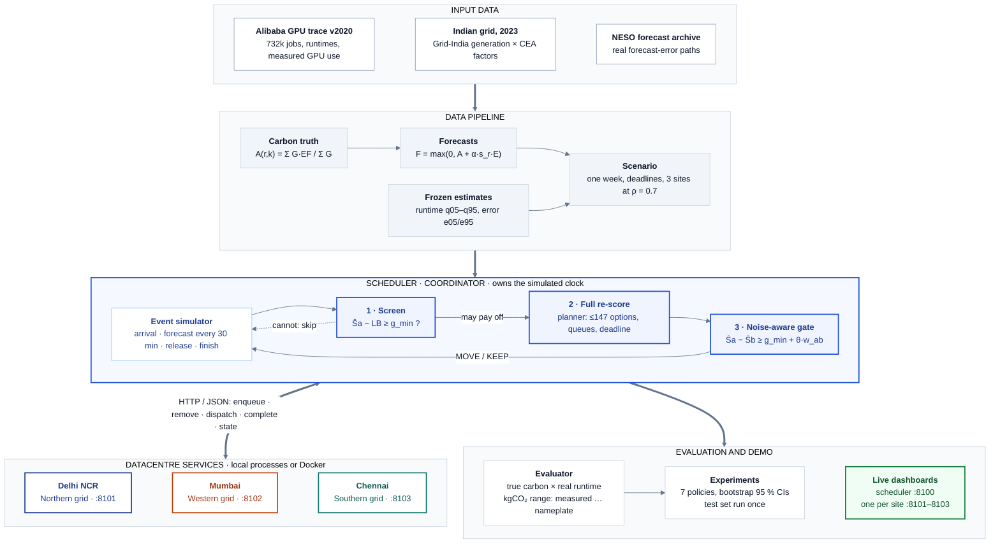

# Flipwise

**When should a carbon-aware scheduler change its mind?** Flipwise is a deterministic simulator and a scheduling policy, *decision-flip*, for re-evaluating waiting GPU jobs across three Indian datacentres only when a better placement could actually exist.

Experiential Learning project, V semester, RV College of Engineering (Team ATLAS, theme: SDG 9 · Industry, Innovation and Infrastructure).

[How it works](docs/DECISION_FLIP.md) · [Walkthrough](docs/WALKTHROUGH.md) · [Demo](docs/DEMO.md) · [Usage](docs/USAGE.md) · [Specification](docs/prd.md) · [Decisions](docs/decisions.md)

---

## Highlights

- **Half the re-planning work, same carbon.** On 16 held-out test weeks, decision-flip made **54 % fewer full re-evaluations** and **60 % fewer job moves** than re-checking every waiting job at every forecast, with no measurable difference in emissions.
- **Provably safe shortcut.** With its noise margin set to zero, decision-flip makes exactly the same decisions as the full re-check. Verified on all 12 validation weeks, with 62 % fewer checks.
- **Real Indian conditions.** Jobs from Alibaba's GPU cluster trace; grid carbon for Delhi NCR, Mumbai and Chennai from Grid-India generation data and official CEA emission factors; forecasts built from real forecast-error histories.
- **A distributed setup with identical results.** The three datacentres run in-process, as local services or as Docker containers, with byte-identical outputs in every mode.
- **A live demo.** A dashboard runs the policies side by side in real time, lets you submit a job and shows every decision made about it.

## Architecture



A slide-sized figure is in [`docs/figures/architecture_ppt.png`](docs/figures/architecture_ppt.png) and a detailed one in [`docs/figures/architecture.png`](docs/figures/architecture.png).

## The idea

A scheduler places each job using the grid-carbon forecast available when it arrives. Forecasts are revised every 30 minutes, so a plan can go stale. Re-checking every waiting job at every update is expensive (up to 147 options per job, each with a queue projection) and moving jobs costs them their place in the queue; never re-checking misses real savings. At each new forecast, decision-flip does three things for a waiting job:

1. **Screen (cheap).** It computes a lower bound on the CO₂ of *any* alternative. If even that bound cannot save at least 5 % of the job's current CO₂, it stops: no move could pay off. This skips 60–70 % of checks.
2. **Full re-score.** Otherwise it scores every feasible option, with queue waits and a conservative deadline check.
3. **Noise-aware gate.** It moves the job only if the saving beats the 5 % gate **plus** a margin for how uncertain the forecast, queue wait and runtime are:

```
move  iff   Ŝ_current − Ŝ_best  ≥  g_min + θ · w_ab        (g_min = 5 % of Ŝ_current, θ = 0.1)
```

Every symbol, with a worked example, is in [docs/DECISION_FLIP.md](docs/DECISION_FLIP.md).

## Results

Test set: 16 replicates (4 trace weeks × 4 carbon weeks, Sep 2023 – Jan 2024), run once with thresholds frozen on validation data. kgCO₂ is per replicate, given as a cited range: measured GPU use (lower bound) to datasheet power (upper bound).

| Policy | kgCO₂ (measured … nameplate) | Full re-scores | Moves | Deadline misses |
|---|---|---|---|---|
| **decision_flip** (ours) | **3,853 … 11,862** | **20,035** | **2,359** | 4.13 % |
| fixed_savings (re-check everything) | 3,865 … 11,885 | 43,540 | 5,897 | 4.14 % |
| periodic (every 30 min) | 3,871 … 11,862 | 43,392 | 6,337 | 4.00 % |
| pred_error (when forecast drifts) | 3,856 … 11,904 | 14,944 | 4,122 | 4.02 % |
| place_once (never re-plan) | 3,873 … 11,902 | 0 | 0 | 3.95 % |
| fcfs (no carbon awareness) | 3,980 … 12,160 | 0 | 0 | 2.13 % |
| pig (oracle, knows the future) | 3,863 … 11,767 | 0 | 0 | 3.03 % |

- Emissions of all re-planning policies are within each other's 95 % bootstrap confidence intervals, and all are clearly below `fcfs`.
- Even the oracle saves at most about 1–2 % over never re-planning on this data, so the value of a trigger is in how cheaply it reaches that carbon.
- About 93 % of deadline misses are jobs that ran longer than their 90th-percentile runtime estimate; improving that estimate is the first planned extension.

Details: [docs/test_results/](docs/test_results/README.md), [docs/power_bracket/](docs/power_bracket/README.md), [docs/validation/](docs/validation/README.md).

## Quick start

Requires [uv](https://docs.astral.sh/uv/) (it installs Python 3.12). Tested on Linux; the commands also have Windows forms.

```bash
uv sync                      # install
uv run pytest -q             # 260 tests, no data needed
uv run flipwise smoke        # toy scenario, all policies, checked against hand-computed answers
```

Install uv first if needed: `curl -LsSf https://astral.sh/uv/install.sh | sh` (Linux/macOS) or `powershell -ExecutionPolicy ByPass -c "irm https://astral.sh/uv/install.ps1 | iex"` (Windows).

### Live demo

```bash
uv run flipwise live --scenario tests/fixtures/toy --speed 120     # 6-job toy, no data needed
uv run flipwise live --config configs/base.yaml                    # a real week, about 7,000 jobs
uv run flipwise live --config configs/base.yaml --services local   # same, datacentres as separate services
```

`--services local` starts the three datacentre services itself and prints four URLs: the scheduler at **http://localhost:8100** and one dashboard per datacentre at **http://localhost:8101** (Delhi NCR), **:8102** (Mumbai), **:8103** (Chennai).

Open **http://localhost:8100**. With the three datacentres as Docker containers:

```bash
docker compose --profile live up --build dc-delhi dc-mumbai dc-chennai live
```

Pages: Overview, Head-to-head (decision-flip against any policy, with every check the screen avoided), Job tracker (submit a job and follow each policy's decisions), Scheduler, Datacentres, Policy comparison, Scale projection, Test results, Architecture. Demo script: [docs/DEMO.md](docs/DEMO.md); what each page shows: [docs/WEB_EXPLAINER.md](docs/WEB_EXPLAINER.md).

### Experiments

These need the processed data (see [Data](#data)).

| Command | Purpose |
|---|---|
| `uv run flipwise validate --config configs/base.yaml` | Check data checksums, coverage and that train, validation and test periods do not overlap |
| `uv run flipwise run --config configs/base.yaml --policy decision_flip` | One policy on one week → `results/<run_id>/` |
| `uv run flipwise compare --config configs/base.yaml --split validation --jobs 5` | All policies on identical replicates, with paired bootstrap statistics |
| `uv run flipwise sweep --config configs/base.yaml --sweep configs/sweeps/theta.yaml` | Parameter grid; each cell is a comparison |
| `uv run flipwise dashboard --runs results/compare_<hash>` | Static, offline report from saved results |
| `bash scripts/local_cluster.sh --config configs/base.yaml --policy decision_flip` | Same run with the datacentres as three local services |
| `bash scripts/docker_check.sh` | Prove Docker gives byte-identical results, including a crash test |

Every documented command has a PowerShell form; see [docs/USAGE.md](docs/USAGE.md).

## Data

Raw and processed data are never committed. `bash scripts/download_data.sh` (or `scripts\download_data.ps1`) downloads and checks them; `flipwise ingest` verifies every archive's SHA-256. Details and checksums: [data/README.md](data/README.md).

| Dataset | Use | Source | Terms |
|---|---|---|---|
| Alibaba Cluster Trace GPU v2020 | Job arrivals, requests, runtimes, measured GPU use | [alibaba/clusterdata](https://github.com/alibaba/clusterdata/tree/master/cluster-trace-gpu-v2020) | Research use; cite Weng et al., NSDI '22 |
| Grid-India NLDC daily reports, Mar 2023 – Feb 2024 | Regional generation by fuel | [grid-india.in](https://grid-india.in/) | Government of India publication |
| Grid-India NLDC SCADA, all-India generation by fuel | Within-day shape of each fuel | [doi:10.17632/y58jknpgs8.2](https://data.mendeley.com/datasets/y58jknpgs8/2) | CC BY 4.0 |
| CEA CO₂ Baseline Database v19.0 | Emission factor per fuel | [cea.nic.in](https://cea.nic.in/) | Government of India publication |
| NESO forecast archive, Mar 2023 – Feb 2024 | Real forecast-error paths | [nmpowell/carbon-intensity-forecast-tracking](https://github.com/nmpowell/carbon-intensity-forecast-tracking) | MIT (archive); NESO terms under review |

## Methodology and guarantees

- **Deterministic.** The same configuration and seed give byte-identical logs (`events.log`, `jobs.csv`, `decisions.csv`) in every deployment mode.
- **Fair.** Every policy runs on the same scenario object with the same planner, feasibility check, dispatcher and deadline rescue; only the re-planning trigger and acceptance rule differ.
- **No look-ahead.** Policies see forecasts and runtime estimates only, through an enforced information boundary; only the oracle reference sees the true future.
- **No tuning on test data.** Estimates are fitted on early data, thresholds are frozen on validation weeks, and the test set was run exactly once.
- **Statistics.** Paired comparisons on identical replicates with 95 % percentile bootstrap intervals (10,000 resamples).

## Limitations

- Forecast errors are real but British (NESO); no archive of Indian carbon forecasts exists.
- Deadlines are not recorded in the trace; each job gets one at arrival from a fixed rule (4 h + 2 × its 90th-percentile runtime estimate).
- CPU power per core (10 W) and idle GPU draw are assumptions, hence the kgCO₂ range.
- Jobs are sampled at 10 % per week to fit a laptop; running jobs are never migrated.

## Repository layout

```
src/flipwise/      simulator, planner, policies, energy, carbon, ingest, experiment runner,
                   datacentre service (dcservice.py), live demo (live.py) and dashboard (web/)
configs/           base experiment config, frozen policy thresholds, sweep grids
scripts/           data download, local cluster, Docker checks, ablation and re-run drivers
tests/             260 tests, including the hand-computed toy scenario (tests/fixtures/toy)
docs/              specification, walkthrough, decisions, results (validation, test, power bracket)
Dockerfile, docker-compose.yml   one image: three datacentre services, coordinator, live demo
```

## Documentation

| Document | Contents |
|---|---|
| [docs/DECISION_FLIP.md](docs/DECISION_FLIP.md) | The algorithm, step by step, with formulas and a worked example |
| [docs/WALKTHROUGH.md](docs/WALKTHROUGH.md) | The whole system from data to results, with a toy scenario traced minute by minute |
| [docs/DEMO.md](docs/DEMO.md) | Step-by-step live demo script: commands, what to click, what to say |
| [docs/WEB_EXPLAINER.md](docs/WEB_EXPLAINER.md) | Every page and component of the live dashboard, and how to read it |
| [docs/USAGE.md](docs/USAGE.md) | Every command, including PowerShell forms |
| [docs/prd.md](docs/prd.md) | The specification: formulas, requirements, data rules |
| [docs/decisions.md](docs/decisions.md) | Every design decision and finding, with reasons |
| [docs/HANDOFF.md](docs/HANDOFF.md) | Current development state and next steps |
| [docs/project_journey.md](docs/project_journey.md) | How the project got here |

## Roadmap

- **EL Phase 2 (current):** simulator, seven policies, validation and test results, distributed deployment (local services and Docker), live demo.
- **EL Phase 3:** sensitivity sweeps and ablations; a scaling study up to the full trace; a learned runtime model and a learned Indian carbon forecaster as inputs to the same rules ([decision D61](docs/decisions.md)); deployment on AWS across Indian regions.

## Acknowledgements

Job data from the Alibaba Cluster Trace Program (Weng et al., *MLaaS in the Wild*, NSDI '22). Indian generation data from Grid-India (NLDC); emission factors from the Central Electricity Authority. Forecast-error paths from the NESO carbon-intensity forecast archive collected by N. Powell. Charts by Apache ECharts; dashboard styles by Tabler.

Licence: to be decided with the project mentor.
