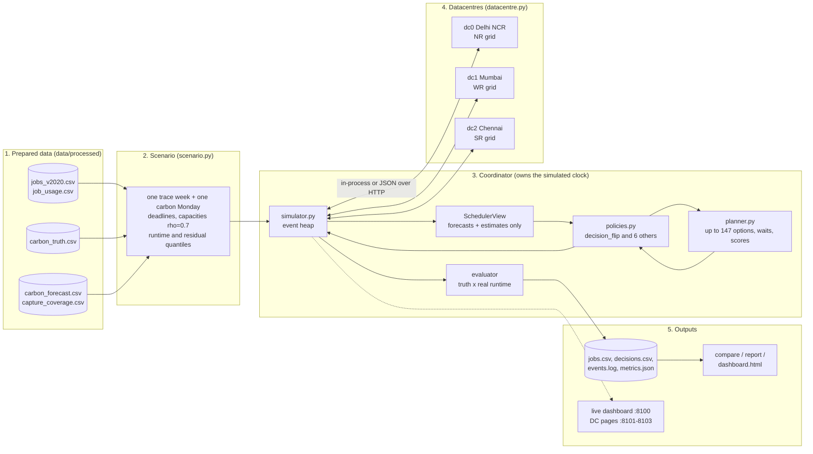
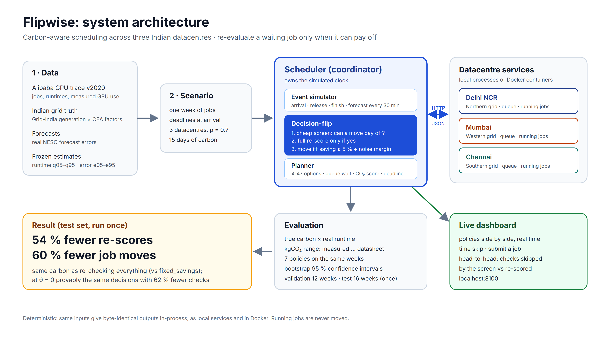
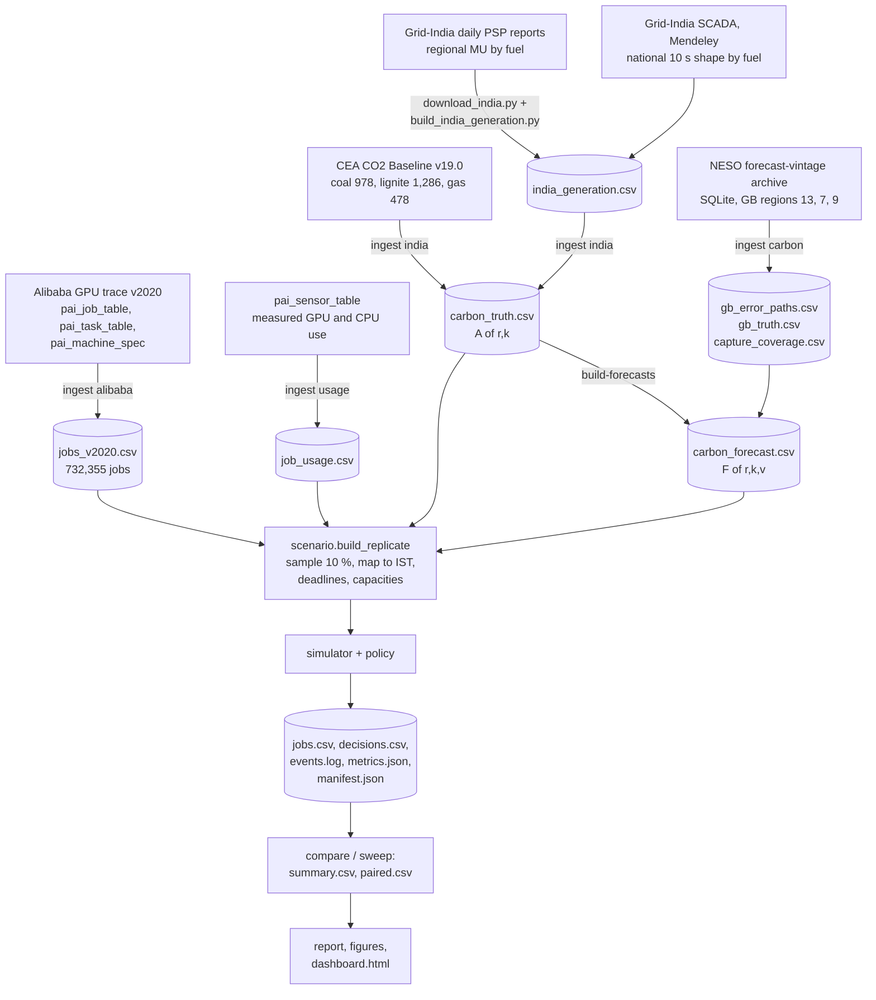
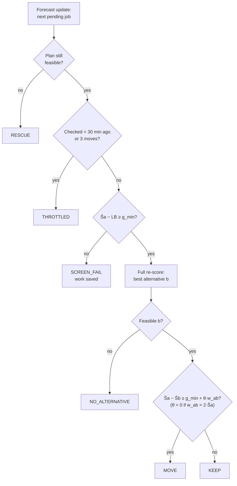
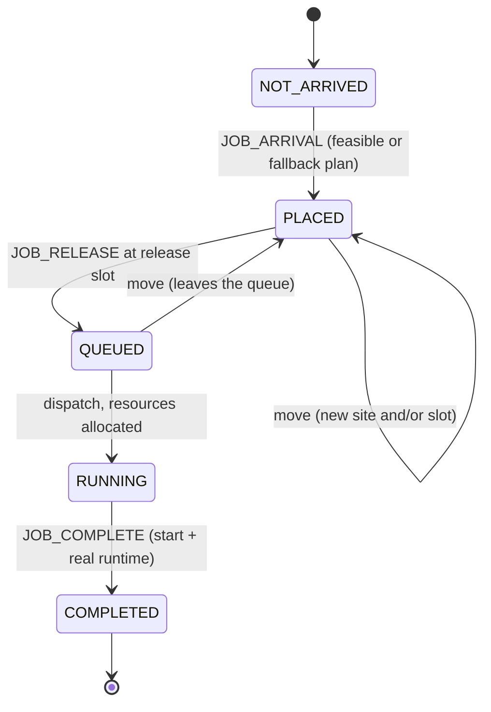

# Flipwise: the complete project explainer

**Efficient Re-Evaluation of Pending Workloads in Carbon-Aware Datacentre Scheduling**
RVCE Experiential Learning (EL), V semester · Team 63 (Atlas) · State as of 13 Nov 2026 (PRD v0.9.3)

This is the one document that explains Flipwise from start to finish: the problem, the system, the data, every formula with a worked example, every policy, every command, how the results were produced and what they say, the live demo, the Phase 2 presentation slide by slide, and what comes next. It is written for the team and for reviewers, in plain language and with real numbers.

Three other files stay authoritative and are not repeated in full here:

- `docs/prd.md`: the formal specification (formulas, requirement IDs R-*, decisions, open items). If this explainer and the PRD ever disagree, the PRD wins and the difference is a bug in this file.
- `docs/decisions.md`: every decision (D*) and finding (F*), with the reason.
- `docs/HANDOFF.md`: the current state and the next steps.

The evidence folders are `docs/validation/`, `docs/test_results/` and `docs/power_bracket/`, each with its own README.

**Contents**

1. [The project in one page](#1-the-project-in-one-page)
2. [The Indian setting](#2-the-indian-setting)
3. [System architecture](#3-system-architecture)
4. [Data flow, end to end](#4-data-flow-end-to-end)
5. [Every formula, with worked examples](#5-every-formula-with-worked-examples)
6. [Inside the simulator, and the toy scenario minute by minute](#6-inside-the-simulator-and-the-toy-scenario-minute-by-minute)
7. [The seven policies](#7-the-seven-policies)
8. [Every command: what goes in, what happens, what comes out](#8-every-command-what-goes-in-what-happens-what-comes-out)
9. [Evaluation method and results](#9-evaluation-method-and-results)
10. [The live demo and the website](#10-the-live-demo-and-the-website)
11. [The Phase 2 presentation, slide by slide](#11-the-phase-2-presentation-slide-by-slide)
12. [Two ways to use Flipwise](#12-two-ways-to-use-flipwise)
13. [Limitations, open items and the Phase 3 plan](#13-limitations-open-items-and-the-phase-3-plan)
14. [How the project got here](#14-how-the-project-got-here)
15. [Glossary](#15-glossary)
16. [References and useful links](#16-references-and-useful-links)

---

## 1. The project in one page

### 1.1 The problem

- A computing job, here a machine-learning job on GPUs, uses electricity.
- How much CO₂ that electricity causes depends on **where** it runs and **when**. Each regional grid burns a different mix of coal, gas, hydro, nuclear, solar and wind, and the mix changes through the day (solar at midday, for example).
- So a scheduler that may choose the datacentre and the start time can cut emissions, as long as every job still meets its deadline. This is **carbon-aware scheduling**, and it is well studied.
- The part that is not well studied: the scheduler decides using a **forecast** of grid carbon, and the forecast is revised **every 30 minutes**.
- A job planned at 09:00 for "Chennai at 15:00" may, by 11:00, have a clearly better option. Every waiting job can be **re-evaluated**: all its options scored again, and the job perhaps moved.
- Re-evaluating costs computation (up to 147 options per job, each needing a queue-wait estimate). Moving a job costs it its place in the queue and can make jobs bounce between sites on forecast noise.
- Never re-evaluating is cheap, but misses savings.

### 1.2 The question

> **When is it worth re-evaluating a waiting job?**

Formally (PRD §3.2): under which conditions does a decision-flip trigger reach modelled emissions and deadline performance comparable to periodic and fixed-savings re-planning, while using fewer planner calls and fewer placement changes?

### 1.3 Our answer: decision-flip

At each forecast update, for each waiting job:

1. **Screen (cheap).** Compute a lower bound on what *any* alternative could cost. If even that best case cannot save 5 % of the current plan's CO₂, stop: no move can pass. On real data this stops 60–70 % of checks.
2. **Full re-score (expensive).** Otherwise, score every feasible option with queue waits and a conservative deadline check.
3. **Noise-aware gate.** Move only if the saving beats the 5 % gate **plus** a margin for how uncertain the forecast is: `Ŝa − Ŝb ≥ g_min + θ · w_ab`, with θ = 0.1.

The design has a provable property, **P1**: with θ = 0 decision-flip makes exactly the same decisions as `fixed_savings` (which re-scores everything), only with fewer full re-scores. This was verified on all 12 validation replicates: identical `jobs.csv` and `events.log`, 62 % fewer full re-scores.

### 1.4 What we found (test set, 16 replicates, run once)

- `decision_flip` needs **54 % fewer full re-scores** and makes **60 % fewer moves** than `fixed_savings` (20,035 against 43,540 re-scores; 2,359 against 5,897 moves).
- On carbon it **cannot be told apart** from the other re-planners (`fixed_savings`, `periodic`, `pred_error`) or from `place_once` (never re-plans): all their 95 % confidence intervals include zero.
- It is **clearly below** `fcfs`, the policy that ignores carbon: −427 kg per replicate (CI −545 to −309) in the original units; −106 to −257 kg under the cited power bracket.
- Even the oracle `pig`, which knows the future, beats `place_once` by under 2 %. There is little carbon to win on this data, so the value of the trigger is the **work it saves**.
- About **4.1 %** of jobs miss their deadline (2.1 % under `fcfs`). Carbon-aware placement causes this, not re-planning (`place_once` is at 3.95 %). About **93 %** of misses are jobs that ran longer than their 90th-percentile runtime estimate.

The agreed claim (D51, F21): *about the same carbon as the other re-planners, at much lower re-planning cost.*

### 1.5 Why it matters

- Data-centre electricity demand is growing fast with AI (IEA, *Energy and AI*, 2025). India's grids are coal-heavy (test-period mean intensity about 725 g/kWh), so where and when GPU work runs matters.
- A real carbon-aware scheduler must re-plan as forecasts change. If it re-plans everything, the scheduler itself becomes expensive and jobs churn; if it never re-plans, it acts on stale forecasts. A rule that re-plans only when a decision could actually change is directly useful.
- The work fits **UN SDG 9** (industry, innovation and infrastructure): target 9.4 (efficient, cleaner infrastructure: same carbon with about half the re-planning work) and 9.5 (research capability: a tested trigger, a reproducible simulator, an open evaluation).

### 1.6 Limits that apply everywhere

- **Nothing real is scheduled.** We replay recorded history in a simulator. Results are modelled emissions, not measured ones.
- **Running jobs are never moved** (no migration). Only waiting jobs can be re-planned.
- **kgCO₂ is a range.** GPU power comes from NVIDIA datasheets per GPU type; how hard each job really used its GPUs comes from Alibaba's measurements. The range runs from `measured` (lower bound) to `nameplate` (upper bound). CPU power is assumed at 10 W per core.
- **Forecast errors are British.** No archive of Indian carbon forecasts exists, so the forecasts carry real forecast-error paths from Britain's grid operator (NESO), scaled to Indian levels.

---

## 2. The Indian setting

### 2.1 Three datacentres, three grids

India's electricity system has five regional grids. We place one virtual datacentre on each of three of them, in the hubs where India's datacentre capacity actually concentrates. They are virtual: not real facilities.

| `dc_id` | Hub | Regional grid | `region_id` | Error path borrowed from (GB region id) |
|---|---|---|---|---|
| 0 | Delhi NCR (Noida, Gurugram) | Northern (NR) | 1 | London (13) |
| 1 | Mumbai / Navi Mumbai | Western (WR) | 2 | South Wales (7) |
| 2 | Chennai | Southern (SR) | 3 | East Midlands (9) |

- The Eastern grid (ER, `region_id` 4) is reserved for a planned high-spread sensitivity test; North-Eastern is not used.
- India's regions form one synchronous national grid, so the differences between regions are smaller than between countries, and the differences across the day (solar) are larger. That is a property to measure, not a defect.

### 2.2 Time

- All stored times are integer Unix seconds in UTC. Everything shown to people is in **IST** (UTC+5:30).
- Carbon is handled in **half-hour slots** of 1,800 s, aligned to :00 and :30 UTC, which is :30 and :00 IST.
- The Alibaba trace's timestamps are shifted by a secret constant; read as UTC+8 they keep the true weekday and time of day, but not the date. Trace day `d` starts at `−28,800 + d × 86,400` s (1970-01-01 00:00 UTC+8). Day 25 is a Monday; the first job arrives on day 6.6.
- **Mapping trace time to Indian time:** `sim_time = C0 + (trace_time − T0)`, where `T0` is a trace Monday 00:00 (UTC+8 clock) and `C0` a carbon Monday 00:00 IST. Trace clock hours line up with IST clock hours, so daytime submissions meet the Indian solar midday.

### 2.3 Why the Indian setting is a good test

- Coal dominates, but solar is growing, so intensity has a strong daily shape: cleaner around midday, dirtier at night.
- Regions differ in fuel mix, so the same half hour can have different intensity at different sites, and moving a job between sites can matter.
- Indian data is public: Grid-India publishes daily generation by fuel per region, and the Central Electricity Authority (CEA) publishes official emission factors per fuel.

---

## 3. System architecture

### 3.1 The big picture

Flipwise is a **deterministic discrete-event simulator**. It has a coordinator (the scheduler, which owns the simulated clock and runs the policy) and three datacentres (each holding a queue and running jobs). Data is prepared once; scenarios are built from it; runs produce logs; logs produce metrics, tables and dashboards. The same datacentre code runs in-process, as separate local processes, or in Docker containers.



The figure used on the slides (`docs/figures/architecture_ppt.png`) shows the same thing in five boxes: Data → Scenario → Scheduler (event simulator, decision-flip, planner) ↔ Datacentre services → Evaluation → Result, with the live dashboard to the side.



### 3.2 Every module and what it owns

All code is in `src/flipwise/`. Python 3.12; the only third-party libraries are pandas, numpy, PyYAML and matplotlib (plotly optional). The HTTP services use only the standard library (`http.server`, `urllib`).

| Module | Owns | Key contents |
|---|---|---|
| `cli.py` | The command line (`flipwise <command>`) | Parses arguments and calls the modules below; `__main__.py` lets `python -m flipwise` run it |
| `config.py` | Configuration | Loads YAML, checks keys and types, applies `--set key=value`, computes the config hash. Errors are `ConfigError` |
| `ingest.py` | Raw data → canonical CSVs + manifests | `ingest alibaba`, `ingest usage`, `ingest india`, `ingest carbon`, and `build-forecasts`; checksums; drop counts by reason |
| `validate.py` | `flipwise validate` | Config, data presence, checksums against manifests, carbon coverage, train/validation/test separation |
| `carbon.py` | Carbon views | Forecast by vintage (what the scheduler sees), truth (evaluator only), gap rules, residual quantiles `e05`/`e95` per lead bucket (`Residuals`) |
| `energy.py` | Power, energy, emissions | The §7.1 equations; slot-overlap sums; the scheduler scale and the measured/nameplate evaluator power |
| `estimates.py` | Runtime and wait estimates | Per-user runtime quantiles (`fit_runtime`); usage profiles and projected starts (`build_profile`) |
| `models.py` | Data model | `Job`, `Datacentre`, placements, events, job states, decision kinds |
| `scenario.py` | Scenarios | Loads a scenario folder (the toy) or builds a real replicate (`build_replicate`): sampling, time mapping, deadlines, capacities |
| `planner.py` | Shared planning | Candidates, feasibility, scores and intervals (`evaluate`, `alternatives`), the screen's lower bound (`lower_bound`), the paired noise width (`paired_width`), the interval check (`interval_problem`) |
| `policies.py` | The seven policies | `fcfs`, `place_once`, `periodic`, `pred_error`, `fixed_savings`, `DecisionFlip`, `pig`; they differ only in trigger and acceptance |
| `simulator.py` | The simulation | Event heap, simulated clock, job lifecycle, moves (`_apply`, `_place`), rescue, throttling, `SchedulerView` and `OracleView`, the evaluator. `run` = `start` + `advance` + `result` |
| `datacentre.py` | One datacentre's logic | Capacity, FIFO queue, running set; `enqueue`, `remove`, `dispatch` (first-fit), `complete`, `state`; the `DatacentreClient` interface and `InProcDatacentre` |
| `dcservice.py` | A datacentre as an HTTP service | `flipwise dc-serve` and `HttpDatacentre` (the client). A transport only: all rules live in `datacentre.py`. Also serves each site's display-only dashboard |
| `metrics.py` | Metrics | Pure functions of the saved logs (PRD §14.1), so `report` can rebuild everything without re-simulating |
| `reporting.py` | Run outputs and comparison tables | Writes `jobs.csv`, `decisions.csv`, `events.log`; builds `summary.csv`, paired bootstrap tables |
| `experiment.py` | `run`, `compare`, `sweep` | Run ids, reuse of finished runs, parallel execution with results independent of completion order |
| `dashboard.py` | Static `dashboard.html` | Reads saved files only; a tab with missing input shows "no data" |
| `live.py`, `localservices.py`, `webstatic.py`, `web/` | `flipwise live` and its website | Paced simulation of several policies side by side, job submission, JSON and server-sent-event API; `--services local` child processes; static HTML/CSS/JS with ECharts and Tabler bundled (`index.html` scheduler, `dc.html` per site) |
| `errors.py`, `trace.py`, `smoke.py`, `figures.py` | Support | Error types (`ConfigError`, `CarbonDataError`, `MigrationError`, `SimulationInvariantError`, `DeploymentError`); raw trace readers; `flipwise smoke` against `expected.yaml`; Matplotlib figures from saved CSVs |

Tests mirror the modules (`tests/test_<module>.py`); there are 273 of them, and they need no real data.

### 3.3 The invariants (rules that must never break)

1. **Determinism (R-SIM-1).** The same config and seed give byte-identical `events.log`, `jobs.csv` and `decisions.csv`. No wall clock in simulation logic (`time.perf_counter` is used only to measure overhead), no unseeded randomness, no iteration over unordered sets where order matters. Tie orders: events by `(time_s, priority, seq)`; jobs by `(deadline_s, arrival_s, job_id)`; datacentres by `dc_id`.
2. **Information boundary (R-LEAK-1/2).** Policies see only a `SchedulerView`: forecasts published up to now, residual quantiles, each job's visible fields (request, deadline, runtime *estimates*), queues and capacities. They never see `runtime_actual_s`, the end time of running jobs, carbon truth, or forecasts published later than now. Only the oracle `pig` gets an `OracleView`. The leakage tests change hidden data after time *t* and check that every decision up to *t* is unchanged.
3. **No migration (R-SIM-4).** Removing a running job raises `MigrationError`; a datacentre service answers HTTP 409 `MIGRATION`.
4. **Same inputs for every policy.** All policies share one scenario object, one planner, one feasibility check, one dispatcher and one rescue rule. Only the trigger (when to re-score) and the acceptance rule (when to move) differ.
5. **Deployment modes are transports, not new logic.** The coordinator owns the simulated clock; datacentre services never read the wall clock. `--mode remote` must give byte-identical outputs to `--mode inproc` (R-DEP-1).
6. **Units.** Times in integer seconds; slots of 1,800 s; power kW; energy kWh; intensity gCO₂/kWh; emissions kgCO₂.
7. **Train, validation and test never mix.** Thresholds are never tuned on test data.

### 3.4 Deployment modes

The same simulation can reach its three datacentres in different ways. In every mode the coordinator sends one request at a time, in event order, and each request carries the simulated time.

| Mode | How to start it | What runs where | Status |
|---|---|---|---|
| **In-process** (default) | `uv run flipwise run ... --mode inproc` | One Python process; datacentres are objects (`InProcDatacentre`) | Used for all research results |
| **DT1 local split** | `bash scripts/local_cluster.sh ...` or `.\scripts\local_cluster.ps1 ...`; or by hand: three `flipwise dc-serve` plus `flipwise run --mode remote` | Three `dc-serve` processes on ports 8101–8103 and the coordinator, on one machine, talking JSON over HTTP | Complete (Linux and Windows) |
| **DT2 Docker** | `docker compose up --build --abort-on-container-exit --exit-code-from coordinator` | One image; containers `dc-delhi`, `dc-mumbai`, `dc-chennai`, `coordinator` on a private network | Complete on Linux, including a clean clone (F20); Windows run waived by the team |
| **DT3 AWS** | `scripts/aws/` (planned) | Three EC2 instances in `ap-south-1` (Mumbai), coordinator on a fourth or a laptop | Not started; comes after the test results |
| **Live mode** | `uv run flipwise live ...` (add `--services local`, or the Docker `live` profile) | The simulator paced by the wall clock, several policies side by side, a website on port 8100 | Done (D60); for showing only, never for results |
| **Per-datacentre dashboards** | Automatic with any `dc-serve` (D62) | Each service also serves its own page on its port: 8101 Delhi NCR, 8102 Mumbai, 8103 Chennai | Done; display only |

**The service API (protocol 1).** `GET /health`, `POST /reset` (capacity and region, sent by the coordinator), `POST /enqueue`, `POST /remove`, `POST /dispatch`, `POST /complete`, `GET /state`. Errors: 409 `DUPLICATE_JOB`, 409 `TIME_BACKWARDS`, 409 `MIGRATION`. `GET /state` returns only what the scheduler may see (no end times, no runtimes). `runtime_actual_s` goes to the service with `/enqueue` because the service plays the machine that runs the job; the policy never sees it.

**Failures abort.** A timeout (30 s), refused connection or error response raises `DeploymentError`. The run exits non-zero and writes no `metrics.json`. There are no retries, because retrying `/enqueue` could apply it twice.

**What the modes cost** (dev week, `decision_flip`, same 58,454 datacentre calls each, one Linux machine, F20): in-process 69 s, local split 101 s, Docker 130 s (about 0.8 ms per call). On a Windows laptop (F18) a call cost about 5.5 ms, so the overhead depends on the host.

**Why the services do not run in real time.** A one-week slice would take a week, and network delays would change the event order, so runs would stop being reproducible and the policy comparison would stop being fair. The coordinator therefore owns the clock and the services only act at the time they are told.

---

## 4. Data flow, end to end

### 4.1 The whole pipeline



### 4.2 Step by step

**Step 1: jobs from the Alibaba trace** (`flipwise ingest alibaba`, `ingest.py`, `trace.py`).

- Input: `pai_job_table` (1,055,501 rows), `pai_task_table` (1,261,050 rows), `pai_machine_spec` (1,897 machines, 6,742 GPUs) from Alibaba's `cluster-trace-gpu-v2020` (two months of a production GPU cluster). Archive SHA-256 values are checked first; a mismatch aborts.
- What happens: tasks are joined to jobs; only **Terminated** jobs are kept (323,146 others dropped); per job: arrival, user, GPUs requested (Σ `inst_num × plan_gpu / 100`), CPU cores (Σ `inst_num × plan_cpu / 100`), memory GB, GPU type, task count, and the real runtime (latest task end minus earliest task start). 145,096 jobs (19.8 %) have no `plan_gpu`; they are treated as CPU-only (`gpu_assumed_zero = 1`), with a sensitivity setting to drop them instead.
- Output: `data/processed/jobs_v2020.csv`, **732,355 jobs**, and `data/manifests/jobs_v2020.json` (checksums, row counts, drop counts by reason).
- Audit: median runtime 663 s, 90th percentile 12,848 s, maximum 626,384 s (7.25 days); median GPU request 1.0.

**Step 2: measured use** (`flipwise ingest usage`).

- Input: `pai_sensor_table` (3,033,232 instance rows; a 406 MB download).
- What happens: per job, sum the measured GPU and CPU use over its instances.
- Output: `job_usage.csv` (`job_id, gpu_used, cpu_used`) and its manifest. It covers 78.6 % of jobs. Median measured GPU use is only 3.5 % of the GPUs requested (mean 17.1 %), which is why the kgCO₂ range is wide (F22).

**Step 3: Indian generation by fuel** (`scripts/download_india.py`, then `scripts/build_india_generation.py`, which needs `uv sync --extra india-data`).

- Inputs: Grid-India NLDC **daily Power Supply Position (PSP) reports**, 13 Mar 2023 – 8 Feb 2024 (regional daily energy by fuel in MU: coal, lignite, hydro, nuclear, "gas, naptha and diesel", wind, solar, other renewables); and Grid-India **SCADA** all-India generation by fuel every 10 s, published on Mendeley Data (CC BY 4.0).
- What happens: each region keeps its measured daily fuel mix, and each fuel's energy is spread within the day using the national SCADA shape of that fuel (formula in §5.1). Missing SCADA days take the typical shape of their month; the one missing PSP day (21 Mar 2023) takes the mean of its neighbours.
- Output: `india_generation.csv` (`region_id, slot_utc, fuel, mwh, source`), with SHA-256 per raw file in `india_raw.json`.

**Step 4: Indian carbon truth** (`flipwise ingest india`).

- Inputs: `india_generation.csv` and the CEA factors in `configs/energy.yaml`.
- What happens: intensity per region and half hour = emissions / generation (§5.1). Gaps of up to 2 slots are linearly interpolated; longer gaps make a replicate invalid.
- Output: `carbon_truth.csv` (`region_id, slot_utc, truth_g_per_kwh, truth_kind, interpolated`), `truth_kind = constructed_psp_scada`, 63,936 rows. Only the evaluator reads it.

**Step 5: British error paths** (`flipwise ingest carbon --gb-regions 13,7,9`).

- Input: a clone of `nmpowell/carbon-intensity-forecast-tracking` (MIT licence), which captured every published NESO regional forecast about twice an hour.
- What happens: reconstruct, for each British source region, every forecast vintage and the later "actual" value, and take the difference: the error path `E(k, v) = F_gb − A_gb`.
- Outputs: `gb_error_paths.csv`, `gb_truth.csv`, and `capture_coverage.csv` (one row per forward capture; each row becomes one `CARBON_UPDATE` event; median 44 captures per day).

**Step 6: Indian forecast vintages** (`flipwise build-forecasts [--alpha 1]`).

- Inputs: Indian truth and the error paths.
- What happens: `F(r, k, v) = max(0, A(r, k) + α · s_r · E(k, v))` for every slot and capture (§5.2).
- Output: `carbon_forecast.csv` (2,208,766 rows, one per change), manifest with the `s_r` values.

**Step 7: check** (`flipwise validate --config configs/base.yaml`). Prints `validate: OK` or names what is wrong.

**Step 8: build a scenario** (`scenario.build_replicate`). One **replicate** = one trace week × one carbon Monday: keep 10 % of the week's jobs (chosen by a hash of the job id, so always the same), map trace time to IST (§2.2), attach frozen runtime quantiles (§5.4) and deadlines (§5.5), size three equal sites for ρ = 0.7 (§5.6), and attach forecasts, residual quantiles, truth and the power model. The run horizon is 15 days: 7 of arrivals plus 8 for the last jobs to finish.

**Steps 9 and 10: simulate, then compare and report** (§8.5–§8.8). Each run writes `results/<run_id>/` (`jobs.csv`, `decisions.csv`, `events.log`, `metrics.json`, `manifest.json`); `compare` runs every policy on the same replicates and writes `summary.csv`, `paired.csv`, `pairwise.csv` and figures.

### 4.3 Train, validation and test periods

| Use | Trace days | Carbon period |
|---|---|---|
| Fit runtime quantiles | 0–20 | — |
| Fit carbon residual quantiles | — | 13 Mar – 30 Jun 2023 |
| Validation (choose thresholds) | 25–45 (3 weeks: days 25, 32, 39) | 1 Jul – 31 Aug 2023 (Mondays 3 Jul, 17 Jul, 31 Jul, 14 Aug) |
| Test (final claim, run once) | 46–73 (4 weeks: days 46, 53, 60, 67) | 1 Sep 2023 – 31 Jan 2024 (Mondays 4 Sep, 30 Oct, 27 Nov, 8 Jan) |
| Dev (development) | 25–32 | Monday 3 Jul 2023 |

Validation has 3 × 4 = **12 replicates**; test has 4 × 4 = **16 replicates**. `validate` refuses overlapping windows.

---

## 5. Every formula, with worked examples

Exact definitions come from PRD §6.2, §7.1, §8, §9, §10, §11 and §14.1. Numbers marked *illustrative* are chosen to make the arithmetic easy to follow; all other numbers are real.

The basic rule used everywhere:

**CO₂ (kg) = power (kW) × hours × intensity (gCO₂/kWh) ÷ 1000**

(kW × h = kWh; kWh × g/kWh = g; ÷ 1000 = kg.)

### 5.1 Carbon truth: A(r, k)

**Formula** (PRD §6.2.2):

`A(r, k) = Σ_f G(r, f, k) × EF_f / Σ_f G(r, f, k)`   (gCO₂/kWh)

| Symbol | Meaning |
|---|---|
| `r` | Region (1 NR, 2 WR, 3 SR) |
| `k` | Half-hour slot |
| `f` | Fuel: coal, lignite, gas, hydro, nuclear, solar, wind, biomass/other |
| `G(r, f, k)` | Energy generated in region `r` from fuel `f` during slot `k` (MWh) |
| `EF_f` | Emission factor of fuel `f` (gCO₂/kWh), CEA CO₂ Baseline Database **v19.0** (FY 2022-23), Table 6: coal **978**, lignite **1,286**, gas **478**; hydro, nuclear, solar, wind **0**; biomass and other 0 by default |

How `G` is built (construction within the day):

`G(r, f, k) = E(r, f, d) × MW(s(f), k) / Σ_{k' in day d} MW(s(f), k')`

- `E(r, f, d)`: the region's measured daily energy from fuel `f` on day `d` (PSP report).
- `MW(s(f), k)`: the national SCADA output of the matching fuel series in slot `k` (coal and lignite follow "thermal"; biomass is spread flat).
- So each region keeps its own daily mix and borrows the national within-day shape of each fuel.
- Inter-regional power flows are ignored (production-based intensity). This is a stated limitation.

**Worked example** (*illustrative* generation in one half hour, region NR):

| Fuel | G (MWh) | EF (g/kWh) | G × EF |
|---|---|---|---|
| Coal | 20,000 | 978 | 19,560,000 |
| Lignite | 1,000 | 1,286 | 1,286,000 |
| Gas | 500 | 478 | 239,000 |
| Hydro | 5,000 | 0 | 0 |
| Nuclear | 1,000 | 0 | 0 |
| Solar | 3,000 | 0 | 0 |
| Wind | 1,500 | 0 | 0 |
| **Total** | **32,000** | | **21,085,000** |

`A = 21,085,000 / 32,000 = 658.9 gCO₂/kWh.` At midday, when solar rises to, say, 9,000 MWh with the rest unchanged, the total becomes 38,000 MWh and `A = 21,085,000 / 38,000 = 554.9` g/kWh: the same coal burn, diluted by more clean energy. That daily dip is what carbon-aware scheduling exploits.

Real scale for comparison: the mean intensity charged to jobs in the test period was about 724–748 g/kWh depending on the policy (`docs/power_bracket/bracket.csv`).

### 5.2 Forecasts: F(r, k, v)

**Formula** (PRD §6.2.4):

`F(r, k, v) = max(0, A(r, k) + α × s_r × E_g(r)(k, v))`

| Symbol | Meaning |
|---|---|
| `v` | Capture (vintage): the time the forecast was published. The scheduler at time `t` sees the latest capture with `v ≤ t` |
| `E_g(k, v)` | British error for slot `k` at capture `v`, in region `g`: `F_gb(g, k, v) − A_gb(g, k)` |
| `g(r)` | Source region: NR ← London (13), WR ← South Wales (7), SR ← East Midlands (9) |
| `s_r` | Scale from British to Indian intensity: `mean A(r, ·) / mean A_gb(g(r), ·)` over the calibration window |
| `α` | Forecast-error scaling for sensitivity tests (base 1; planned sweep 0.5 and 2) |

Real `s_r` values (from `data/manifests/india_forecasts.json`): **NR 3.953, WR 2.658, SR 2.782**. Indian intensities are roughly three to four times British ones, so British errors are stretched by that much.

**Worked example.** NR slot with truth `A = 650` g/kWh. The London forecast for that slot, 10 hours ahead, was 12 g/kWh too high: `E = +12`. With α = 1:

`F = max(0, 650 + 1 × 3.953 × 12) = 650 + 47.4 = 697.4 g/kWh`

Six hours later the London forecast has been revised to only 3 g/kWh too high: the new vintage gives `F = 650 + 11.9 = 661.9`. The forecast drifts towards the truth smoothly, the way real forecasts do. If a British error were very negative, say `E = −200`, the result `650 − 790.7` would be negative and is clipped to 0.

**Why not random noise?** Independent noise would make each new forecast jump around, so every re-planning policy would see fake opportunities and a noise margin would look unfairly good. Real error paths revise smoothly. The honest limit: the errors have a real forecast's statistical shape, but their causes are British weather.

**Missing data rules** (same for every policy): if the latest vintage lacks a slot, use the nearest earlier slot of the same vintage if at most 2 slots back; beyond that the slot is unknown and any candidate needing it is infeasible (`NO_CARBON`). Slots beyond the forecast horizon repeat the last forecast slot (flagged *extrapolated*) and use the widest error bucket.

### 5.3 Residual quantiles: e05 and e95

**Formula** (PRD §6.8). For every captured `(r, k, v)` in the calibration period (13 Mar – 30 Jun 2023):

`e = A(r, k) − F(r, k, v)`, with lead `ℓ = k − v`

Lead buckets: `[0, 6 h)`, `[6, 12 h)`, `[12, 24 h)`, `[24, 48 h]`. Per bucket, store the 5th and 95th percentiles `e05(b)` and `e95(b)`, pooled over the three regions. The interval for a forecast value is:

`[max(0, F + e05(b)), F + e95(b)]`  (nominal 90 % coverage)

**Worked example** (*illustrative* quantiles for the 6–12 h bucket: `e05 = −90`, `e95 = +80`). A forecast of 697 g/kWh, 10 hours ahead, has the interval `[607, 777]`. "The truth will probably be between 607 and 777."

**How well calibrated?** Measured coverage on the test set was 88.8 %, 88.7 %, 88.5 % and 86.7 % for the four buckets against a nominal 90 % (validation: 91–93 %). Close to nominal.

### 5.4 Runtime quantiles: q05 to q95

**Rule** (PRD §6.5). From jobs arriving in trace days 0–20 only: for each user with at least `n_min = 20` such jobs, store the 5th, 50th, 90th and 95th percentiles of their real runtimes (`numpy.quantile`, linear method): `r_q05`, `r_q50`, `r_q90`, `r_q95`. Other users fall back to their GPU-request class (`{0}`, `(0, 1]`, `(1, 8]`, `> 8` GPUs). The estimates are then frozen, so no evaluated job helps estimate itself. 756 of 1,307 users have at least 20 jobs, and they own 99.5 % of the jobs.

**Worked example** (*illustrative* user with 40 past jobs): `r_q05 = 120 s`, `r_q50 = 1,800 s` (30 min), `r_q90 = 7,200 s` (2 h), `r_q95 = 10,800 s` (3 h). The scheduler plans with 30 minutes, checks deadlines with 2 hours, and treats 2 min to 3 h as the 90 % range.

**Calibration:** on validation, the real runtime fell inside `[q05, q95]` for 86.8 % of jobs against a nominal 90 %. About 11.5–12 % of jobs ran longer than their `r_q90`. These are the jobs behind almost all deadline misses (§9.5).

### 5.5 Deadlines

The trace has no deadlines, so each job gets one at arrival (PRD §6.6):

`deadline_s = arrival_s + slack_base_s + k_slack × r_q90_s`, with `slack_base_s = 14,400` (4 h) and `k_slack = 2`

**Worked example** (user above): `deadline = arrival + 14,400 + 2 × 7,200 = arrival + 28,800 s`, so 8 hours after arrival. A job arriving at 10:00 IST must finish by 18:00 IST.

Because the rule uses only the frozen estimate, the deadline tells the scheduler nothing new about the real runtime. Planned sweeps: `slack_base_s ∈ {1 h, 4 h, 24 h}`, `k_slack ∈ {1.5, 2, 4}`.

### 5.6 Datacentre capacity for ρ = 0.7

**Formula** (PRD §8.1):

`ρ = Σ_j gpu_req_j × runtime_actual_j / (N_dc × cap_gpu × W)`, so `cap_gpu = Σ_j gpu_req_j × runtime_actual_j / (N_dc × ρ × W)`

| Symbol | Meaning |
|---|---|
| `ρ` | Offered load: average share of GPU capacity the week's jobs would use (0.7; sweep 0.4, 0.9) |
| `N_dc` | Number of datacentres (3, equal size) |
| `W` | Slice length: 7 days = 604,800 s |

CPU and memory scale with GPUs in the ratio of the real cluster (`pai_machine_spec`: 156,576 cores, 948,224 GB, 6,742 GPUs), that is **23.22 cores and 140.6 GB per GPU**, so GPUs are normally the binding resource.

**Worked example** (*illustrative* week): the sampled jobs need Σ gpu × runtime = 211,680,000 GPU-seconds (58,800 GPU-hours).

`cap_gpu = 211,680,000 / (3 × 0.7 × 604,800) = 211,680,000 / 1,270,080 = 166.7 GPUs per datacentre`

Then `cap_cpu = 166.7 × 23.22 ≈ 3,871 cores` and `cap_mem = 166.7 × 140.6 ≈ 23,440 GB`. Capacity is pooled per site (no individual machines); fractional GPU requests use fractional capacity. Capacity uses the real runtimes, which is legitimate because it is scenario construction, identical for every policy.

### 5.7 Power, energy and emissions

**Equations** (PRD §7.1):

- Power: `P_j = gpu_req_j × p_gpu_kw + cpu_req_j × p_cpu_kw` (kW)
- IT energy: `E_j = P_j × R_j / 3600` (kWh), `R_j` the real runtime in seconds; PUE = 1.0, so this is IT energy only
- Emissions: `M_j = Σ_k P_j × (τ_jk / 3600) × A(r_d, k) / 1000` (kgCO₂), `τ_jk` = seconds of the job's run inside slot `k`

**The power model is a bracket (D58)**:

| Model | Formula | Role |
|---|---|---|
| **Scheduler scale** (decisions) | `gpu_req × 0.30 + cpu_req × 0.01` kW, for every GPU type | Scoring only. Power multiplies every option of a job equally, so it cannot change which option wins; keeping it uniform keeps the frozen thresholds meaningful (F24) |
| **`nameplate`** (upper bound) | `gpu_req × gpu_kw(type) + cpu_req × 0.01` | Every requested GPU at datasheet power |
| **`measured`** (lower bound, base) | `gpu_req × gpu_kw(type) × u_j + cpu_used × 0.01`, `u_j = min(1, gpu_used / gpu_req)` | Datasheet power × the job's measured GPU use; leaves out idle draw |

Datasheet GPU power (`configs/energy.yaml`): **V100 0.30 kW** (also V100M32), **P100 0.25**, **T4 0.07**, **MISC 0.15** (K40m, K80, M60; the trace does not say which). CPU: **0.01 kW per core**, an assumption (10 W; the trace names no CPU model). Jobs with no sensor rows (about 21 %) take their GPU type's mean use and median CPU ratio.

Why a per-type scheduler scale was rejected (F24): with it, 1 of 84 validation runs changed (`periodic` on one replicate), because `periodic` and `pred_error` accept any gain above an absolute 10⁻⁹ kg, and rescaling moves tiny gains across that line. So the scheduler keeps the uniform scale, and only the evaluator uses D58 power. Every decision in all 392 re-measured runs stayed byte-identical (F25).

**Worked example 1** (the job-tracker job of §10: 8 × V100, 48 CPU cores, 2 h, run at 700 g/kWh):

- Nameplate: `8 × 0.30 + 48 × 0.01 = 2.40 + 0.48 = 2.88 kW`; energy `2.88 × 2 = 5.76 kWh`; CO₂ `5.76 × 700 / 1000 = 4.03 kg`.
- Measured (*illustrative* use: GPUs at 20 %, 10 cores used): `8 × 0.30 × 0.20 + 10 × 0.01 = 0.48 + 0.10 = 0.58 kW`; `1.16 kWh`; `0.81 kg`.
- The true value lies between 0.81 and 4.03 kg, closer to the lower end if idle draw is small.

**Worked example 2** (slot overlap): a 2.88 kW job starts at 10:15 and runs 1 hour. It spends 900 s in slot 10:00–10:30 (forecast 700), 1,800 s in 10:30–11:00 (680) and 900 s in 11:00–11:30 (650):

`2.88 × (900/3600 × 700 + 1800/3600 × 680 + 900/3600 × 650) / 1000 = 2.88 × (175 + 340 + 162.5) / 1000 = 1.95 kg`

**Why the power values matter less than they look** (PRD §7.3): for one job, `P_j` multiplies every option's score equally, so rankings and relative-gate decisions do not depend on it. It matters for fleet totals (how GPU-heavy jobs weigh against CPU-only ones) and for absolute thresholds.

### 5.8 Candidates

A **candidate** is a pair *(datacentre d, release slot s)*: "join datacentre d's queue at slot s" (PRD §9.2).

- `slot0 = ceil_to_slot(t)`: the next half-hour boundary.
- `latest_release = min(slot0 + H_defer, floor_to_slot(deadline − r_q90))`, with `H_defer = 24 h`.
- Candidates: every datacentre the job fits × every slot from `slot0` to `latest_release`.
- At most **3 × 49 = 147 candidates** per job. If `latest_release < slot0`, only `(d, slot0)` for each site.

**Example:** at 10:07 with deadline 18:00 and `r_q90` = 2 h: `slot0 = 10:30`, `latest_release = floor(16:00) = 16:00`, so slots 10:30, 11:00, …, 16:00 = 12 slots × 3 sites = 36 candidates.

### 5.9 Queue-wait estimate

Joining a queue at slot `s` does not mean starting at `s`; the site may be busy (PRD §9.3).

1. For each site and each runtime quantile `q ∈ {q05, q50, q95}`, build a **usage profile**: each running job holds its request until `start + max(r_q, (t − start) + 60)` (a job that has outlived its estimate is assumed to need at least one more minute); queued jobs, then planned jobs, are placed first-fit in order at the earliest time they fit.
2. For candidate `(d, s)`, the projected start `s_q` is the earliest time ≥ `s` at which the job fits for `r_q` on top of the profile.
3. Waits: `w_lo = min(s_q05, s_q50, s_q95) − s`, `w_mid = s_q50 − s`, `w_hi = max(s_q05, s_q50, s_q95) − s`. Taking min and max guards against list-scheduling oddities where longer runtimes give earlier starts.
4. A job never competes with itself: its own current plan keeps its own place in the order, while a new candidate joins at the end.

**Example** (the toy, §6.6): at time 0, Delhi's 4 GPUs are taken by J1 and J2 until 3,600 s. J3 needs 4 GPUs, so for candidate (Delhi, slot 0) the wait is `w = 3,600 s`. The planner knows J3 will start at 3,600, not 0.

### 5.10 Candidate score and interval

With `K = P_j / 3600 / 1000` (PUE 1) (PRD §9.4):

- Point score: `Ŝ = K × Σ_k τ_k(s + w_mid, r_q50) × F(r_d, k, v)`
- Lower end: `L = K × Σ_k τ_k(s + w_lo, r_q05) × max(0, F + e05(b_k))`
- Upper end: `U = K × Σ_k τ_k(s + w_hi, r_q95) × (F + e95(b_k))`

`τ_k(a, r)` is how many seconds of `[a, a + r)` fall in slot `k`. The score is the expected kgCO₂ on the current forecast; `[L, U]` is a deliberately wide (conservative) range.

**Example** (*illustrative*): 0.76 kW job, `r_q50` = 2 h, starting on a slot boundary, forecast 650 then 640 g/kWh for the 4 half-hours: `Ŝ = 0.76 × 0.5 × (650 + 650 + 640 + 640) / 1000 = 0.98 kg`.

### 5.11 Feasibility and the choice

A candidate counts only if all checks hold (PRD §9.5):

| Check | Rule | Reason code if it fails |
|---|---|---|
| Fit | Request ≤ site capacity in GPU, CPU and memory | `NO_FIT` |
| Range | `slot0 ≤ s ≤ latest_release` (not applied to the current plan of a queued job) | `OUT_OF_RANGE` |
| Start | A projected start exists within the profile (9 days) | `NO_START` |
| Deadline | `s + w_hi + r_q90 ≤ deadline` (pessimistic wait, cautious runtime) | `DEADLINE_RISK` |
| Carbon | Every slot needed is known or extrapolated | `NO_CARBON` |

**Choice** (PRD §9.1): among feasible candidates, the lowest `Ŝ`. Ties within 10⁻⁹ kg go to the earlier start, then the lower `dc_id`, then the earlier slot. No weighted carbon-versus-latency score is used, so no weight can be tuned to favour a policy.

**No feasible candidate:** take the one with the earliest pessimistic finish `s + w_hi + r_q90`, flag the job `deadline_risk`, and log `FALLBACK` (`FALLBACK_EARLIEST_FINISH`).

### 5.12 Decision-flip: the screen

For a waiting job with current plan (incumbent) `a` at time `t` (PRD §10.3–10.4):

**Re-price the incumbent:** `Ŝa` = its score on the new forecast, with its own queue place.

**The gate:** the smallest saving worth a move:

`g_min = max(g_abs, g_rel × Ŝa) + κ_switch + κ_queue × [job is queued] + λ_ovh`

Frozen values: `g_rel = 0.05`; `g_abs`, `κ_switch`, `κ_queue`, `λ_ovh` = 0. So **g_min = 5 % of Ŝa**.

**The lower bound:**

`LB = min over sites d of K × min over x in [slot0, deadline − r_q90] of C(r_d, x, r_q50)`

where `C(r, x, ρ) = Σ_k τ_k(x, ρ) × F(r, k, v)` is the forecast carbon of running for `ρ` seconds from time `x`. In words: the cleanest `r_q50`-long window in any region, starting anywhere between now and the latest start that still meets the deadline, with queues ignored. `LB = +∞` if that window is empty.

**Why LB is a true lower bound:** every feasible candidate's point start `x = s + w_mid` lies in that window (waits are ≥ 0, and the deadline check forces `s + w_hi + r_q90 ≤ deadline` with `w_mid ≤ w_hi`). Queues can only push a start later inside the window, never make it cleaner than the cleanest point in it. Test R-TRIG-1 checks `LB ≤` every feasible score on random inputs. The minimum is found by checking only slot boundaries, so it costs a few array lookups per region, with no wait profiles, against up to 147 wait-profile evaluations for a full re-score.

**The screen:** if `Ŝa − LB < g_min`, no alternative can clear the gate even at θ = 0, so a full re-score cannot change the decision. Skip it and log `SCREEN_FAIL`.

History: the first bound (PRD v0.7) took the cleanest window over 8 days in any region, ignoring the deadline. A plan almost always looked beatable against that, so 100 % of checks passed and the screen saved nothing (F1). The deadline-limited window fixed it: across 12 validation replicates the pass rate is 40.6 %.

### 5.13 Decision-flip: full re-score, noise width and the gate

**Full re-score:** `b = argmin over feasible c ≠ a of Ŝ_c`. Counted in `stage2_calls`.

**Noise width** of the comparison (PRD §10.5):

`w_ab = ½ [(U'a − L'a) + (U'b − L'b)] + ½ |Δ(r_q95) − Δ(r_q05)|`

- `L'`, `U'`: the interval of §5.10 with runtime held at `r_q50` (forecast and wait uncertainty only).
- `Δ(r) = Ŝa(r) − Ŝb(r)`: the score difference when both options run for `r`. Runtime enters only through the *difference*, because a longer run costs more at both sites.
- Why paired: the first width added each option's full runtime spread and was "too wide" on 98.7 % of comparisons (F2), so θ never mattered.

**Sanity check:** if `w_ab > w_max × Ŝa` (`w_max = 2`), the width is uninformative: θ is set to 0 for this comparison and the reason `INTERVAL_TOO_WIDE` is logged. Malformed intervals (NaN, `L > Ŝ`, `U < Ŝ`) also set θ to 0 (`INTERVAL_MALFORMED`).

**The decision-flip condition:** move to `b` only if

**`Ŝa − Ŝb ≥ g_min + θ × w_ab`  and  `Ŝa − Ŝb > 0`**, with θ = 0.1 (frozen)

The second condition only matters when the gate is 0 (for example a zero-power job), and stops pointless moves.

### 5.14 A complete worked example

A 2-GPU job planned for Delhi 14:00–16:00, deadline 22:00, `r_q50` = 2 h, `r_q90` = 3 h. Scheduler power `P = 2 × 0.30 = 0.6 kW` (no CPU, for simplicity). It is now 10:00 and a new forecast has arrived.

| Step | Calculation | Result |
|---|---|---|
| 1. Throttle | Last checked over 30 min ago; fewer than 3 moves | Continue |
| 2. Rescue | Plan still meets the deadline | Continue |
| 3. Re-price incumbent | Delhi now forecast 650: `0.6 × 2 × 650 / 1000` | **Ŝa = 0.78 kg** |
| 4a. Lower bound | Cleanest 2 h window between 10:00 and 19:00 (= 22:00 − 3 h), any region: Chennai 12:00–14:00 at 450: `0.6 × 2 × 450 / 1000` | **LB = 0.54 kg** |
| 4b. Gate | `0.05 × 0.78` | **g_min = 0.039 kg** |
| 4c. Screen | `0.78 − 0.54 = 0.24 ≥ 0.039` | Passes: re-score |
| 5. Full re-score | Best feasible: Chennai, join 12:00, start 12:30 after a short queue, 470 g/kWh: `0.6 × 2 × 470 / 1000` | **Ŝb = 0.564 kg**; saving 0.216 kg |
| 6. Noise width | Forecast and wait part 0.46 kg + runtime part 0.162 kg | **w_ab = 0.62 kg** |
| 6b. Sanity | `0.62 < 2 × 0.78 = 1.56` | θ stays 0.1 |
| 7. Condition | Needed: `0.039 + 0.1 × 0.62 = 0.101`; saving 0.216 ≥ 0.101 | **MOVE** |
| Counter-case | Best alternative 0.72 kg: saving 0.06 < 0.101 | **KEEP**: a saving that small could be forecast error |

**Applying a move** (PRD §10.6): remove the job from its queue if queued (it loses its place); set the new site and slot; count one move; push a new release event (old one invalidated by a version number); rebuild both sites' wait profiles **before** the next job is checked, so jobs do not all rush into the same cheap slot (the "stampede", R-TRIG-8); log `MOVE` with `Ŝa, Ŝb, LB, w_ab, g_min, θ`.

### 5.15 The order of checks for each waiting job



### 5.16 Property P1: why the screen is safe

- At θ = 0, the condition `Ŝa − Ŝb ≥ g_min` is exactly `fixed_savings`'s rule.
- The screen skips a job only when `Ŝa − LB < g_min`. Since `LB ≤ Ŝb` for every feasible `b`, that means `Ŝa − Ŝb < g_min` for every `b`: `fixed_savings` would not have moved it either.
- So decision-flip at θ = 0 makes **exactly** `fixed_savings`'s decisions, with fewer full re-scores (when both use the same `g_*` and the default 30-minute cooldown).
- Checked by `scripts/check_p1.py` (dev week) and on all 12 validation replicates (`docs/validation/p1.csv`): identical `jobs.csv` and `events.log` on every replicate; full re-scores 185,188 against 492,783 in total, that is **62 % fewer** (R-TRIG-2).
- With θ = 0.1, any difference from `fixed_savings` comes from the noise margin alone (property P3).

### 5.17 Metrics

Definitions from PRD §14.1. `J` = jobs in the slice; `J_c` = jobs completed by the stop time.

| Metric | Definition |
|---|---|
| Total emissions | `M = Σ_{j in J_c} M_j` (kgCO₂, truth intensity, real runtime) |
| Intensity | `M / Σ E_j` (gCO₂/kWh) |
| Estimable-job emissions | The same, only for jobs with `runtime_actual ≤ r_q90` (a reporting split; it never affects decisions) |
| Deadline-miss rate | Share of jobs that finished after their deadline or did not finish |
| Full re-scorings | `stage2_calls`: planner calls excluding initial placements and rescues (the cost measure) |
| Moves | Total `MOVE`s; also per job |
| Fallback share | Share of comparisons where θ was switched off (`INTERVAL_TOO_WIDE` and others) |
| Interval coverage | Runtime, wait and carbon: share of real values inside the predicted interval |

Rule: an emissions number is never reported without the completion, miss rate and intensity of the same runs.

### 5.18 Paired bootstrap confidence intervals

For each metric, policies are compared **on the same replicates** (paired): same jobs, same carbon, only the policy differs. For a difference such as `decision_flip − place_once`:

1. Compute the difference on each of the 16 replicates.
2. Resample the 16 differences with replacement 10,000 times (numpy, fixed seed); take the mean of each resample.
3. The 2.5th and 97.5th percentiles of those means form the 95 % CI.

If the CI excludes 0, the difference is clear; if it includes 0, the two policies cannot be told apart. No p-values are used, because replicates share trace weeks and carbon weeks and so are not independent.

**Example:** `decision_flip − place_once` on the test set: mean −55 kg, CI −128 to +12. The CI includes 0, so "not distinguishable".

---

## 6. Inside the simulator, and the toy scenario minute by minute

### 6.1 Discrete-event simulation

`simulator.py` does not tick every second. It keeps a heap of future events and jumps from one to the next. When several events happen at the same second, a priority decides the order (lower first):

| Priority | Event | What happens |
|---|---|---|
| 1 | `CARBON_UPDATE` | A new forecast is published (one per capture, about every 30 min). The policy may re-evaluate pending jobs |
| 2 | `JOB_COMPLETE` | A running job finishes and frees its resources |
| 3 | `JOB_ARRIVAL` | A job enters; the policy places it |
| 4 | `JOB_RELEASE` | A placed job's release slot arrives; it joins that site's queue (skipped if a move made it stale) |
| 5 | `PERIODIC_TICK` | Timer for `periodic` only |
| 6 | `DEADLINE` | Diagnostics only |
| 7 | `SIM_END` | Stop; unfinished jobs counted as incomplete |

Heap key: `(time_s, priority, seq)`, where `seq` is a global counter, so the order is always the same. Why this order: forecasts first, so decisions at that instant use the newest forecast; completions before arrivals and releases, so freed capacity is visible; releases after the carbon update, so a job due for release can still be moved.

### 6.2 A job's life



- **PLACED** and **QUEUED** are *pending*: only these can be re-planned.
- **RUNNING** jobs are never moved (`MigrationError`).
- A deadline miss is recorded as `end > deadline`. Jobs are never dropped for being late.
- Resources are allocated at RUNNING and released at COMPLETED; nothing is reserved earlier, so capacity can never be overbooked (R-SIM-3).

### 6.3 Dispatch

After every event, for each touched site in `dc_id` order: scan the queue front to back and start every job that fits the free capacity (**first-fit in FIFO order**). This can delay large jobs; that shows up as waits and misses and works the same way for every policy. Backfilling with reservations is not implemented.

### 6.4 Shared safety rules

- **Rescue.** At every forecast update and at a job's release, if its plan can no longer meet the deadline, it is re-planned whatever the policy's own rule (`RESCUE`; `RESCUE_NOOP` if nothing finishes earlier). Limits: a job already on a fallback plan is not rescued again; a queued job is rescued only if a feasible alternative exists; at most one rescue per release. `fcfs` never defers, so it has no rescues.
- **Throttle.** A job is fully re-scored at most once per 30 minutes (`cooldown_s` = 1,800) and moved at most 3 times (`max_moves`); otherwise `THROTTLED`.
- Queue and capacity changes are not separate triggers. Their effect enters at the next forecast update, at most 30 minutes later, through the exact re-pricing of the incumbent. This keeps trigger work proportional to updates, not to completions.

### 6.5 Decision kinds in `decisions.csv`

| Kind | Meaning |
|---|---|
| `PLACE` | First placement on arrival |
| `KEEP` | Fully re-scored; the plan stayed (saving below what was needed) |
| `MOVE` | Moved to a better pending placement |
| `SCREEN_FAIL` | The screen showed no alternative could clear the gate; full re-score skipped |
| `NO_ALTERNATIVE` | No other feasible placement existed |
| `FALLBACK` | No candidate could meet the deadline; earliest pessimistic finish chosen |
| `RESCUE`, `RESCUE_NOOP` | Deadline rescue made, or considered and not made (reason such as `NOT_EARLIER`, `ON_FALLBACK`) |
| `THROTTLED` | Skipped by the cooldown or the move limit |

Each row carries the numbers behind it: `S_a`, `S_b`, `LB`, `w_ab`, `g_min`, `theta_eff`, `reason`. When θ is switched off the `reason` is `INTERVAL_TOO_WIDE`.

### 6.6 The toy scenario, minute by minute

The toy (`tests/fixtures/toy/`) is a hand-made scenario small enough to follow every decision. Its correct answers were worked out by hand in `expected.yaml`; `uv run flipwise smoke` checks that every policy matches.

**Setup.** Three sites with 4 GPUs each: dc0 Delhi NCR, dc1 Mumbai, dc2 Chennai. Power is 1 kW per GPU (plus 0.01 kW per CPU core). Times are seconds after the start (05:30 IST on Mon 3 Jul 2023 in the live demo). Runtimes equal all their percentiles, so wait estimates are exact and the noise width is 0.

| Job | GPUs | Runtime | Arrives | Deadline |
|---|---|---|---|---|
| J1 | 2 | 3,600 s | 0 | 21,600 |
| J2 | 2 | 3,600 s | 0 | 21,600 |
| J3 | 4 (+4 CPU cores) | 1,800 s | 0 | 21,600 |
| J4 | 1 | 1,800 s | 900 | 21,600 |
| J5 | 1 | 3,600 s | 900 | **2,000** (impossible) |
| J6 | 3 | 1,800 s | 1,800 | 21,600 |

| Region (site) | Forecast at t = 0 | Forecast from t = 3,600 | Truth |
|---|---|---|---|
| NR, Delhi (dc0) | 100 | **400 from t = 3,600 on** | 100, then 400 from 3,600 |
| WR, Mumbai (dc1) | 300 | 300 | 300 |
| SR, Chennai (dc2) | 200 | 200 | 200 |

At first Delhi looks cleanest, and it is, but only for the first hour. The forecast published at t = 3,600 reveals that Delhi turns dirty: exactly the situation re-evaluation is for.

**t = 0: forecast, three arrivals.**

- J1 (2 GPUs, 1 h): Delhi at 100 scores `2 × 1 × 100 / 1000 = 0.2 kg`, the lowest. Placed on dc0, starts at once.
- J2: the same, 0.2 kg on dc0. All 4 Delhi GPUs are now busy until 3,600.
- J3 (4.04 kW, 0.5 h): on Delhi it must wait until 3,600, but still scores `4.04 × 0.5 × 100 / 1000 = 0.202 kg`, against 0.404 on Chennai and 0.606 on Mumbai. Placed on dc0; it queues. The wait estimate knew it would start at 3,600.

**t = 900: two arrivals.**

- J5 (deadline 2,000): the earliest slot is 1,800 and `1,800 + 3,600 > 2,000`, so every candidate fails the deadline check. `FALLBACK`: earliest finish 5,400 at Mumbai or Chennai; the tie goes to dc1. J5 misses under every policy.
- J4 (1 GPU, 0.5 h): Delhi from 5,400 scores 0.05 kg against 0.1 on Chennai. Placed on dc0, slot 1,800.

**t = 1,800: J6 arrives; releases.**

- J6 (3 GPUs): Delhi from 5,400, 0.15 kg, against 0.3 on Chennai. Placed on dc0.
- J5 starts on Mumbai. J4 and J6 join Delhi's queue behind J3: queue [J3, J4, J6]. J5's release triggers a rescue check: it is already on a fallback plan, so `RESCUE_NOOP` (`ON_FALLBACK`).

So far decision-flip behaves exactly like `place_once`: everything is packed into Delhi.

**t = 3,600: the new forecast** (priority 1, before J1 and J2 complete). Delhi will be 400 from now on. Pending: J3, J4, J6, all queued on Delhi.

| Job | Ŝa on Delhi at 400 | LB (Chennai at 200) | g_min (5 %) | Screen | Ŝb | Condition | Result |
|---|---|---|---|---|---|---|---|
| J3 | 4.04 × 0.5 × 400 / 1000 = **0.808** | **0.404** | 0.0404 | 0.404 ≥ 0.0404, pass | Chennai at 3,600: **0.404** | 0.404 ≥ 0.0404 + 0.1 × 0 | **MOVE** to dc2 |
| J4 | 0.2 | 0.1 | 0.01 | pass | Chennai from 5,400 (after J3): 0.1 | 0.1 ≥ 0.01 | **MOVE** to dc2 |
| J6 | 0.6 | 0.3 | 0.03 | pass | Chennai from 5,400 next to J4 (3 + 1 = 4 GPUs): 0.3 | 0.3 ≥ 0.03 | **MOVE** to dc2 |

After each move both sites' wait profiles are rebuilt before the next job is checked; that is why J4 sees Chennai busy with J3 until 5,400.

**Emissions, measured against the truth:**

| Job | Ran on | Truth | kgCO₂ |
|---|---|---|---|
| J1 | dc0, 0–3,600 | 100 | 0.2 |
| J2 | dc0, 0–3,600 | 100 | 0.2 |
| J3 | dc2, 3,600–5,400 | 200 | 0.404 |
| J4 | dc2, 5,400–7,200 | 200 | 0.1 |
| J5 | dc1, 1,800–5,400 | 300 | 0.3 (deadline missed) |
| J6 | dc2, 5,400–7,200 | 200 | 0.3 |
| | | **Total** | **1.504** |

**The same toy under every policy:**

| Policy | Total kgCO₂ | What happened |
|---|---|---|
| `place_once` | **2.308** | Same plan, never re-plans: J3, J4, J6 run on Delhi at 400 (0.808 + 0.2 + 0.6) |
| `fcfs` | 1.904 | Ignores carbon; spreads jobs to whichever site starts them first, partly avoiding Delhi by luck |
| `periodic` | 1.904 | Its timer fires after J1 and J2 complete at 3,600, so J4 and J6 have already started on Delhi; only J3 moves |
| `fixed_savings`, `pred_error` | 1.504 | Same moves as decision-flip |
| `decision_flip` | **1.504** | As traced above |
| `pig` (oracle) | 1.504 | Knew the truth at arrival and used Chennai from the start |

The toy shows the whole idea: a carbon-aware plan made on an old forecast (2.308 kg) can be worse than ignoring carbon (1.904 kg), and re-evaluating at the right moment recovers the oracle's result (1.504 kg). On the toy every pending job's decision really did flip, so the screen passed every time. On real data the screen fails about 60 % of the time; that is the work it saves.

---

## 7. The seven policies

All seven share the scenario, the planner, the feasibility check, the dispatcher, the rescue rule and the tie order (PRD §11). Only *when they re-score* and *when they accept a move* differ, so any difference in results comes from the policy.

| Policy | First placement | When it re-scores | When it moves | Frozen settings | Why it is compared |
|---|---|---|---|---|---|
| `fcfs` | Earliest projected start at `slot0`; carbon ignored; ties rotate across sites by arrival index | Never | — | — | The non-carbon-aware reference: what carbon awareness buys at all |
| `place_once` | Best feasible `Ŝ` | Never (rescue only) | — | — | The value of any re-planning: plans once on the arrival forecast |
| `periodic(T)` | Best `Ŝ` | Every `T` seconds, all pending jobs | `Ŝa − Ŝb > 10⁻⁹` kg | T = 1,800 s | Timer re-optimisation, as in GREEN (NSDI 2025), which reschedules every 30 min |
| `pred_error(ε)` | Best `Ŝ` | At a forecast update, if the mean forecast over the plan's window changed by more than ε since the plan was last examined, or its wait estimate shifted by more than ε of the time to start | `Ŝa − Ŝb > 10⁻⁹` kg | ε = 0.05 | Reacts to input error, not to the ranking; as in CarbonScaler (SIGMETRICS 2024). The key contrast: error-magnitude trigger against decision-relevance trigger |
| `fixed_savings(g)` | Best `Ŝ` | Every forecast update, every pending job, no screen | `Ŝa − Ŝb ≥ g_min` and `> 0` | `g_rel` = 0.01 | A simple benefit gate; re-checks everything. P1's partner |
| `decision_flip(g, θ)` | Best `Ŝ` | Every update, but only jobs that pass the screen | `Ŝa − Ŝb ≥ g_min + θ·w_ab` and `> 0` | `g_rel` = 0.05, θ = 0.1, `w_max` = 2 | **Proposed** |
| `pig` | Best *true* emissions, using real runtimes and the truth | Never (rescue only) | — | — | Perfect-information greedy reference: how much carbon is there to win? Not deployable, and not an optimum (still greedy in arrival order) |

Notes:

- Throttling (30-min cooldown, 3 moves) applies to `periodic`, `pred_error`, `fixed_savings` and `decision_flip` alike.
- **`g_rel` differs by policy** because each was frozen on validation data by the same rule (§9.2): 0.01 for `fixed_savings`, 0.05 for `decision_flip`. For the P1 check and ablation A1 both must use the same `g_*`; `scripts/check_p1.py` does this.
- Why `fcfs` rotates ties: with the global tie order, every tie on an idle system went to dc0 Delhi, one of the cleaner grids, so a carbon-blind reference was quietly favoured. Rotation spreads ties evenly and stays deterministic.

---

## 8. Every command: what goes in, what happens, what comes out

All commands run from the repository root. The folder name contains spaces, so quote paths. `uv run ...` commands are identical on Linux (bash) and Windows (PowerShell or Git Bash). `uv run flipwise <command> --help` lists every flag.

### 8.1 Setup and quality checks

| Step | Linux / Git Bash | Windows PowerShell |
|---|---|---|
| Go to the repo | `cd "~/Desktop/projects/5TH SEM EL/flipwise"` | `cd "C:\5TH SEM EL\flipwise"` |
| Install | `uv sync` | same |
| Lint and format | `uv run ruff check . && uv run ruff format --check .` | `uv run ruff check .; uv run ruff format --check .` |
| Tests | `uv run pytest -q` (273 tests; no real data needed) | same |

Real data lives in `data/processed/` (not in git; get the team's data zip). Without it, only the toy commands work.

### 8.2 `flipwise smoke`

- **In:** the toy scenario `tests/fixtures/toy/` and its `expected.yaml`.
- **Steps:** run all seven policies on the toy; compare each one's emissions, placements and counts with the hand-computed answers.
- **Out:** `smoke: OK` (exit 0) or the first mismatch (non-zero exit). Run folders in `results/smoke/<policy>/`.

### 8.3 `flipwise ingest` and `build-forecasts` (rebuild the data; not needed day to day)

| Command | In | Out |
|---|---|---|
| `flipwise ingest alibaba --raw data/raw/v2020 --out data/processed` | Alibaba archives | `jobs_v2020.csv` + manifest; aborts on a checksum mismatch |
| `flipwise ingest usage --raw data/raw/v2020 --out data/processed` | `pai_sensor_table` | `job_usage.csv` + manifest |
| `uv run python scripts/download_india.py` | Grid-India file API, Mendeley | Raw PSP reports and SCADA workbooks; SHA-256 per file in `india_raw.json` |
| `uv run --extra india-data python scripts/build_india_generation.py` | Those raw files | `data/raw/india/india_generation.csv` |
| `flipwise ingest india --raw data/raw/india --cea data/raw/cea --start 2023-03-13 --end 2024-02-08 --out data/processed` | Generation + CEA factors | `india_generation.csv`, `carbon_truth.csv` + manifest |
| `flipwise ingest carbon --archive <clone> --start 2023-03-13 --end 2024-02-08 --gb-regions 13,7,9 --out data/processed` | NESO archive clone | `gb_error_paths.csv`, `gb_truth.csv`, `capture_coverage.csv` |
| `flipwise build-forecasts --out data/processed [--alpha 1]` | Truth + error paths | `carbon_forecast.csv` + manifest with `s_r` |

### 8.4 `flipwise validate --config configs/base.yaml`

- **In:** the config and `data/processed/`, `data/manifests/`.
- **Steps:** check the config schema; that every data file exists; checksums against the manifests; that carbon covers each run horizon; region ids; that fitting, validation and test windows do not overlap.
- **Out:** `validate: OK`, or the first problem. If it fails, stop: results on different data cannot be compared with the team's.

### 8.5 `flipwise run`

```bash
uv run flipwise run --config configs/base.yaml --policy decision_flip          # dev week, about 70 s
uv run flipwise run --scenario tests/fixtures/toy --policy decision_flip --out demo
uv run flipwise run --config configs/base.yaml --policy decision_flip --set scenario.rho=0.5
```

- **In:** a config (real data, `--split dev` by default) or a scenario folder; one policy; optional `--seed`, `--set key=value` (needs `--config`; an unknown key stops with `ConfigError`), `--mode inproc|remote` and `--dc-urls`.
- **Steps:** build the replicate; compute the `run_id` (a hash of everything the run depends on, including the mode); if that folder already exists, reuse it; otherwise simulate and evaluate.
- **Out:** `results/<run_id>/` (prints `wrote results/<run_id>`):

| File | Contents |
|---|---|
| `jobs.csv` | One row per job: `dc_id`, `start_s`, `end_s`, `wait_s`, `energy_kwh`, `kg_co2`, `deadline_missed`, `n_moves` |
| `decisions.csv` | Every decision in order, with `S_a`, `S_b`, `LB`, `w_ab`, `g_min`, `theta_eff`, `reason` |
| `events.log` | Every event in order |
| `metrics.json` | Totals (§5.17) and `fallback_share` |
| `manifest.json` | Config, git commit, data checksums, versions, `power_label`, mode, URLs, `overhead` (wall time, calls and seconds per datacentre), `output_sha256` |
| `policy_stats.json` | Counters such as full re-scorings |

Caution: the `run_id` does not cover the code. After changing simulator, planner or policy code, delete `results/` or old runs come back as if current.

### 8.6 `flipwise compare`

```bash
uv run flipwise compare --config configs/base.yaml --jobs 7                       # all policies, dev week, about 8 min
uv run flipwise compare --config configs/base.yaml --split validation --policies all --jobs 5   # about 6 h
uv run flipwise compare --scenario tests/fixtures/toy --policies all --out demo
```

- **In:** config or scenario, `--policies` (list or `all`), `--split dev|validation|test`, `--jobs` (parallel workers).
- **Steps:** build every replicate once (hashed), run every policy on each, reusing finished runs; results do not depend on the order runs finish.
- **Out:** `results/compare_<hash>/`: `summary.csv` (every metric per replicate and policy), `paired.csv` (each policy against `place_once`, 95 % CI), `pairwise.csv`, `carbon_timeline.csv`, `carbon_coverage.csv`, `diagnostics.csv`, `decision_counts.csv`, `runs.json`, `figures/*.png`.
- **`--split test` has been run once (12 Nov 2026) and must never be run again** (PRD §14.3, D57).

### 8.7 `flipwise sweep`

```bash
uv run flipwise sweep --config configs/base.yaml --sweep configs/sweeps/theta.yaml \
  --split validation --policies place_once,decision_flip --jobs 5
```

- **In:** a sweep file in `configs/sweeps/` (`theta.yaml`, `w_max.yaml`, `g_rel*.yaml`, `periodic_t.yaml`, `pred_error_eps.yaml`, `kappa.yaml`, `ablation_*.yaml`, `sens_*.yaml`).
- **Steps:** each cell of the grid is a `compare`; baselines shared between cells are reused.
- **Out:** `results/sweep_<hash>/summary.csv`, per-cell means and per-replicate tables, sweep figures.

### 8.8 `flipwise report` and `flipwise dashboard`

```bash
uv run flipwise report --runs results/compare_<hash>
uv run flipwise dashboard --runs results/compare_<hash> [--sweep results/sweep_<hash>] [--out results/dashboard.html]
```

- `report` rebuilds every table and figure from saved logs only (no simulation; R-REP-2).
- `dashboard` writes one self-contained `dashboard.html` that opens with no server or internet: tabs for the carbon timeline (forecast curves, one bar per job, markers where decision-flip moved a job), the Pareto plot (kgCO₂ against re-scores), the results table and the θ sweep. A tab with no input shows "no data". The committed `docs/validation/dashboard.html` and `docs/test_results/dashboard.html` open directly.

### 8.9 `scripts/check_p1.py`

```bash
uv run python scripts/check_p1.py --config configs/base.yaml
```

- **In:** the dev week.
- **Steps:** run `decision_flip` at θ = 0 and `fixed_savings` with the same `g_*`; compare `jobs.csv`, `events.log` and every state-changing decision (`PLACE`, `FALLBACK`, `MOVE`, `RESCUE`).
- **Out:** `P1: HOLDS` and the re-score counts, or a non-zero exit. A mismatch is a bug in the bound or the code.

### 8.10 `flipwise dc-serve`

```bash
uv run flipwise dc-serve --dc-id 0 --port 8101 [--host 127.0.0.1]
```

- **In:** HTTP requests from a coordinator. Capacity arrives with `POST /reset`.
- **Steps:** serves the §3.4 API on top of `datacentre.py`; refuses migration and backwards time; keeps a display-only log for its dashboard.
- **Out:** JSON responses; a dashboard at `http://localhost:<port>/`. `curl http://127.0.0.1:8101/health` returns `{"status": "ok", "dc_id": 0, ...}`.

### 8.11 DT1: `local_cluster.sh` and `local_cluster.ps1`

```bash
bash scripts/local_cluster.sh --scenario tests/fixtures/toy --policy decision_flip
bash scripts/local_cluster.sh --config configs/base.yaml --policy decision_flip
bash scripts/local_cluster.sh --crash 1:5 --scenario tests/fixtures/toy --policy decision_flip
```

```powershell
.\scripts\local_cluster.ps1 --scenario tests/fixtures/toy --policy decision_flip
```

- **In:** script flags `--base-port 8101`, `--n-dc 3`, `--crash DC:N`; every other argument goes to `flipwise run`.
- **Steps:** refuse busy ports before starting anything; start three `dc-serve` processes on 8101–8103; wait up to 20 s for every `/health`; run `flipwise run --mode remote`; stop exactly the processes it started on exit or Ctrl-C.
- **Out:** `local_cluster: 3 services up on http://127.0.0.1:8101,...`, `wrote results/<run_id>`, `local_cluster: done`; logs `dc-0.log` to `dc-2.log` in the run folder; `manifest.json` records `"mode": "remote"`.
- **Crash demo** (`--crash 1:5`, datacentre 1 exits on its fifth request): the coordinator stops with `DeploymentError: POST http://127.0.0.1:8102/enqueue: Remote end closed connection without response`; the script prints `run failed (exit 1)`; no `metrics.json`; no process left on the ports.
- **By hand**, in four terminals: `uv run flipwise dc-serve --dc-id 0 --port 8101` (and 1 → 8102, 2 → 8103), then `uv run flipwise run --mode remote --scenario tests/fixtures/toy --policy decision_flip`.

### 8.12 DT2: Docker Compose

```bash
export GIT_COMMIT=$(git rev-parse HEAD)          # PowerShell: $env:GIT_COMMIT = git rev-parse HEAD
docker compose up --build --abort-on-container-exit --exit-code-from coordinator
docker compose down
```

- **In:** the `Dockerfile` (Python 3.12 slim, `uv sync --frozen --no-dev`, non-root user, entrypoint `flipwise`), `docker-compose.yml`, `data/` mounted read-only, `results/` read-write.
- **Steps:** build one image (about 733 MB, a few minutes the first time); start `dc-delhi`, `dc-mumbai`, `dc-chennai` (ids 0, 1, 2); the coordinator starts only when all three health checks pass; it runs `flipwise run --mode remote --dc-urls http://dc-delhi:8101,...`.
- **Out:** `wrote results/<run_id>` and exit 0; results in `./results/`. Default run: toy, `decision_flip`.
- **Other runs:** `FLIPWISE_RUN_ARGS="--config configs/base.yaml --policy decision_flip" docker compose up --abort-on-container-exit --exit-code-from coordinator` (PowerShell: `$env:FLIPWISE_RUN_ARGS = "..."` first). `FLIPWISE_RESULTS` changes the results folder; `FLIPWISE_TAG` the image tag.
- On Fedora and other SELinux systems the compose file labels its mounts with `:z`. Windows needs Docker Desktop.

### 8.13 `scripts/docker_check.sh` (DT2 acceptance)

```bash
bash scripts/docker_check.sh toy      # every policy on the toy (R-DEP-1)
bash scripts/docker_check.sh dev      # decision_flip on the dev week (R-DEP-2), a few minutes
bash scripts/docker_check.sh crash    # kill a datacentre container mid-run (R-DEP-3)
bash scripts/docker_check.sh all      # all three (default)
```

- **Steps:** build once; for each case run the cluster in Compose and an in-process run; compare `jobs.csv`, `decisions.csv` and `events.log` byte for byte; for `crash`, check that the coordinator fails with `DeploymentError` and writes no `metrics.json`.
- **Out:** `PASS` or `FAIL` per case; non-zero exit on any failure. Bash only: on Windows use Git Bash or run the compose commands by hand.
- **Comparing by hand:** `cmp inproc/<id>/jobs.csv remote/<id>/jobs.csv` (PowerShell: `Get-FileHash` on both). Reference: the toy `decision_flip` `jobs.csv` SHA-256 starts `07e367b1`; the dev week's starts `3f222d58`.

### 8.14 `flipwise live` and the Docker live profile

```bash
uv run flipwise live --scenario tests/fixtures/toy --speed 120               # toy, 6 jobs
uv run flipwise live --config configs/base.yaml                              # dev week, in-process
uv run flipwise live --config configs/base.yaml --services local             # + three local DC services
uv run flipwise live --config configs/base.yaml --split validation           # validation weeks in turn
docker compose --profile live up --build dc-delhi dc-mumbai dc-chennai live  # DCs as containers
docker compose --profile live down
```

- **In:** a scenario or config; `--policies` (default `decision_flip,fixed_savings,periodic,pred_error,place_once`; `all` adds `fcfs` and `pig`), `--speed` (simulated seconds per real second, default 1,800), `--mode`, `--dc-urls`, `--services local`, `--base-port` (default 8101), `--host`, `--port` (default 8100). `--split test` is refused.
- **Steps:** build the scenario; start one simulator per policy on a shared simulated clock; call `Simulator.advance` as the wall clock moves; serve the website and JSON API. With `--services local`, start three `dc-serve` children, wait for `/health`, run the first policy in remote mode against them, and stop them on exit. Only the first policy (`decision_flip`) talks to the services; the others use in-process datacentres with the same code.
- **Out:** a website at `http://localhost:8100` (and 8101–8103 with services). **Nothing is written to `results/`**: submitted jobs and wall-clock pacing make a session unrepeatable, so it is for showing, never for results.
- Docker toy variant: `FLIPWISE_LIVE_ARGS="--scenario tests/fixtures/toy --speed 120" docker compose --profile live up --build dc-delhi dc-mumbai dc-chennai live` (PowerShell: `$env:FLIPWISE_LIVE_ARGS = "--scenario tests/fixtures/toy --speed 120"` first; clear it afterwards with `unset FLIPWISE_LIVE_ARGS` or `Remove-Item Env:FLIPWISE_LIVE_ARGS`).

### 8.15 Troubleshooting

| Symptom | Cause and fix |
|---|---|
| `validate` fails, or `FileNotFoundError` under `data/processed/` | Data missing or different; unzip the team's data so `data/processed/` exists |
| `port 8101 is in use; nothing started` | An earlier cluster is still running: find it (`ss -ltn \| grep 810` or `Get-NetTCPConnection -LocalPort 8101`) and stop it. Never run two copies of `tests/test_local_cluster.py` at once |
| Old numbers after a code change | Results are reused by `run_id`, which does not cover code; delete `results/` |
| Dashboard pill says **Disconnected** | The live process stopped, or port 8100 is taken: use `--port 8200` |
| `DeploymentError` | A datacentre service died. Intended: the run aborts rather than continue with wrong numbers |

---

## 9. Evaluation method and results

### 9.1 Design of the experiment

- **Replicates.** A replicate is one trace week (sampled at 10 %) × one carbon Monday. Validation: 3 weeks × 4 Mondays = 12 replicates (92,920 jobs in total, about 7,700 per replicate). Test: 4 × 4 = 16 replicates (144,412 jobs, about 9,000 per replicate).
- **Paired comparison.** Every policy runs on the same replicates, so each comparison has the same jobs and the same carbon; only the policy differs (R-FAIR-1).
- **Chronological split** (§4.3). Runtime estimates from trace days 0–20; forecast errors from Mar–Jun 2023; thresholds chosen on Jul–Aug 2023 and trace days 25–45; the claim from Sep 2023 – Jan 2024 and trace days 46–73. Nothing tuned on the test period.
- **Statistics.** Mean over replicates, paired difference, 95 % percentile bootstrap CI with 10,000 resamples (§5.18). No p-values.
- **Units.** The tables in `docs/validation/` and `docs/test_results/` were produced before the D58 power model, with 0.3 kW per GPU for every job, so their kgCO₂ is in **relative units**. The same runs were re-measured under the cited bracket with every decision byte-identical (`docs/power_bracket/`, F25). Quote kgCO₂ as the measured–nameplate range; the re-score and move counts are unaffected.

### 9.2 Threshold selection and freeze (validation)

Rule (PRD §14.5): for each policy, sweep its setting on the 12 validation replicates and pick the value with the lowest emissions whose miss rate is within 1 percentage point of `place_once`'s (4.09 % + 1 pp); ties go to fewer re-scores. Frozen on 5 Nov 2026 (D47) in `configs/policies.yaml`:

| Policy | Swept | Frozen | kgCO₂ (rel.) | Miss rate | Full re-scores | Moves |
|---|---|---|---|---|---|---|
| `decision_flip` | θ, `w_max`, `g_rel` | θ = 0.1, `w_max` = 2, `g_rel` = 0.05 | 14,008 | 4.17 % | 16,933 | 2,289 |
| `fixed_savings` | `g_rel` | 0.01 | 14,032 | 4.26 % | 39,969 | 5,938 |
| `periodic` | `T` | 1,800 s | 14,057 | 4.16 % | 37,966 | 6,343 |
| `pred_error` | `ε` | 0.05 | 14,077 | 4.15 % | 15,684 | 4,569 |
| `place_once` | — | — | 14,155 | 4.09 % | 0 | 0 |
| `fcfs` | — | — | 14,169 | 2.07 % | 0 | 0 |
| `pig` | — | — | 13,896 | 2.64 % | 0 | 0 |

Every swept value met the miss limit. Neighbouring sweep values were mostly within each other's CIs, so the sweep curves (`docs/validation/figures/sweep_*.png`) say more than the single chosen point. After the freeze the team decided (10 Nov): keep `w_max` = 2 (D49); run the test set once at sampling 0.1 (D50); state the claim as "same carbon, lower cost" (D51); deployment before the test run (D52).

### 9.3 Test results (16 replicates, run once on 11–12 Nov 2026)

Command: `flipwise compare --config configs/base.yaml --split test --policies all --jobs 5`, commit `6cf8b8a`, 112 runs, all completed. Means per replicate:

| Policy | kgCO₂ measured … nameplate (cited, F25) | kgCO₂ (relative) | Miss rate | Full re-scores | Moves |
|---|---|---|---|---|---|
| `decision_flip` | 3,853 … 11,862 | 16,055 | 4.13 % | **20,035** | **2,359** |
| `fixed_savings` | 3,865 … 11,885 | 16,079 | 4.14 % | 43,540 | 5,897 |
| `periodic` | 3,871 … 11,862 | 16,045 | 4.00 % | 43,392 | 6,337 |
| `pred_error` | 3,856 … 11,904 | 16,109 | 4.02 % | 14,944 | 4,122 |
| `place_once` | 3,873 … 11,902 | 16,110 | 3.95 % | 0 | 0 |
| `fcfs` | 3,980 … 12,160 | 16,482 | 2.13 % | 0 | 0 |
| `pig` (oracle) | 3,863 … 11,767 | 15,858 | 3.03 % | 0 | 0 |

**decision_flip minus each other policy (relative kgCO₂, 95 % CI, `pairwise.csv`):**

| Against | Difference | CI | Reading |
|---|---|---|---|
| `fcfs` | −427 | −545 to −309 | Clearly lower |
| `place_once` | −55 | −128 to +12 | Not distinguishable (on validation: −146, clearly lower) |
| `fixed_savings` | −24 | −83 to +31 | Not distinguishable |
| `periodic` | +10 | −59 to +78 | Not distinguishable |
| `pred_error` | −54 | −128 to +14 | Not distinguishable |
| `pig` | +196 | +146 to +245 | The oracle is clearly lower |

**Under the cited bracket** (difference from `place_once`, `bracket.csv`): `decision_flip` −20 (CI −73 to +26) measured, −40 (CI −111 to +25) nameplate; `fcfs` +106 (+75 to +137) and +257 (+181 to +331). Same reading at both ends.

### 9.4 What the results mean, point by point

1. **The cost claim holds.** Against `fixed_savings`: 54 % fewer full re-scores (20,035 vs 43,540) and 60 % fewer moves (2,359 vs 5,897). Against `periodic`: 54 % and 63 % fewer. Per job that is about 2.6 fewer full re-scores and 0.39 fewer moves.
2. **The carbon is the same as the other re-planners.** All four re-planners lie within each other's CIs.
3. **Not better than `place_once` on carbon.** The validation lead (−146 kg) shrank to −55 kg on test and its CI now includes 0 (F21). The claim must not say "lower emissions than `place_once`".
4. **Clearly better than ignoring carbon.** Below `fcfs` on validation, on test, and at both ends of the bracket.
5. **Little carbon is there to win.** The oracle beats `place_once` by about 1.6 % on test (1.8 % on validation). Under `measured` power the oracle is not even the lowest, because it plans with the scheduler's uniform power scale while the evaluator weights jobs by real GPU use.
6. **Against `pred_error`:** `decision_flip` makes more full re-scores (+5,091, CI +4,471 to +5,661, about 34 % more) but 1,763 fewer moves. `pred_error` re-scores less often because it reacts only to large forecast changes, but when it does it moves more.
7. **The screen works.** Across validation the pass rate was 40.6 %: about 60 % of checks stop at the cheap screen.

### 9.5 Deadlines

- `decision_flip` misses 4.13 %, `place_once` 3.95 % (+0.2 points, CI +0.1 to +0.3), `fcfs` 2.13 %.
- Carbon-aware placement causes the extra misses, not re-planning: placing a job in a cleaner, later slot uses up slack it may turn out to need.
- **93 % of `decision_flip`'s misses are jobs that outran their 90th-percentile runtime estimate.** Jobs that ran within their estimate almost never miss (0.4 % on validation). No scheduler can plan around a job it believes is short, which is why Phase 3 targets runtime prediction.

### 9.6 The noise margin

- θ was switched off (`INTERVAL_TOO_WIDE`) on **23.4 %** of comparisons on test (28.4 % on validation), above the PRD's 10 % flag, and on 59.6 % of moves. The median `w_ab / Ŝa` is about 1.3: the comparisons are noisy relative to the saving.
- `w_max` = 3 or 5 lowers that share (17.3 % and 9.6 % on validation) without lowering emissions, so `w_max` stays 2 and the share is reported with every result (D49).
- Wide runtime spread is the main cause; better runtime estimates would let θ act more often.

### 9.7 Calibration and other diagnostics

Coverage against a nominal 90 %: carbon intervals 88.8, 88.7, 88.5 and 86.7 % by lead bucket on test (91–93 % on validation); runtime `[q05, q95]` 86.8 % and queue wait `[w_lo, w_hi]` 89.8 % on validation.

- Energy is concentrated: the top 1 % of jobs use about 56 % of the energy (F4, F15). Where those few long jobs land decides a single week's total, so single-replicate totals are noisy and only multi-replicate comparisons are trusted.
- Completion was equal across policies on every replicate.

### 9.8 Still to run (validation data only)

- **Ablations** (PRD §14.6): A0 full `decision_flip`; A1 θ = 0 (= P1); A2 no screen (decisions must equal A0; cost approaches `fixed_savings`); A3 no wait uncertainty; A4 carbon uncertainty only; A5 point deadline rule; A6 a cost for leaving a queue (κ_queue > 0).
- **Sensitivity sweeps** (PRD §14.4): load ρ 0.4 and 0.9; deadline slack; switching costs; α 0.5 and 2; interval scaling; the Eastern grid; energy multipliers; missing-GPU policy; time phase shift.
- Started on 12 Nov and interrupted; resume with `bash scripts/run_ablations.sh`. Some (σ spread scaling, the ER region set, interval scaling, energy multipliers, α) need new code first.

---

## 10. The live demo and the website

### 10.1 How the live mode works

- **One simulated clock, several policies.** The server runs the same week of jobs and carbon through five policies at once (`decision_flip`, `fixed_savings`, `periodic`, `pred_error`, `place_once`; `--policies all` adds `fcfs` and `pig`). They share the clock, the jobs and the carbon, so any difference comes from the policy.
- **Simulated time moves with real time.** The header sets the speed (for example *30 min/s*). A forecast arrives every 30 simulated minutes; that is when policies re-check waiting jobs.
- **The research path is untouched.** `Simulator.run` is `start` → `advance` → `result`; live mode only decides *when* `advance` is called. Policies still see only `SchedulerView`. Submitted jobs get ids `USER-1`, `USER-2`, … and arrive at the current simulated time. Nothing is written to `results/`.
- **Data.** The browser polls the JSON API about every 1.5 s and listens to a server-sent-event stream for decisions and messages. Chart and style libraries (ECharts, Tabler) are bundled, so no internet is needed.
- **Units.** Live kgCO₂ counts completed jobs only, with the evaluator's power model (`measured` by default). Early in a run totals are small and differences can look large; they settle as more jobs finish.

### 10.2 Header and sidebar (every page)

- **Clock** in IST; **Play/Pause**; **Speed** (1 min/s to 2 h/s); **time skip** (+1 h, +6 h, +1 day) replays history as fast as possible, with a spinner (seconds on the toy, 20–60 s on a real week); **Submit job**; a connection pill (*Live* or *Disconnected*); toasts when a skip finishes or your job is moved or completes. The sidebar groups Monitor and Evidence pages.

**Decision badges** used on several pages: PLACE, SCREEN_FAIL (screen showed no move could pay off; work saved), KEEP (re-scored, saving too small), MOVE, RESCUE / RESCUE_NOOP, FALLBACK, THROTTLED (§6.5).

### 10.3 Overview

The whole system on one page.

| Component | What it shows | How to read it |
|---|---|---|
| KPI tiles | For decision_flip: CO₂ so far, full re-scores, jobs moved, checks stopped by the screen, jobs completed and misses; each with a sparkline and, where possible, a comparison with fixed_savings | The headline: same CO₂, far fewer re-scores and moves |
| Grid carbon intensity chart | One line per region: actual so far (solid) and the latest forecast ahead (dashed), with a "now" marker | Lower is cleaner. Where dashed lines cross, the best site changes: that is when re-planning can pay off |
| Services card | Scheduler and three datacentres: separate service (URL) or in-process, request count, mean latency; links to each site's page | Shows the sites really are separate services |
| Latest messages | Newest scheduler-to-datacentre calls: `enqueue`, `remove`, `dispatch`, `complete` | A `remove` then an `enqueue` elsewhere is a move |
| Datacentre cards | Carbon now (green below 600, amber below 800, red from 800 g/kWh), GPU load, running and queued jobs, CO₂ so far | Where load and emissions are going now |
| Policy comparison, live | Each policy's CO₂, full re-scores, moves and a "work vs fixed_savings" bar | The core trade-off in one table |
| Decision feed | decision_flip's newest decisions, e.g. *MOVE · Delhi NCR → Chennai, saves 0.31 kg ≥ needed 0.12 kg* | The algorithm's reasoning as it happens |

### 10.4 Head-to-head

decision_flip against one chosen policy (default fixed_savings) on the same jobs and clock. This is the page that shows the contribution.

| Component | What it shows |
|---|---|
| Policy picker | fixed_savings, periodic, pred_error, place_once |
| Summary strip | Re-scores saved (count and %), moves avoided, CO₂ difference, share of checks the screen avoided, one plain sentence (e.g. *"decision_flip skipped 1,106 of 1,504 checks with the cheap screen…"*) |
| Lane headers | Per policy: full re-scores, skipped by screen, moves, rescues, CO₂, misses |
| Datacentre panels (3 per lane) | Carbon now, GPU load, and job chips in *Planned · waiting for release*, *Queue · FIFO first-fit* and *Running*. A chip is labelled with its GPUs; an amber dot marks a moved job, a black outline a job you submitted |
| Re-plan activity chart | One stacked bar per forecast update: **grey** = avoided by the screen, **pink** = re-scored and kept, **amber** = moved, **red** = rescued. Same vertical scale in both lanes |
| Event log | Per lane, e.g. *"06:00 forecast update · 232 checked · 173 skipped · 58 re-scored · 1 moved"* |

Read it as: decision_flip's bars are mostly grey; fixed_savings' are pink. Every grey block is work not done.

### 10.5 Job tracker

Submit a job and see what every policy does with it.

- **Form:** GPUs, GPU type (V100, P100, T4, MISC), CPU cores, memory (GB), runtime (h), deadline (hours from now), optional GPU utilisation (0–1). The scheduler only sees the runtime as an estimate; the job reaches every policy at the same simulated moment. Invalid values show the server's message.
- **Job selector:** USER-1, USER-2, …
- **Swim lanes:** one lane per policy, with a chip per decision (PLACE, SCREEN_FAIL, KEEP, MOVE, …) and a final RUNNING or COMPLETED chip; a summary (moves, decisions); and the CO₂.
- **Decision detail** (click a chip): current plan, best alternative, the saving, what was needed (`g_min + θ × w_ab`, with its parts), the verdict and one sentence of explanation.
- **Note:** the per-job kgCO₂ shown in the lanes are the scheduler's **plan estimates** (forecast and estimated runtime, scheduler power scale), not measured emissions. Fleet totals elsewhere use the evaluator.

**Tested example (the real dev week).** Start `uv run flipwise live --config configs/base.yaml`; at the start (Mon 03 Jul 2023 00:00 IST) submit:

- 8 GPUs, V100, 48 CPU cores, 120 GB, runtime 2 h, deadline 30 h.
- Press **+6 h** repeatedly until the job is done.
- Result: **decision_flip makes 0 moves** (13 SCREEN_FAIL, 11 KEEP); **fixed_savings, periodic and pred_error make 3 moves each.**

Backup example if the first behaves differently: 2 GPUs, P100, 16 CPU cores, 32 GB, runtime 4 h, deadline 36 h → decision_flip 0 moves against 3 for the others.

What to say: *"The other policies moved this job three times for small forecast differences. decision-flip checked it 24 times: 13 times the cheap screen showed no move could pay off, and 11 times the full check found a saving smaller than the forecast could be wrong. The job kept its place."*

### 10.6 Test results

The evidence from the one test run (16 replicates, thresholds frozen beforehand), read from `docs/test_results/` through `GET /results`; not the live session. A table per policy (kgCO₂ measured, kgCO₂ nameplate, miss rate, full re-scores, moves) and one bar chart per column. Read it as: CO₂ bars almost equal across the re-planners; re-scores and moves far lower for decision_flip than for fixed_savings and periodic.

### 10.7 Scale projection

What the savings would mean at millions of jobs.

- **Per-job rates:** full re-scores, moves and scheduler time per job, per policy. *Measured* = this live session (totals ÷ jobs arrived); *Reference* = the 16 test replicates (144,412 jobs).
- **Projection:** a slider from 10 thousand to 10 million jobs showing re-scores saved, moves avoided and scheduler CPU-hours saved against a chosen baseline, labelled *projected*.
- **Example:** at 1,000,000 jobs, about 2.6 million fewer re-scores and about 390,000 fewer moves than fixed_savings.
- **Caveat on the page:** the trace has about 730,000 unique jobs, so beyond that the numbers are projections from per-job rates, not measurements.

### 10.8 Architecture

The scheduler and the three datacentres as boxes, each site with its URL (or *in-process*), request count and latency, and short explanations of the local split and Docker, both byte-identical to the single-process run.

### 10.9 Supporting monitor pages

The sidebar also has pages that show the same live data in more detail: **Scheduler** (the forecast the scheduler acts on against the actual values; a donut of what decision_flip does with each check: screened out, re-scored and kept, moved; a filterable decision table with `Ŝa`, `Ŝb`, `LB`, `w_ab`, `g_min`, θ), **Datacentres** (one tab per site: GPU, CPU and memory gauges; running and queued jobs over time; CO₂ per half hour; job chips; service health) and **Policy comparison** (cumulative CO₂, moves and re-scores per policy over time, and a leaderboard). Read them as: lines close together on CO₂, far apart on re-scores and moves.

### 10.10 Per-datacentre dashboards (ports 8101–8103)

Each `dc-serve` process serves its own page: **8101 Delhi NCR** (Northern grid), **8102 Mumbai** (Western), **8103 Chennai** (Southern). They are display only: they show what the service has been told and add nothing to the simulation; they never read the wall clock for simulation; the §3.4 API and the byte-identity of `--mode remote` are unchanged (D62). They poll once a second (paused when the tab is hidden).

On each page: a header (site, grid, port, the simulated clock last sent by the scheduler, a pill *Live* / *Waiting for scheduler* / *Disconnected*, a link back); KPI tiles (GPU utilisation, running, queued, completed here, messages received); GPU, CPU and memory gauges; the local **FIFO first-fit** queue (head first) and running set as chips, with the last dispatch decisions (*"started job X: fits 4 GPUs"*); GPUs in use and queue length per simulated half hour; the grid carbon at this site, read from the scheduler (the service itself knows no carbon); and the last 200 messages from the scheduler (`enqueue` blue, `remove` amber, `dispatch` green, `complete` grey). Before the scheduler's first request the page says it is waiting.

### 10.11 The API behind the pages

The pages read a small JSON API on port 8100: `GET /status`, `/clock`, `/history`, `/dc/<id>`, `/activity`, `/lanes`, `/jobs`, `/jobs/<id>`, `/health`, `/results`, the event stream `GET /stream`, and `POST /jobs`, `POST /control` (speed, pause, skip). Each datacentre service adds `GET /`, `GET /live` and `GET /static/...` for its own page.

### 10.12 The demo script (about 10 minutes)

**The story in one sentence:** *a carbon-aware scheduler has to decide when to re-check waiting jobs as forecasts change; decision-flip checks cheaply first and re-plans only when it can pay off, so it reaches the same carbon with about half the work.*

**The day before** (on the presenting laptop):

| Step | Linux / Git Bash | Windows PowerShell |
|---|---|---|
| Install | `uv sync` | same |
| Tests | `uv run pytest -q` (273 passed) | same |
| Data | `uv run flipwise validate --config configs/base.yaml` (`validate: OK`) | same |
| Docker image | `export GIT_COMMIT=$(git rev-parse HEAD)` then `docker compose --profile live build` | `$env:GIT_COMMIT = git rev-parse HEAD` then `docker compose --profile live build` |

**15 minutes before:** close anything on ports 8100–8103; start Docker (Docker Desktop on Windows); browser and terminal side by side, browser zoom 90 %; open the architecture slide.

**Every act can run two ways.** The dashboard and the four URLs are the same.

| | Local processes | Docker |
|---|---|---|
| Start | one `uv run flipwise live ... --services local` | one `docker compose --profile live up ...` |
| Stop | Ctrl-C (stops all four processes) | Ctrl-C, then `docker compose --profile live down` |
| Use when | Fastest; no Docker needed | To show real containers on a private network |

**Opening (1 min, slide).** *"A GPU job's emissions depend on where and when it runs. Indian grids differ by region and by half hour. Forecasts change every 30 minutes, so: when is it worth re-checking a waiting job? Re-checking everything is expensive; never re-checking misses savings. Decision-flip answers with a cheap check first."*

**Act 1: the idea on six jobs (2 min).**

```bash
uv run flipwise live --scenario tests/fixtures/toy --speed 120 --services local
```

```bash
FLIPWISE_LIVE_ARGS="--scenario tests/fixtures/toy --speed 120" \
  docker compose --profile live up --build dc-delhi dc-mumbai dc-chennai live
```

(PowerShell: `$env:FLIPWISE_LIVE_ARGS = "--scenario tests/fixtures/toy --speed 120"`, then the same `docker compose` line.)

1. Open `http://localhost:8100`; clock *Mon 03 Jul 2023 05:30 IST*. Overview: Delhi 100, Chennai 200, Mumbai 300. *"Every carbon-aware policy packs the first jobs into Delhi."*
2. Click **+1 h**. At 06:30 the new forecast says Delhi turns dirty (400). The decision feed shows three **MOVE** rows. *"Decision-flip moved three waiting jobs from Delhi to Chennai, each with its numbers: the saving and what it needed to beat."*
3. Click **+1 h** twice more. Policy comparison: decision_flip about **1.50 kg**, place_once about **2.31 kg**. *"The plan made on the old forecast was worse than no carbon awareness at all."*
4. Stop (Ctrl-C; Docker: also `docker compose --profile live down`, then `unset FLIPWISE_LIVE_ARGS` or `Remove-Item Env:FLIPWISE_LIVE_ARGS`).

**Act 2: a real week, real services (2 min).**

```bash
uv run flipwise live --config configs/base.yaml --services local
```

```bash
docker compose --profile live up --build dc-delhi dc-mumbai dc-chennai live
```

(In Docker, wait 10–20 s for the `live` container to build the week, then reload.) Open the four URLs side by side: `:8100` scheduler, `:8101` Delhi NCR, `:8102` Mumbai, `:8103` Chennai.

1. Pill reads **Live**; clock *Mon 03 Jul 2023 00:00 IST*. *"One real week of Alibaba's GPU jobs, about 7,000, on Indian grid data for July 2023."*
2. **Architecture**: three boxes with URLs, request counts and latency rising. *"Separate services over HTTP; the results are byte-identical to one program."*
3. Watch a datacentre page: `enqueue` (blue) where a job goes, `remove` (amber) where it leaves, then `dispatch` (green) and `complete` (grey). *"Each site is its own program with its own queue. It only knows what the scheduler sends it."*
4. Optional (Docker): `docker compose ps` and `docker compose logs --tail 5 dc-mumbai`.
5. Overview: **+6 h** (20–30 s spinner). *"The skip replays recorded history as fast as the computer can."*

**Act 3: submit a job and follow it (2 min).** Job tracker: submit the tested example of §10.5 (8 × V100, 48 cores, 120 GB, 2 h, deadline 30 h) right at the start of the week. Press **+6 h** until it completes. Point at decision_flip's lane (SCREEN_FAIL and KEEP chips, 0 moves) against three MOVE chips in fixed_savings, periodic and pred_error. Click a KEEP chip: *"The best alternative would save less than the 5 % gate plus the forecast-noise margin. A saving that small could be a forecast error, so the job keeps its plan and its queue place."* If you submit later in the week, numbers differ; the pattern holds.

**Act 4: head-to-head (2 min).** Picker on fixed_savings. Summary strip: *"decision-flip skipped most of its checks with the cheap screen and ran far fewer full re-scores and moves, for about the same carbon."* Activity charts: *"Every grey block is work we did not have to do."* Optionally switch to periodic or pred_error.

**Act 5: the evidence (1.5 min).** Test results: *"16 held-out test weeks, run once with thresholds frozen beforehand. CO₂ is a cited range: measured GPU use to datasheet power. All re-planners land within each other's confidence intervals; decision-flip needs 54 % fewer full re-scores and 60 % fewer moves."* Scale projection at 1,000,000 jobs: *"About 2.6 million re-scores and 390,000 moves avoided."*

**Close (30 s).** *"Same carbon as re-checking everything, half the re-planning work, and with the noise margin at zero it provably makes the same decisions. In Phase 3 we scale the tests up and add a learned runtime model, because most deadline misses come from jobs that run longer than expected."* Stop with Ctrl-C (Docker: then `docker compose --profile live down`).

**If something goes wrong:** page unreachable or pill *Disconnected*: restart the command (port taken: `--port 8200`); Docker fails: use `uv run flipwise live --config configs/base.yaml` (same dashboard, *in-process*); a skip is slow: it is replaying history, wait; numbers differ from the script: they depend on when you submit or skip, the pattern holds.

Likely questions in the demo are answered under slides 4, 6, 12 and 13 in §11.

---

## 11. The Phase 2 presentation, slide by slide

The deck is `ppt-stuff/phase2/Flipwise_Phase2_Presentation.pptx` (18 slides, outside the repository). For each slide: what is on it, what to say, and the questions it invites. Section numbers point to the full explanation in this document.

**Slide 1, Title.** *Efficient Re-Evaluation of Pending Workloads in Global Carbon-Aware Datacenter Scheduling*, with the SDG 9 mark.

- Say: *"We ask when a carbon-aware scheduler should re-check jobs that are still waiting, as carbon forecasts change. We built and tested a rule for that, decision-flip, in a simulator on Indian grid data."*
- Q: *Why "global"?* The scheduler chooses across sites (spatial) and times (temporal); our sites are three Indian regions.

**Slide 2, Team.** Team 63, *Atlas*: Rohith S Panchamukhi (1RV24CS234), Stavan Rahul Khobare (1RV24CS284), Dinesh (1RV24CD021), Aryan Hegde (1RV24CI024); mentor Dr Suma B. Introduce each member and their main area of work.

**Slide 3, Outline.** Project execution; tools and techniques; partial results; limitations, Phase 3 plan and references.

**Slide 4, Problem and scope** (§1, §2). The problem chain (CO₂ depends on where and when → forecasts revised every 30 min, plans go stale → re-checking all is costly → never re-checking misses savings → *when* to re-evaluate?) and the scope as built (decision-flip for waiting GPU jobs; Delhi NCR, Mumbai, Chennai; Alibaba v2020; Grid-India × CEA; NESO error paths; seven policies; no migration).

- Say: walk the chain, then *"We replay a real job log against real Indian grid data, so every policy faces exactly the same conditions."*
- Q: *Why not move running jobs?* GPU-job migration is costly and often unsupported; the code forbids it (`MigrationError`). *Why three regions?* That is where India's datacentre capacity is; the Eastern grid is a planned sensitivity test.

**Slide 5, System architecture** (§3, §4). The architecture figure (§3.1): Data → Scenario → Scheduler (event simulator, decision-flip, planner; owns the simulated clock) ↔ three datacentre services over HTTP/JSON → Evaluation → Result (54 % fewer re-scores, 60 % fewer moves), with the live dashboard.

- Say: follow the arrows: *"Data becomes a scenario; the scheduler owns the clock and talks to the three sites over HTTP; the evaluator measures with the truth the scheduler never saw."* Point at the footnote: byte-identical in every mode, no migration.
- Q: *Why does the scheduler own the clock?* So distributed runs stay reproducible and fair (§3.4). *What does the evaluator know that the scheduler does not?* Real runtimes and true carbon (§3.3).

**Slide 6, Decision-flip** (§5.12–§5.16). The three steps (screen: if even the best case cannot save 5 %, stop, skipping 60–70 % of checks; full re-score; noise-aware gate), the condition `Ŝa − Ŝb ≥ g_min + θ·w_ab` with `g_min` = 5 % of `Ŝa` and θ = 0.1, and the guarantee (at θ = 0 exactly fixed_savings' decisions with 62 % fewer checks on 12 validation weeks).

- Say: the worked example of §5.14 (plan 0.78 kg, bound 0.54, best alternative 0.564, needed 0.101, so move), then *"the screen only skips jobs that could not have moved anyway."*
- Q: *Why is LB a true bound?* Every feasible option starts in the deadline window; queues only delay starts. *Why 5 %?* Frozen on validation by a pre-stated rule. *What is `w_ab`?* The uncertainty of the comparison: forecast error, queue waits and runtime spread, paired.

**Slide 7, Principal's suggestions and our response** (§5.1, §5.7, §4.2, §9.1). Emission table → CEA v19.0 (coal 978, lignite 1,286, gas 478 g/kWh; others 0). Calculation → intensity = Σ(generation × factor) / generation; CO₂ = power × time × intensity, as a range. SCADA → Grid-India 10 s data gives each fuel's within-day shape. Pinedo → online parallel-machine scheduling with release and due dates; justifies FCFS and list-scheduling baselines and random runtimes. Methodology → time-based split, frozen thresholds, test run once, paired bootstrap CIs.

- Say: *"Each suggestion changed the project, and here is where."*
- Q: *Why v19.0?* It covers FY 2022-23, the closest public version to our 2023 carbon period. *Gas includes naphtha and diesel?* Grid-India reports them together, so the gas factor applies: a slight underestimate for a small share.

**Slide 8, Tools.** Python 3.12; pandas, numpy; PyYAML; matplotlib; `http.server` and `urllib`; Docker and Compose; uv, pytest, ruff.

- Say: *"Few dependencies on purpose; the services use only the standard library."*
- Q: *How many tests?* The slide says 260; the suite now has 273 (it grew with the per-datacentre dashboards).

**Slide 9, Techniques** (§6.1, §5.8, §3.3, §5.18). Discrete-event simulation; one shared planner (≤ 147 options); the information boundary with leakage tests; screen and noise-aware gate; byte-identical reproducibility; paired bootstrap with thresholds frozen on validation.

- Say: stress fairness: every policy uses the same planner and data.
- Q: *How do you know nothing leaks?* Leakage tests change hidden data after time *t* and check every decision up to *t* is unchanged.

**Slide 10, Integration** (§3.4, §8.11–§8.14). In-process, local services, Docker; the scheduler owns the clock; datacentre logic once in `datacentre.py`; byte-identical outputs (R-DEP-1); live dashboards for the scheduler and each site.

- Say: *"Same three output files, byte for byte, whichever way the sites run. Killing a site stops the run cleanly instead of giving wrong numbers."*
- Q: *Network cost?* Dev week: 69 s in-process, 101 s local split, 130 s Docker, same 58,454 calls. *AWS?* DT3, after the results.

**Slide 11, Setup.** Data sources; validation 12 weeks (thresholds frozen); test 16 replicates run once; 7 policies; paired bootstrap with 10,000 resamples; kgCO₂ as a measured–nameplate range.

- Say: *"The test set was run exactly once, after freezing every threshold."*
- Q: *Why 10 % sampling?* Runtime; the same for validation and test (D50). *Are replicates independent?* No, they share weeks; hence bootstrap intervals and no p-values.

**Slide 12, Partial results, test set** (§9.3). The seven-policy table with kgCO₂ range, re-scores, moves and misses.

- Say: read decision_flip's row (3,853–11,862 kg, 20,035 re-scores, 2,359 moves, 4.13 %) against fixed_savings (43,540 and 5,897).
- Q: *Why is the kg range so wide?* Median measured GPU use is 3.5 % of the request, so nameplate over-counts. *Why does pred_error re-score less?* It reacts only to large forecast changes, but then moves 75 % more often.

**Slide 13, Analysis** (§9.4–§9.5). Same carbon as fixed_savings with 54 % fewer re-scores and 60 % fewer moves; all re-planners within each other's CIs and below fcfs; the oracle saves only 1–2 %; 93 % of misses are runtime underestimates.

- Say honestly: *"Ours is not the lowest-carbon policy. Its value is the same carbon with half the work."*
- Q: *Then why re-plan?* The room is small on this data; sweeps test where it grows. *Why the misses?* Carbon-aware placement uses slack; jobs that outrun their estimate then miss (place_once shows the same).

**Slide 14, Live demo** (§10). Screenshots: Head-to-head (62 % fewer re-scores, carbon within 0.1 %, mid-run), the Overview, and the Delhi NCR datacentre page.

- Say: run the demo of §10.12, or talk through the screenshots.
- Q: *Is live mode used for results?* No; it writes nothing to `results/`. *Why 62 % here and 54 % in the table?* One partial live week against 16 full replicates.

**Slide 15, Limitations and SDG 9** (§13.1, §1.5). British forecast errors; synthetic deadlines; assumed CPU power; 10 % sampling; the oracle saves at most 1–2 %; SDG 9.4 (same carbon, half the re-planning work) and 9.5 (tested trigger, reproducible simulator, open evaluation); results are modelled.

- Say: state the limits first and plainly; they make the result credible.

**Slide 16, Phase 3 plan** (§13.3). Scale up (full trace, about 730,000 jobs); learned runtime model; learned Indian forecaster; sweeps and ablations; cited CPU and idle power; AWS across Indian regions.

- Say: *"Each item fixes a measured weakness."* New test runs need untouched data: the existing test split is spent.

**Slide 17, References.** IEA *Energy and AI*; Radovanović et al.; Hall et al.; Li, Liu, Ding; Sukprasert et al.; Hanafy et al.; CATS; Alibaba; NESO; CEA v19.0; Grid-India; Pinedo; UN SDG 9. Name the two closest: Sukprasert et al. (limits of shifting, consistent with our small oracle gain) and Hanafy et al. (the stampede effect, which our one-move-at-a-time rule guards against).

**Slide 18, Thank you.** Invite questions; keep the live dashboard open for follow-ups.

---

## 12. Two ways to use Flipwise

### 12.1 As a tool: an offline what-if evaluator

- Flipwise is an **offline, deterministic evaluator**. An operator brings a job log and grid data, and asks: *which re-planning policy, with which thresholds, suits my workload and my grids?*
- The workflow is the one in §8: `ingest` the job log and the carbon data, `validate`, `compare` the policies on replicates, `sweep` the thresholds on a validation period, then `report` and `dashboard`.
- Every run is reproducible and every number traces back to a config, a git commit and data checksums, so a choice made this way can be audited.
- There is **no risk to production**: nothing real is scheduled, so a bad policy costs nothing but simulator time.

### 12.2 As a service or algorithm inside a real scheduler

- The `decision_flip` policy is a **separable component**. It sees only a `SchedulerView`: the pending jobs with their requests, runtime estimates and deadlines, plus the published forecasts and their error quantiles.
- It returns only `PLACE`, `KEEP` or `MOVE` for **pending** jobs, never touching running ones (no migration). That matches how real schedulers work: they can re-queue or re-target work that has not started, but rarely move running work.
- **Evidence that the transport is separable:** R-DEP-1. In `--mode remote` the datacentres are separate services reached over HTTP, and the outputs are byte-identical to the in-process run. The decision logic does not depend on where the sites live.

**Integration paths (proposed, not built):**

| Environment | How decision-flip would plug in |
|---|---|
| **Kubernetes** | A controller, or an admission component for Kueue / MultiKueue (multi-cluster job queueing), that on each forecast update runs the screen over pending workloads and re-queues those that should move to another cluster or later admission. Running pods are never touched |
| **Slurm** | A `job_submit` plugin for the first placement (partition and begin time), plus a small daemon that, on each forecast update, updates a pending job's partition or `BeginTime` when decision-flip says MOVE |

**Rollout (proposed):** run it first in **shadow / advisory mode**, logging what it would do next to what the production scheduler does (this is the spirit of Phase 3 item X12), then switch to enforcement once the logged decisions are trusted.

---

## 13. Limitations, open items and the Phase 3 plan

### 13.1 Limitations

| Limitation | Effect | How it is handled |
|---|---|---|
| Simulation, not real scheduling | Results are modelled emissions | Stated everywhere; never presented as measured savings |
| Forecast errors are British (NESO) | Error *shape* is real, *causes* are British weather | α and permuted-mapping sweeps planned; learned Indian forecaster in Phase 3 |
| Indian truth is constructed from daily fuel mix × national within-day shape | Regional timing differences (e.g. solar a few minutes later in the west) are lost | Labelled `constructed_psp_scada`; production-based, flows ignored |
| Deadlines are synthetic | Results depend on slack | Deadline sweeps planned |
| CPU power assumed (10 W per core); idle GPU draw unknown | Absolute kgCO₂ is a range | Bracket from `measured` to `nameplate`; 0.5/1.5 multipliers planned |
| Jobs sampled at 10 % per week | Lower load per run, wider CIs | Same sampling for validation and test; full trace in Phase 3 |
| Little carbon to win on this data | Oracle only 1.6–1.8 % better than `place_once` | Reported as a finding; sweeps look for regimes where it grows |
| θ often switched off (23–28 %) | The noise margin has no say in many comparisons | Reported with every result (D49); better runtime estimates should help |

### 13.2 Open items

| ID | Question | State |
|---|---|---|
| **B1** | Does the mentor confirm the scope, with decision-flip as the core contribution and the v0.8 method changes? | Waiting on the mentor |
| **B2** | NESO archive suitability and terms for redistributing derived error paths | Coverage answered (median 44 captures a day; known gaps listed in `data/manifests/carbon_archive.json`); NESO redistribution terms still open |
| **B3** | Cited power parameters | Mostly resolved (D58): GPU power from datasheets plus measured use give the bracket. Still open: a CPU model for the PAI machines, the K40m share of MISC, idle GPU draw, PUE |
| B4 | Indian generation by fuel | Resolved (PRD v0.7): Grid-India PSP + SCADA, CEA v19.0 |

### 13.3 Phase 3 plan

1. **Scale the tests up.** The full trace (about 730,000 jobs) or larger sampling, more weeks, tighter CIs; show how the savings grow with the number of jobs. New claims need data not yet used for tuning.
2. **Ablations and sensitivity sweeps** on validation data (§9.8): which part of decision-flip does what, and where re-planning matters (load, slack, forecast quality, spread, the Eastern grid).
3. **Machine learning in the inputs, not the rules (D61):**
   - **X10, learned runtime quantiles (first).** Gradient-boosted quantile regression for q05, q50, q90, q95 from features known at submission (user, GPU/CPU/memory request, GPU type, task count, hour, weekday, the user's recent runtimes), replacing the per-user tables. Target: the 93 % of misses that are runtime underestimates, and the 86.8 % runtime coverage against 90 %. Narrower, better intervals also let θ act more often.
   - **X11, a learned Indian carbon forecaster** with its own quantiles (lagged intensity, hour, weekday, fuel mix), replacing the borrowed British error paths, evaluated against the synthetic forecasts.
   - **X12, an advisory learned trigger** (a classifier: will a full re-score lead to a move?) after the screen, reported only as an ablation, because it can skip a needed move and so loses P1.
   - Rules for all three: train only on the fit periods (runtime: trace days 0–20; carbon: before 1 Jul 2023), tune on validation, test once; fixed seeds and checksummed model files so runs stay byte-identical; inputs only from `SchedulerView`. Adding one ML library (scikit-learn or LightGBM) needs a PRD §12.1 edit first.
4. **Narrow the kgCO₂ range** with a cited CPU power and idle GPU draw.
5. **DT3 AWS:** the DT2 image on three EC2 instances in `ap-south-1` (Mumbai), optionally spread to `ap-south-2` (Hyderabad) to measure real latency; teardown after every session.
6. **Analysis and package:** report figures, the limitations, a reproducibility README; a fresh machine reproduces the tables.

Why the rules stay rule-based: the value of the trigger is that it is provable (P1) and explainable (every decision logs its numbers). A learned trigger would give neither guarantee; a learned *input* fixes the measured weakness without touching the algorithm.

---

## 14. How the project got here

| Date (2026) | PRD | What happened |
|---|---|---|
| 23–25 Oct | v0.1–v0.3 | Specification written; Alibaba v2020 downloaded and audited; the static dashboard and EL phase mapping decided |
| 28 Oct | v0.4 | Deployment track added: datacentres as separate services (DT1–DT3), with the simulated clock kept in the coordinator |
| 29 Oct | v0.5–v0.7 | The world became Indian: three regional grids, CEA factors, NESO error paths. Indian generation constructed from Grid-India PSP and SCADA (B4 resolved); full data pipeline passes `validate` |
| 2 Nov | v0.8 | Design review on the first real week: the screen passed 100 % of checks and θ was off on 98.7 % of comparisons. Fixed with the deadline-limited lower bound and the paired noise width; trace weeks re-aligned to Mondays; `fcfs` tie rotation |
| 4 Nov | v0.8.2–v0.8.4 | Baselines, rescue limits and the experiment runner built; P1 holds on the real dev week |
| 5 Nov | v0.8.6–v0.8.7 | Validation (12 replicates, 300 runs) and threshold freeze (D47) |
| 10–11 Nov | v0.8.8–v0.8.9 | Post-freeze team decisions (D49–D52); DT1 local split complete on Windows and Linux; DT2 Docker passes R-DEP-1/2/3, also from a clean clone |
| 12 Nov | v0.9–v0.9.3 | Test set run once (F21); cited power bracket (D58) and re-measurement with identical decisions (F25); live demo mode (D60); Phase 3 ML plan (D61); per-datacentre dashboards and one-command launch (D62) |

From here on, decisions and findings are recorded in `docs/decisions.md` and the current state in `docs/HANDOFF.md`.

---

## 15. Glossary

| Term | Meaning |
|---|---|
| Ablation | A run with one part of decision-flip switched off, to measure that part's contribution |
| `A(r, k)`, truth | The real carbon intensity of region `r` in slot `k`; only the evaluator and `pig` see it |
| Bootstrap CI | A 95 % range for a mean difference, from resampling the replicates 10,000 times |
| Capture, vintage `v` | The time a forecast was published; each capture forecasts many future slots |
| Carbon intensity | Grams of CO₂ emitted per kWh of electricity (gCO₂/kWh) |
| CEA | Central Electricity Authority of India; its CO₂ Baseline Database gives the emission factor of each fuel |
| Deadline risk, fallback | No candidate can meet the deadline; the job takes the earliest pessimistic finish |
| DT1, DT2, DT3 | Deployment stages: local split, Docker, AWS |
| `e05`, `e95` | 5th and 95th percentiles of forecast error per lead bucket |
| EL | Experiential Learning, the RVCE project course this work belongs to |
| `F(r, k, v)`, forecast | Intensity of region `r` in slot `k` as forecast at capture `v` |
| `g_min`, gate | The minimum saving worth a move: 5 % of the current score for decision-flip |
| Grid-India (NLDC) | India's national grid operator (National Load Despatch Centre); publishes the PSP reports and SCADA data |
| IST | Indian Standard Time, UTC+5:30 |
| Incumbent `a` | A job's current plan |
| Information boundary | What policies may see: forecasts up to now and estimates; never the truth or real runtimes |
| `INTERVAL_TOO_WIDE` | `w_ab > w_max × Ŝa`, so θ is switched off for that comparison |
| Lead time, lead bucket | How far ahead of its capture a forecast slot is: 0–6 h, 6–12 h, 12–24 h, 24–48 h |
| `LB` | Lower bound on any feasible alternative's score; used by the screen |
| Measured / nameplate | The lower and upper ends of the kgCO₂ range (measured GPU use vs datasheet power) |
| Miss rate | Share of jobs that finished after their deadline (or did not finish) |
| MU | Million units = GWh; the unit of Grid-India's daily energy figures |
| NESO | National Energy System Operator, Great Britain's grid operator; its archived forecasts give the error paths |
| NR, WR, SR, ER | India's Northern, Western, Southern and Eastern regional grids |
| Oracle, `pig` | Perfect-information greedy policy; a reference for how much could be won |
| P1 | At θ = 0, decision-flip makes exactly fixed_savings' decisions with fewer full re-scores |
| Paired comparison | Policies compared on the same replicate, so only the policy differs |
| Pending | Planned or queued, not yet running; only pending jobs can be re-planned |
| Policy | The rule for when to re-plan and when to accept a move |
| PSP | Grid-India's daily Power Supply Position report |
| PUE | Power Usage Effectiveness; 1.0 here (IT energy only) |
| `r_q05` … `r_q95` | Runtime percentiles of a job, from the user's past jobs |
| R-* | Requirement IDs in the PRD (e.g. R-SIM-1 determinism, R-DEP-1 byte-identical remote mode, R-TRIG-2 P1) |
| Replicate | One scenario: a trace week paired with a carbon Monday |
| Rescue | Re-planning a job whose plan can no longer meet its deadline, whatever the policy |
| ρ (rho) | Offered load: how busy the datacentres are on average (0.7) |
| `s_r` | Scale from British to Indian intensity per region (NR 3.95, WR 2.66, SR 2.78) |
| `Ŝ`, score | A candidate's estimated kgCO₂ on the current forecast |
| SCADA | Supervisory Control and Data Acquisition: the grid's real-time measurement system; here, Grid-India's 10-second generation by fuel |
| `SchedulerView`, `OracleView` | What a normal policy may see, and the extra truth only `pig` gets |
| Screen, `SCREEN_FAIL` | Stage 1 of decision-flip; skips the full re-score when no alternative could clear the gate |
| SDG 9 | UN Sustainable Development Goal 9: industry, innovation and infrastructure |
| Slot | A half hour (1,800 s); the unit of time for carbon |
| `stage2_calls` | Number of full re-scores; the cost measure |
| θ (theta) | How much of the noise width a saving must also beat (0.1) |
| Validation, test | Separate periods: thresholds tuned on validation; the test set run once |
| `w_ab`, noise width | Uncertainty of the comparison between incumbent and best alternative |
| `w_max` | Above `w_max × Ŝa` the noise width is treated as uninformative (2) |

---

## 16. References and useful links

**Workload data**

- Alibaba Cluster Trace Program, `cluster-trace-gpu-v2020`: <https://github.com/alibaba/clusterdata/tree/master/cluster-trace-gpu-v2020> (repository: <https://github.com/alibaba/clusterdata>; mirror in split parts: <https://github.com/qzweng/clusterdata-cluster-trace-gpu-v2020-data>).
- Direct downloads: `pai_job_table.tar.gz` <https://aliopentrace.oss-cn-beijing.aliyuncs.com/v2020GPUTraces/pai_job_table.tar.gz>, `pai_task_table.tar.gz` <https://aliopentrace.oss-cn-beijing.aliyuncs.com/v2020GPUTraces/pai_task_table.tar.gz>, `pai_machine_spec.tar.gz` <https://aliopentrace.oss-cn-beijing.aliyuncs.com/v2020GPUTraces/pai_machine_spec.tar.gz>.
- Q. Weng et al., "MLaaS in the Wild: Workload Analysis and Scheduling in Large-Scale Heterogeneous GPU Clusters," USENIX NSDI '22: <https://www.usenix.org/conference/nsdi22/presentation/weng>.

**Indian grid data**

- Central Electricity Authority, CO₂ Baseline Database for the Indian Power Sector: <https://cea.nic.in/> (User Guide v21.0: <https://cea.nic.in/wp-content/uploads/baseline/2025/12/User_Guide_V_21.0.pdf>; factors used here from v19.0, Table 6).
- Grid-India: <https://grid-india.in/>; daily PSP reports via the public file API `https://webapi.grid-india.in/api/v1/file`.
- Grid-India NLDC SCADA on Mendeley Data (D. Mukherjee, K. Kalita, S. Kumar), doi:10.17632/y58jknpgs8.2: <https://data.mendeley.com/datasets/y58jknpgs8/2> (CC BY 4.0).
- Considered, not used: Energymap (paid) <https://www.energymap.in/data-shop>; Ember India (monthly) <https://ember-energy.org/data/india-electricity-data/>.

**Forecast-error source (Great Britain)**

- N. Powell, `carbon-intensity-forecast-tracking` (MIT): <https://github.com/nmpowell/carbon-intensity-forecast-tracking>.
- NESO Carbon Intensity API: <https://api.carbonintensity.org.uk/> (definitions: <https://carbon-intensity.github.io/api-definitions/>).
- NESO Data Portal, Regional Carbon Intensity Forecast: <https://www.neso.energy/data-portal/regional-carbon-intensity-forecast>.

**Scheduling theory and related work**

- M. L. Pinedo, *Scheduling: Theory, Algorithms, and Systems*, 6th ed., Springer, 2022: <https://doi.org/10.1007/978-3-031-05921-6>.
- International Energy Agency, *Energy and AI*, 2025.
- A. Radovanović et al., "Carbon-Aware Computing for Datacenters," IEEE Trans. Power Systems, 2023: <https://doi.org/10.1109/TPWRS.2022.3173250>.
- S. Hall et al., "Carbon-Aware Computing for Data Centers with Probabilistic Performance Guarantees," IEEE Trans. Power Systems, 2025: <https://doi.org/10.1109/TPWRS.2025.3630499>.
- A. Li, S. Liu, Y. Ding, "Uncertainty-Aware Decarbonization for Datacenters," HotCarbon '24: <https://hotcarbon.org/assets/2024/pdf/hotcarbon24-final84.pdf>.
- T. Sukprasert et al., "On the Limitations of Carbon-Aware Temporal and Spatial Workload Shifting in the Cloud," EuroSys '24: <https://doi.org/10.1145/3627703.3650079>.
- W. A. Hanafy et al., "Untangling the Carbon-Cost Tradeoffs and Stampede Effect Challenges in Cloud Computing," IEEE Trans. Computers, 2026: <https://doi.org/10.1109/TC.2026.3667610>.
- W. A. Hanafy et al., "CarbonScaler: Carbon-Aware Execution for Elastic Cloud Workloads," SIGMETRICS 2024 (source of `pred_error`).
- K. Xu et al., "GREEN: Carbon-efficient Resource Scheduling for Machine Learning Clusters," USENIX NSDI 2025 (source of `periodic`).
- D. Chen, Z. Zong, "CATS: A Carbon-Aware Task Simulator for Reducing AI Data Center Emissions," arXiv:2609.14775, 2026: <https://arxiv.org/abs/2609.14775>.
- GHG Protocol, Scope 2 Guidance: <https://ghgprotocol.org/scope-2-guidance>.
- UN, Sustainable Development Goal 9: <https://sdgs.un.org/goals/goal9>.

**Inside the repository**

- `docs/prd.md` (specification), `docs/decisions.md` (decisions and findings), `docs/HANDOFF.md` (state and next steps), `data/README.md` (data layout).
- Evidence: `docs/validation/README.md`, `docs/test_results/README.md`, `docs/power_bracket/README.md`; static dashboards `docs/validation/dashboard.html` and `docs/test_results/dashboard.html`.
