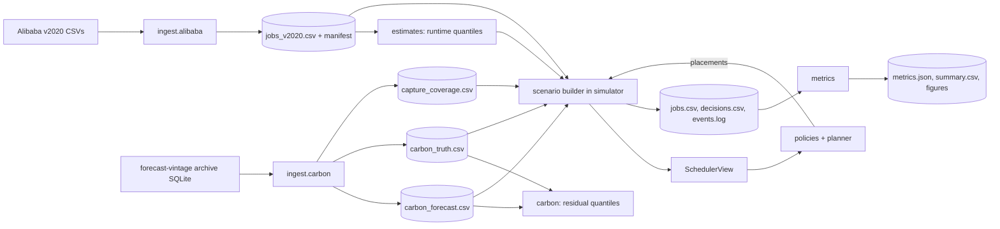
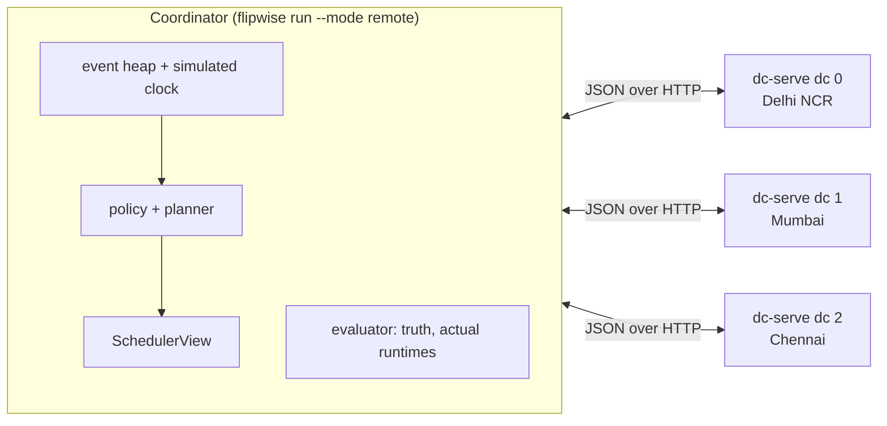

# Product Requirements Document (PRD)

## Efficient Re-Evaluation of Pending Workloads in Carbon-Aware Datacentre Scheduling

| Field | Value |
|---|---|
| Document status | Implementation-ready draft. Supersedes v0.6, v0.5.1 and v0.5 (29 Oct 2026), v0.4 (28 Oct 2026), v0.3 (24 Oct 2026), v0.2 (24 Oct 2026) and v0.1 (23 Oct 2026). Changes are listed in the changelog below. |
| Version | 0.7 |
| Revised | 29 October 2026 |
| Project name | **Flipwise** (Python package and CLI `flipwise`) [Decision]: it re-evaluates decision flips wisely. Renamed from FlipSim on 25 Oct 2026. Availability of the name on GitHub and PyPI is [Open], not yet checked. |
| Project context | RV College of Engineering, Experiential Learning, V Semester, AY 2026–27; SDG 9 |
| Deliverable | Offline, command-line research simulator and reproducible evaluation pipeline, plus a static, self-contained HTML results dashboard generated from result CSVs. Not a production scheduler. No web app in the MVP. From v0.4, a **deployment track** (Section 13.5) runs the same simulation with each virtual datacentre as a separate service: first as local processes, then in Docker, then on AWS. Research results always come from the in-process mode; the deployment modes must reproduce them exactly. |
| Companion document | `explanation.md` (plain-language project explanation). Where the two disagree, this PRD is authoritative (see Section 5). `explanation.md` was updated to match v0.5 on 29 Oct 2026. |
| Repository state at revision | Git repository exists (`https://github.com/Rohith-sp/flipwise`) with `README.md` and `docs/` only. No code yet. Initial layout in Section 13.1. |

### Changelog

| Version | Date | Changes |
|---|---|---|
| 0.7 | 29 Oct 2026 | Resolved B4 with source option 3 (6.2.2): regional daily generation by fuel from Grid-India NLDC daily PSP reports, shaped within each IST day by Grid-India NLDC all-India SCADA generation by fuel (10-second data, Mendeley Data, CC BY 4.0). Electricity Maps was checked first: its free CSV datasets were discontinued in March 2026 (academic access only, by application). CEA factors filled from User Guide v19.0 Table 6 (FY 2022-23): coal 978, lignite 1286, gas 478 g/kWh (7.5). New scripts `download_india.py`, `build_india_generation.py`; optional extra `india-data` (openpyxl, xlrd) for reading the reports (12.1, 13.4). |
| 0.6 | 29 Oct 2026 | Moved deployment stage DT2 (Docker) into EL Phase 2 as a stretch goal after DT1, and set the DT1 build order: `datacentre.py` first, then the `DatacentreClient` interface, the HTTP service, a scripted driver that tests local split before the simulator exists, then `local_cluster.sh` (18). Added R-DEP-7 (client conformance). |
| 0.5.1 | 29 Oct 2026 | Build phases 1, 3 and 4 implemented; phase 2 partly (Indian truth waits for B4). Findings from the real data: tasks-per-job mean is 1.21 over Terminated jobs (1.19 was over all jobs) (6.1). `A_gb` rule made precise: the value at the last capture whose window covers the slot; `pt24h` windows reach back exactly 24 h, so a literal `capture ≥ k + 24 h` almost never matches, while the measured lag of the last covering capture is p50 24 h, p05 23 h (6.2.3). GB truth matches the NESO Data Portal regional series in 98–99 % of slots (MAE < 0.6 g/kWh). GB source-region means: London 156, South Wales 276, East Midlands 257 g/kWh; IDs 13, 7, 9 confirmed in the archive (O3). Archive coverage reported (B2): no forward captures on 2023-03-20, 2023-03-31 – 04-02, 2023-10-21 and from 2024-02-04, so the run tail to 8 Feb 2024 cannot be met for carbon starts after about 19 Jan 2024. `capture_coverage.csv` keeps `window_first_utc, window_last_utc, source` (forward captures only); `gb_truth.csv` added for `s_r` (6.7). Carbon Mondays fixed in `configs/base.yaml` to avoid the gaps (14.2). Layout gains `errors`, `trace`, `scenario`, `validate`, `smoke` modules and `configs/energy.yaml` holds CEA factors (13.1). Linux supported alongside Windows 11. |
| 0.5 | 29 Oct 2026 | Made the simulated world India-only (D17–D20): three virtual datacentres in Delhi NCR, Mumbai and Chennai on the Northern, Western and Southern regional grids; Indian truth intensity from regional generation by fuel × CEA emission factors (6.2.2); Indian forecast vintages built from the NESO archive's real error paths, scaled to Indian levels (6.2.4); trace time aligned to IST (6.3). The CEA CO2 Baseline Database replaces DESNZ as the established emissions reference (7.5). Carbon-spread sweep redefined (14.4); new requirements R-ING-5/6; new blocker B4 (Indian generation data); DT3 default region `ap-south-1` (Mumbai). Novelty point (c) narrowed accordingly (19). |
| 0.4 | 28 Oct 2026 | Added the deployment track (13.5): the three virtual datacentres run as separate services in three stages, DT1 local processes started by a shell script, DT2 Docker Compose, DT3 AWS. The coordinator keeps the simulated clock, so every mode must produce byte-identical `jobs.csv` and `decisions.csv` to the in-process run (R-DEP-1…6). Updated the non-goals (4.3), stack (12.1), layout (13.1), CLI (13.4), risks and open questions (17), roadmap and EL mapping (18). Recorded the GitHub repository. Added `CLAUDE.md` to the initial repository contents. |
| 0.3 | 24 Oct 2026 | Named the project Flipwise (`flipwise`; renamed from the placeholder `carbonsim` throughout). Added `flipwise dashboard` (static `dashboard.html`, no server), kept separate from `flipwise run` (4.1, 4.3, 12.1, 13.1, 13.4, 16.2). Replaced "no web UI" with "no server or web app in MVP; optional Streamlit viewer is a Phase 3 extension" (X9). Mapped EL Phase 2 and Phase 3 to the roadmap, with `pred_error(ε)` moved to EL Phase 3 (Section 18.1). Added the 24 Oct literature-search findings: CarbonScaler as the published source for `pred_error(ε)`, GREEN for `periodic(T)`, Li et al. as closest to the θ·w_ab margin, and the novelty verdict "candidate contribution" (11, 19). Added cited GPU nameplate powers for B3; CPU and MISC GPU power remain unverified (7.2, 17.3). Added the initial repo contents and README outline, and updated the target layout with `docs/`, `scripts/`, `LICENSE` and `dashboard.py` (13.1). |
| 0.2 | 24 Oct 2026 | Implementation-ready revision of v0.1 (see Section 5). |
| 0.1 | 23 Oct 2026 | First draft. |

---

## 1. Status, purpose and scope

### 1.1 Purpose

This PRD tells a developer who has never met the team what to build, how it behaves, what data it reads, how emissions are computed, which dependencies to install, which commands to run, how to test it, which baselines to compare, and what evidence would support or weaken the research hypothesis.

### 1.2 Evidence labels used throughout

| Label | Meaning |
|---|---|
| **[Confirmed]** | Supported by the submitted report as summarised in the supplied documents, by a primary source checked on 24 Oct 2026, or by direct inspection of downloaded data. |
| **[Working direction]** | Stated in `explanation.md` or PRD v0.1; not formally approved by the mentor. |
| **[Decision]** | Design choice made in this revision so the simulator is implementable. Changeable, but only by editing this PRD. |
| **[Synthetic]** | A value or field generated by the simulator, not measured in any source dataset. |
| **[Open]** | Needs verification or a team/mentor decision. Section 17 separates blockers from configurable items. |

### 1.3 Scope in one paragraph

The MVP is a deterministic discrete-event simulator of three virtual datacentres (pooled GPU/CPU/memory capacity) in Indian hubs (Delhi NCR, Mumbai, Chennai), one Indian regional grid each. It replays one-week slices of the Alibaba PAI GPU trace v2020 aligned to Indian Standard Time, feeds the scheduling policy half-hourly carbon-intensity forecasts built from Indian grid data and the real error paths of an archived operational forecast (Section 6.2), scores outcomes against later carbon values held only by the evaluator, and compares seven policies under identical inputs. Running jobs are never migrated. DRO is outside the MVP.

---

## 2. Executive summary

A scheduler places a job at a datacentre and start time using estimates. Before the job starts, carbon forecasts are revised every half hour and queues change, so the placement may stop being the best feasible one. Never revisiting is cheap but can miss savings; re-optimising on a timer or at every update costs planner time and can move jobs back and forth on forecast noise.

This project tests a specific rule for *when* to re-plan a pending job. On each forecast update, a cheap screen checks whether any alternative could possibly beat the incumbent by more than a benefit gate. Only jobs that pass the screen are fully re-scored, and a job moves only if the best alternative beats the incumbent by the gate plus a noise margin derived from calibrated forecast-error intervals.

The design has one property worth stating early because it makes the experiment honest. With the noise margin set to zero, the proposed policy makes exactly the same placement decisions as a fixed-savings-gate policy that re-scores every job at every update; it only makes fewer planner calls. Any carbon or deadline difference between the two therefore comes from the noise margin, and any overhead difference comes from the screen. Section 10.9 turns this into a test.

### 2.1 Three-sentence explanation

We simulate three virtual datacentres in Indian hubs on different regional grids, replay real AI-cluster jobs through them, and let different policies decide where and when each job runs using only the carbon forecasts available at that moment. The proposed policy re-plans a waiting job only when an alternative placement could beat the current one by a meaningful, noise-adjusted margin. We measure whether this keeps most of the modelled carbon benefit of frequent re-planning while making far fewer planner calls and placement changes, and we report the conditions where it does worse.

---

## 3. Problem statement and research questions

### 3.1 Problem

In a multi-datacentre setting, a pending job's best feasible `(datacentre, release slot)` can change between initial placement and start because (a) carbon forecasts are revised, (b) other jobs finish earlier or later than estimated, and (c) other placements change congestion. Re-scoring every pending job at every update scales with jobs × candidates × updates. Never re-scoring forfeits improvements. A fixed-savings rule reacts to point-estimate differences without regard to forecast noise. The question is whether a margin-based screen plus a noise-adjusted gate gives a better trade-off between modelled emissions, deadline performance and scheduling effort.

### 3.2 Main research question

Under which workload-pressure, carbon-spread, forecast-error and deadline-slack conditions does decision-flip-triggered re-evaluation of pending jobs achieve modelled emissions and deadline performance comparable to periodic and fixed-savings re-planning while using fewer planner calls and fewer placement changes?

### 3.3 Supporting questions

- RQ1. How many full re-scorings does the Stage-1 screen avoid, and does avoiding them change any decision? (Expected: no decision change at θ = 0; verified by test.)
- RQ2. Does the noise margin θ reduce churn without raising emissions or deadline misses, relative to the fixed-savings gate at the same benefit threshold?
- RQ3. How calibrated are the runtime, queue-wait and carbon intervals on held-out data, and how sensitive are outcomes to miscalibration?
- RQ4. In which regimes is a simpler baseline (place-once, periodic, fixed-savings) as good or better?

### 3.4 Hypotheses (to test, not to assume)

| ID | Hypothesis | Evidence that would weaken it |
|---|---|---|
| H1 | Decision-flip (θ = 0) makes ≥ 50 % fewer full re-scorings than fixed-savings with identical decisions. | Screen pass rate near 100 % (bound too loose), or any decision mismatch (bug or invalid bound). |
| H2 | Decision-flip with θ > 0 reduces placement changes versus fixed-savings while total modelled emissions stay within the seed-to-seed spread. | Emissions rise beyond the spread, or churn does not fall. |
| H3 | Benefit of any re-planning over place-once grows with carbon spread across regions and with deadline slack. | No trend, or re-planning worse than place-once at high load (stampede). |
| H4 | Under-covering carbon intervals (scaled narrower) increase churn; over-covering intervals suppress useful moves. | Outcomes flat across interval scaling. |

The 50 % figure in H1 is a pre-registered threshold for calling the screen useful, not a prediction.

---

## 4. What will be built

### 4.1 MVP (must exist for the main experiment)

1. Ingest adapters: Alibaba PAI v2020 job and task tables to a canonical job CSV; Indian regional generation data and CEA factors to an Indian truth CSV; NESO forecast-vintage archive to error paths; a builder that combines them into Indian forecast vintages (6.2).
2. A deterministic event engine (`heapq`) with job lifecycle, three virtual datacentres, FIFO first-fit dispatch, and a strict scheduler/evaluator information boundary.
3. Energy and emissions model with explicit units and configurable power parameters.
4. Estimators: per-user runtime quantiles (frozen after calibration), lead-time-bucketed carbon residual quantiles, model-based queue-wait intervals.
5. Shared candidate generator, feasibility checker and scorer used by every policy.
6. Seven policies: FCFS, carbon-aware place-once, periodic re-planning, prediction-error trigger, fixed-savings gate, decision-flip (proposed), perfect-information greedy reference.
7. Metrics, per-job and per-decision logs, run manifests, comparison tables and Matplotlib plots.
8. A hand-built toy scenario with known answers, plus unit, invariant, integration and reproducibility tests.
9. `flipwise dashboard` [Decision, v0.3]: reads saved result CSVs only and writes one self-contained `dashboard.html` that opens in any browser with no server and no internet. Tabs: (a) carbon-intensity forecast curves for the three regions with one bar per job showing where and when it ran, and markers where decision-flip moved a job (the hero figure); (b) Pareto plot of kgCO2 against `stage2_calls`, one point per policy; (c) results table of kgCO2, deadline-miss rate and re-score count per policy; (d) θ sweep of emissions and overhead against θ. A tab whose input CSVs do not exist yet shows "no data" instead of failing. It never runs a simulation, and `flipwise run` never starts a server. Default rendering embeds Matplotlib PNGs (no new dependency); if the optional `plotly` extra is installed, charts are interactive (hover, zoom) with plotly.js inlined so the file still works offline.

### 4.2 Extensions (explicitly not in MVP)

| ID | Extension | Precondition |
|---|---|---|
| X1 | Global–Local DRO planner behind the same planner interface | Formal ambiguity set and objective written in this PRD; MVP results exist |
| X2 | Machine-level bin packing and GPU-type eligibility | MVP results exist; fragmentation becomes a research question |
| X3 | Task-level execution for multi-task jobs | Same |
| X4 | Include trace jobs with status `Failed` as resource consumers | Sensitivity only |
| X5 | Per-datacentre PUE and heterogeneous power models | Sourced PUE values |
| X6 | Second trace release (v2023 or v2026) | Adapter for its schema |
| X7 | Forecast-vintage data from the Jul–Oct 2026 archive partitions | Coverage audit of those months |
| X8 | Probabilistic flip estimate by Monte Carlo sampling | MVP interval method evaluated first |
| X9 | Optional live Streamlit viewer over result CSVs (EL Phase 3), separate entry point, never imported by the simulator | Static dashboard (4.1 item 9) exists; evaluators ask for live interaction |

The deployment track (DT1 local split, DT2 Docker, DT3 AWS) is not an extension: it is planned work with its own requirements (13.5, 15.1) and roadmap stages (18). It does not change any research result.

### 4.3 Non-goals

Real infrastructure control; live-job migration; claims of measured real-world emission reductions; a web app in the MVP (the static `dashboard.html` is in scope; a live viewer is X9); databases, message queues, GPUs or deep learning; reproducing any production scheduler; treating virtual datacentres as real Alibaba facilities.

The deployment track (13.5) is in scope but is not a production system. Its datacentre services hold simulated queues and never run real jobs; the AWS stage (DT3) hosts those services on cloud machines and does not measure AWS's energy or emissions. Carbon values always come from the Indian carbon data (6.2), whichever machine a service runs on. Deployment modes never produce research results of their own: a result counts only if the in-process mode produces the identical output.

---

## 5. Source-document contradictions and decisions

| # | Issue in v0.1 / `explanation.md` | Resolution in v0.2 | Rationale |
|---|---|---|---|
| D1 | Job states differ (`unseen/pending/reserved/...` vs `SUBMITTED/PENDING_UNPLACED/PENDING_PLACED/...`). | One state machine (Section 8.2). Deadline miss is an outcome flag, not a state. | One vocabulary; misses are measured, not a terminal state. |
| D2 | Whether future capacity is reserved was left open. | No future reservations. A placement sets a release slot; at release the job joins the datacentre FIFO queue; resources are allocated only at start. | Overbooking becomes impossible by construction; replacing a placement needs no reservation bookkeeping. |
| D3 | SimPy *or* custom `heapq`. | Custom `heapq` engine. | Needs cancellable future events (moved releases) and fixed same-time priorities. SimPy timeouts cannot be cancelled cleanly; a version-stamped heap is about 60 lines. |
| D4 | pandas *or* Polars; YAML *or* TOML; Parquet *or* CSV. | pandas, YAML (PyYAML), CSV. | Smallest set; job table is ~0.73 M rows after filtering, which CSV handles. |
| D5 | Trace release undecided (v2020 vs v2026). | v2020 for MVP. | Downloaded and checksum-verified; schema documented; 68.9 days; 6,742 GPUs. v2026 is far larger and its schema was not audited. |
| D6 | v0.1 §7.7 proposes historical queue-wait intervals. | Queue wait is model-based (Section 9.3). | In the released v2020 data every job's `start_time` equals its earliest task `start_time` (0 of 1,055,501 jobs differ), so historical wait is not derivable. |
| D7 | NESO forecast-vintage availability unknown. | Use the public `nmpowell/carbon-intensity-forecast-tracking` archive for vintages; regional "truth" is the final published regional forecast. | The official API overwrites old forecasts and publishes `actual` nationally only; the archive records each half-hourly capture. From v0.5 the archive supplies forecast-error paths only (D19). |
| D8 | "CATS-style savings gate" baseline. | Renamed "fixed-savings gate". No CATS equivalence is claimed. | The CATS paper describes Speed-First, Carbon-First, Spatial Shifting and Temporal Shifting policies; a savings gate was not found in the material checked. |
| D9 | Robust q90 runtime placement listed as a separate baseline. | q90-runtime deadline feasibility is the shared rule for every policy. Point-estimate feasibility becomes an ablation. | Avoids a baseline that differs from others only in a shared component. |
| D10 | Oracle called a "lower bound". | "Perfect-information greedy" (PIG) reference; not a bound. | It is greedy in arrival order; better schedules may exist. |
| D11 | DRO status ambiguous. | Extension X1. Report must be updated to say so. | Trigger contribution is testable without DRO; mixing both confounds attribution. |
| D12 | Whether queued (released, not started) jobs may be moved. | Yes. Moving a queued job removes it from the queue and it loses its position. | Matches "pending = not started"; queue loss is a real, modelled switching cost. |
| D13 | Whether optimiser overhead is converted to carbon. | No. Reported as wall-clock and call counts. Optional penalty parameter defaults to 0. | No measured scheduler energy model. |
| D14 | Two different repository layouts. | One small package (Section 13). | Fewer modules for an MVP. |
| D15 | Deadlines unspecified. | Synthetic, derived only from the frozen runtime estimate (Section 6.4). | Deriving them from actual runtime would leak the runtime to the scheduler. |
| D17 | Simulated world was GB (v0.1–v0.4). | India only: three Indian hubs and regional grids (6.2.1). | The team wants Indian conditions; the datasets stay as available. |
| D18 | No Indian carbon truth. | Production-based regional intensity from generation by fuel × CEA factors (6.2.2). | Uses India's official emission-factor source; flows ignored and stated. |
| D19 | No archive of Indian carbon forecasts exists. | Indian forecast vintages = Indian truth + scaled real NESO error paths (6.2.4). | Keeps realistic forecast revision behaviour; random noise would bias the comparison towards noise-margin policies. |
| D20 | Trace clock aligned to UK time. | Aligned to IST (6.3). | Submissions meet the Indian solar day. |
| D16 | Runtime estimates unspecified. | Per-user empirical quantiles fitted on the first 21 trace days, frozen. | Leak-free and identical across policies (online updates would depend on each policy's completion order). |

---

## 6. Dataset inventory, schema and provenance

### 6.1 Alibaba Cluster Trace GPU v2020 [Confirmed by download and audit, 24 Oct 2026]

Source: `https://github.com/alibaba/clusterdata/tree/master/cluster-trace-gpu-v2020`. Primary download links point to `aliopentrace.oss-cn-beijing.aliyuncs.com`; a GitHub mirror (`qzweng/clusterdata-cluster-trace-gpu-v2020-data`) splits archives into parts. No survey is required for v2020 (unlike v2017/v2018). Use is permitted "for research or study purpose" per the repository README; cite Weng et al., NSDI '22.

Files used by the MVP and their verified SHA-256 (archives):

| File | Archive SHA-256 | Rows (no header) | Used for |
|---|---|---|---|
| `pai_job_table.tar.gz` | `5aad7f7c…6cb0` | 1,055,501 | arrival, user, status |
| `pai_task_table.tar.gz` | `cd1d6dc3…40e5` | 1,261,050 | runtime, resource requests |
| `pai_machine_spec.tar.gz` | `cc0d38a4…6c2d` | 1,897 | capacity sanity check only |

Full checksums are in the upstream README; `ingest` must verify them. CSV files have no header row; column names come from the `.header` files.

Audit results (Terminated jobs unless stated):

| Quantity | Value |
|---|---|
| Job status counts (all jobs) | Terminated 732,355; Failed 256,555; Running 62,928; Waiting 3,663 |
| Span of job `start_time` | 68.9 days |
| Tasks per job | 1–4 (mean 1.21 over Terminated jobs; 1.19 over all jobs) |
| Runtime (max task end − min task start), s | p10 43; p50 663; p90 12,848; p99 68,884; max 626,384 |
| GPU request per job (Σ `inst_num × plan_gpu / 100`) | p50 1.0; p90 5; p99 30; max 400; fractional values occur (e.g. 0.1) |
| Jobs with missing `plan_gpu` (and `gpu_type`) in some task | 145,096 (19.8 %) |
| Jobs mixing GPU types | 0.16 % |
| Users with ≥ 20 Terminated jobs | 756 of 1,307; they own 99.5 % of jobs |
| Machines / GPUs in `pai_machine_spec` | 1,897 / 6,742 |

Time semantics [Confirmed from README]: timestamps are seconds minus a secret constant. Interpreted as Unix time in UTC+8 they keep the true time of day and weekday; calendar dates are fake. Consequence: trace time can be aligned to carbon time by weekday and time of day only (Section 6.3).

### 6.2 Carbon intensity: Indian grid conditions [Decision, v0.5]

The simulated world is Indian: three virtual datacentres on three of India's five regional grids, Indian carbon intensity, Indian Standard Time. No public archive of Indian carbon-intensity **forecasts** exists (searched 29 Oct 2026), so the forecasts the scheduler sees are built from Indian truth plus the real forecast-error paths of the NESO (Great Britain) archive. Two datasets feed this section:

| Input | Role | Status |
|---|---|---|
| Indian regional generation by fuel (≤ 1 h resolution) and CEA fuel emission factors | Truth `A(r, k)`: what the grid actually emitted | Source to confirm (blocker B4) |
| NESO forecast-vintage archive (`nmpowell/carbon-intensity-forecast-tracking`) | Error paths `E(k, v)`: how real half-hourly forecasts drift and get revised | Downloaded and inspected [Confirmed] |

#### 6.2.1 Regions and datacentres [Decision]

| `dc_id` | Datacentre hub | Regional grid | `region_id` |
|---|---|---|---|
| 0 | Delhi NCR (Noida, Gurugram) | Northern (NR) | 1 |
| 1 | Mumbai / Navi Mumbai | Western (WR) | 2 |
| 2 | Chennai | Southern (SR) | 3 |

The hubs are where India's existing datacentre capacity concentrates; the virtual datacentres are not real facilities. Eastern (ER, `region_id` 4) is reserved for the high-spread variant (14.4); North-Eastern is not used. India's regions form one synchronous national grid, so regional carbon differences may be smaller, and time-of-day differences (solar) larger, than in multi-country studies. This is a property to measure (H3), not a defect.

#### 6.2.2 Indian truth `A(r, k)` [Decision; data source Open, B4]

Production-based generation intensity per region and half-hour slot:

`A(r, k) = Σ_f G(r, f, k) × EF_f / Σ_f G(r, f, k)`   (gCO2/kWh)

- `G(r, f, k)`: energy generated in region `r` from fuel `f` during slot `k` (MWh). 15-minute blocks (India's scheduling interval) are summed in pairs into 30-minute slots; hourly data give both half-hours the same value (`truth_kind = hourly_step`).
- `EF_f`: operational CO2 emission factor of fuel `f` (gCO2/kWh net generation) derived from the CEA CO2 Baseline Database as the generation-weighted average over the database's stations of that fuel (coal, lignite, gas, diesel). Hydro, nuclear, solar and wind are 0. Biomass and "other" are [Open]: 0 by default, configurable. No factor values are hard-coded in this PRD; they live in `configs/energy.yaml` with the CEA version cited.
- Inter-regional power flows are ignored (production-based, not consumption-based) [Decision]. This is stated as a limitation; a flow-adjusted variant needs inter-regional exchange data at the same resolution.

Candidate sources for `G` that were considered: (1) Grid-India regional generation by source at 15-minute or hourly resolution: not published for 2023 (the daily PSP reports carry regional data per day only); (2) third-party hourly series: Energymap is paid, and Electricity Maps discontinued its free CSV datasets in March 2026; (3) construction from Grid-India data. **[Decision, v0.7] Option 3 is used:**

- **Regional daily energy by fuel (measured):** Grid-India NLDC daily Power Supply Position report, sheet `MOP_E`. Section G "Sourcewise generation (Gross) (MU)" gives NR/WR/SR/ER daily MU for coal, lignite, hydro, nuclear, "Gas, Naptha & Diesel" (→ `gas`) and RES. Section A gives regional wind and solar MU; RES minus wind minus solar (floored at 0) becomes `biomass` (biomass and other RES). The report for day *d* is titled `DD.MM.YY_NLDC_PSP` with *d* the data day.
- **Within-day shape (measured, national):** Grid-India NLDC SCADA all-India generation by fuel at 10-second resolution (thermal, hydro, gas, nuclear, wind, solar; timestamps IST), published on Mendeley Data (doi:10.17632/y58jknpgs8.2, CC BY 4.0), averaged into 30-minute slots.
- **Construction [Synthetic within the day]:** `G(r, f, k) = E(r, f, d) × MW(s(f), k) / Σ_{k' ∈ d} MW(s(f), k')`, where `s(f)` maps coal and lignite → thermal, gas → gas, hydro → hydro, nuclear → nuclear, wind → wind, solar → solar, and biomass → flat. Each region therefore keeps its measured daily fuel mix and takes the national within-day shape of each fuel; regional differences in timing (e.g. solar a few minutes later in the west) are not represented. Days with incomplete SCADA take the typical shape of their month; with no complete day in the month, the typical shape over the whole period; with no data for the fuel at all, an even spread. The Mendeley workbook for 2024 onward is hourly and carries wind and solar only, so from 1 Jan 2024 thermal, gas, hydro and nuclear take their 2023 typical shape while wind and solar keep their real hourly shape. A day with no PSP report (1–2 consecutive days only; 21 Mar 2023 is the one case in the window) takes the mean of the nearest reported days before and after, listed in the manifest. Both fallbacks are counted in `data/manifests/india_generation.json` (`construct_india_generation`, tested in `tests/test_ingest.py`).

`truth_kind = constructed_psp_scada`. The PSP figures are gross generation; only the ratio of fuels matters for intensity, so gross vs net does not bias `A` beyond auxiliary-consumption differences between fuels.

Required coverage: 13 Mar 2023 – 8 Feb 2024 (calibration through test, plus the 8-day run tail). Truth gaps: linear interpolation across at most 2 slots, otherwise the replicate is invalid and `validate` fails.

#### 6.2.3 Error source: the NESO forecast-vintage archive [Confirmed]

- The NESO Carbon Intensity API publishes half-hourly regional forecasts for Great Britain up to 48 h ahead and keeps no history of past forecast versions.
- The `nmpowell/carbon-intensity-forecast-tracking` repository (MIT licence) scrapes the API twice an hour and stores every capture in SQLite. Inspected schema: `regional_intensity(window_utc, region_id, capture_utc, forecast, <fuel mix columns>)`, `national_intensity(window_utc, capture_utc, forecast, actual)`, `captures(capture_utc, endpoint, window_first_utc, window_last_utc, observed_utc, source)`, `capture_gaps(...)`. Regional partitions are change-logs; the `captures` table records coverage so the value at any captured time can be reconstructed.
- Partitions present on 24 Oct 2026: March 2023 – early February 2024, then July – October 2026. Early 2023 captures have `source = 'summary_csv'`. The README reports about 90 % capture success.

For each GB source region `g`: `F_gb(g, k, v)` is the forecast for slot `k` as of capture `v`; `A_gb(g, k)` is the value in effect at the last capture (`regional_fw48h` or `regional_pt24h`) whose window covers slot `k` [v0.5.1: `pt24h` windows reach back exactly 24 h, so this capture is at about `k + 24 h`; measured p50 24 h, p05 23 h]. The error path is `E_g(k, v) = F_gb(g, k, v) − A_gb(g, k)`.

#### 6.2.4 Indian forecast vintages [Synthetic: real error paths on Indian truth]

`F(r, k, v) = max(0, A(r, k) + α × s_r × E_{g(r)}(k, v))`

- Same UTC slot `k` and capture `v` as the archive, so the Indian forecasts inherit the archive's capture schedule, missing captures, lead-time growth of error, revision timing and correlation across slots and regions.
- `s_r = mean A(r, ·) / mean A_gb(g(r), ·)` over the calibration window scales GB errors (gCO2/kWh) to the Indian intensity level. Additive scaled errors are used instead of relative errors because relative errors explode where GB intensity is near zero.
- `α` is the forecast-error scaling of 14.4 (base 1).
- Source mapping `g(r)` [Decision; IDs verified at ingest, O3]: three different mid-to-high-intensity England/Wales regions, NR ← London, WR ← South Wales, SR ← East Midlands. Scottish regions are excluded because their near-zero intensity makes `s_r` unstable. Sensitivity: a permuted mapping.
- Why not random noise: independent noise per `(k, v)` would make forecasts jitter between consecutive captures, inflating churn for every re-planning policy and unfairly favouring a noise margin. Real error paths revise smoothly, as operational forecasts do.
- Limitation, stated in every report: the errors have the statistical structure of a real operational forecast, but their causes are British weather, not Indian monsoon or solar variability.

**Two views of carbon data [Decision]:**

| View | Definition | Who may read it |
|---|---|---|
| Forecast `F(r, k, v)` | 6.2.4. Visible at simulated time `t` iff `v ≤ t`; the scheduler sees the latest such `v`. | Scheduler |
| Truth `A(r, k)` | 6.2.2 | Evaluator only |

Timestamp rules: all times stored as integer Unix seconds UTC. Slots are 1,800 s, aligned to `:00` and `:30` UTC, which is also `:30`/`:00` IST. Missing slot handling (identical for every policy): if the latest vintage lacks slot `k`, use the nearest earlier slot from the same vintage if at most 2 slots back (persistence); beyond that, the slot is unknown and any candidate needing it is infeasible. For slots beyond the forecast horizon (needed by long jobs), persistence of the last forecast slot is used and the slot is flagged `extrapolated`; its interval uses the widest lead-time bucket.

**[Decision] Carbon period:** 13 March 2023 – 31 January 2024 for both the Indian truth and the error paths, so the borrowed errors line up date for date. The 2026 archive partitions are extension X7.

### 6.3 Mapping trace time to Indian time [Decision, Synthetic]

For a replicate with trace slice starting at trace time `T0` (a Monday 00:00 in the trace's UTC+8 clock) and carbon start `C0` (a Monday 00:00 IST, i.e. Sunday 18:30 UTC):

`sim_time = C0 + (trace_time − T0)`

This aligns the trace's weekday and clock-hour pattern of job submissions with Indian clock hours, so daytime submissions meet the Indian solar midday. Sensitivity: `phase_shift_h ∈ {0, −2.5}` (−2.5 h aligns true instants instead of local clocks, since UTC+8 is 2.5 h ahead of IST).

### 6.4 Canonical job schema

File: `data/processed/jobs_v2020.csv`. One row per Terminated job whose tasks all have valid start and end times.

| Column | Type / unit | Source | Derivation | Missing-data rule | Provenance | Visible to scheduler |
|---|---|---|---|---|---|---|
| `job_id` | str | `job_name` | as is | drop row if missing | source | yes |
| `user` | str | job `user` | as is | `"__unknown__"` | source | yes |
| `trace_arrival_s` | int s | job `start_time` | as is | drop | source | yes (converted) |
| `trace_start_s` | int s | task `start_time` | min over tasks | drop | derived | no |
| `trace_end_s` | int s | task `end_time` | max over tasks | drop | derived | no |
| `runtime_actual_s` | int s | | `trace_end_s − trace_start_s`, min 1 | drop if ≤ 0 | derived | **no** |
| `gpu_req` | float GPUs | `plan_gpu`, `inst_num` | Σ `inst_num × plan_gpu / 100` | NaN `plan_gpu` with NaN `gpu_type` → 0 and `gpu_assumed_zero = 1` | derived | yes |
| `cpu_req` | float cores | `plan_cpu`, `inst_num` | Σ `inst_num × plan_cpu / 100` | drop if NaN | derived | yes |
| `mem_req_gb` | float GB | `plan_mem`, `inst_num` | Σ `inst_num × plan_mem` | drop if NaN | derived | yes |
| `gpu_type` | str | task `gpu_type` | mode over tasks | `"NONE"` | source | yes (unused in MVP) |
| `n_tasks` | int | | count | | derived | yes |
| `gpu_assumed_zero` | 0/1 | | see above | | derived | yes |

Columns added per scenario (not stored in the canonical file): `arrival_s` (sim time), `r_q05/q50/q90/q95_s` (frozen estimates, visible), `deadline_s` (synthetic, visible), `deadline_rule` (provenance string).

Known modelling simplifications [Decision]: a multi-task job is treated as one gang holding its summed resources from its earliest task start to its latest task end (over-states resource-time for staggered tasks; X3 removes this). Runtime is assumed independent of datacentre (homogeneous hardware). Failed, Running and Waiting jobs are excluded and counted in the ingest report (X4 revisits Failed).

The 19.8 % zero-GPU assumption is [Open, configurable]: the interpretation "missing plan_gpu means CPU-only" is plausible but undocumented upstream. Sensitivity: `missing_gpu_policy ∈ {zero, drop}`.

### 6.5 Runtime estimates [Decision]

Calibration slice: jobs with `trace_arrival_s` in trace days [0, 21). For each user with ≥ `n_min = 20` calibration jobs, store empirical quantiles q05, q50, q90, q95 of `runtime_actual_s` (`numpy.quantile`, method `linear`). Otherwise fall back to the quantiles of the job's GPU-request class over all calibration jobs: classes `{0}`, `(0, 1]`, `(1, 8]`, `> 8`. Estimates are then frozen. Evaluation slices start at trace day 21, so no evaluation job contributes to its own estimate. The nominal runtime interval is [q05, q95] (90 %).

### 6.6 Synthetic deadlines [Synthetic]

`deadline_s = arrival_s + slack_base_s + k_slack × r_q90_s`

Defaults `slack_base_s = 14,400` (4 h), `k_slack = 2.0`. Sweep: `slack_base_s ∈ {3,600; 14,400; 86,400}`, `k_slack ∈ {1.5, 2, 4}`. Because the formula uses only the frozen estimate, the deadline carries no information about the actual runtime beyond what the scheduler already has.

### 6.7 Canonical carbon files

| File | Columns |
|---|---|
| `data/processed/india_generation.csv` | `region_id:int, slot_utc:int, fuel:str, mwh:float, source:str` |
| `data/processed/carbon_truth.csv` | `region_id:int, slot_utc:int, truth_g_per_kwh:float, truth_kind:str, interpolated:0/1` (Indian truth, 6.2.2) |
| `data/processed/gb_error_paths.csv` | `gb_region_id:int, slot_utc:int, capture_utc:int, error_g_per_kwh:float` (one row per change) |
| `data/processed/carbon_forecast.csv` | `region_id:int, slot_utc:int, capture_utc:int, forecast_g_per_kwh:float, source:str` (Indian vintages, 6.2.4; one row per change) |
| `data/processed/gb_truth.csv` | `gb_region_id:int, slot_utc:int, truth_g_per_kwh:float, interpolated:0/1` (`A_gb`, needed for `s_r`; v0.5.1) |
| `data/processed/capture_coverage.csv` | `capture_utc:int, endpoint:str, window_first_utc:int, window_last_utc:int, source:str` (forward `regional_fw48h` captures; one `CARBON_UPDATE` per row; the window bounds which slots a vintage covers) |
| `data/manifests/*.json` | source URL, retrieval date, commit hash (archive) or file SHA-256, CEA database version, row counts, filters, exclusion counts, `s_r` values |

### 6.8 Carbon residual model [Decision]

For the calibration period (13 Mar – 30 Jun 2023), compute residuals `e = A(r, k) − F(r, k, v)` for every captured `(r, k, v)` with lead `ℓ = k − v` in buckets `[0, 6 h), [6, 12 h), [12, 24 h), [24, 48 h]`. Store the 5th and 95th percentiles `e05(b), e95(b)` per lead bucket, computed on the Indian vintages (6.2.4), pooled over the three regions (per-region quantiles if each region has ≥ 500 residuals per bucket; report which was used). Interval for a forecast slot: `[max(0, F + e05(b)), F + e95(b)]`. Coverage and width are reported per bucket on validation and test periods.

### 6.9 Development (toy) mode

`tests/fixtures/toy/` holds a hand-written scenario: 3 datacentres, 6 jobs, 12 slots, two forecast vintages, explicit truth. Every expected outcome (placements, starts, emissions) is written in `tests/fixtures/toy/expected.yaml` and computed by hand in a comment block. The full trace is never needed to run `smoke` or the unit tests.

---

## 7. Energy and emissions model

### 7.1 Equations and units

Allocated power of job `j` (kW):

`P_j = gpu_req_j × p_gpu_kw + cpu_req_j × p_cpu_kw`

IT energy over its execution `[s_j, s_j + R_j)`, with `R_j` the actual runtime in seconds:

`E_j^IT (kWh) = P_j × R_j / 3600`

Facility energy: `E_j = PUE_d × E_j^IT` with `PUE_d = 1.0` in the MVP, so results are IT energy.

Modelled emissions (kgCO2), summing over half-hour slots `k` overlapped by execution, with `τ_jk` the overlap in seconds:

`M_j = Σ_k  PUE_d × P_j × (τ_jk / 3600) × A(r_d, k) / 1000`

Units: kW × h = kWh; kWh × gCO2/kWh = gCO2; ÷ 1000 = kgCO2. The scheduler's estimate uses the same function with `F` instead of `A` and estimated start/runtime.

### 7.2 Parameter provenance [Synthetic until sourced]

| Parameter | MVP default | Status |
|---|---|---|
| `p_gpu_kw` | must be set in `configs/energy.yaml` with a citation before any real-trace emission number is reported | [Partly confirmed, v0.3] Nameplate (datasheet) power: V100 SXM2 300 W (V100M32 assumed the same, not checked separately), P100 PCIe 250 W (PAI form factor unverified), T4 70 W, all from NVIDIA datasheets. MISC GPUs (K40m, K80, M60; 2,240 of 6,742) [Open]: one assumed value, included in the sweep. Proposed form `p_gpu_kw = TDP_type × f`, with utilisation factor `f` swept over {0.4, 0.7, 1.0}. Default `f` is [Open]: 1.0 (conservative upper bound) or about 0.4 (sanity check from Dodge et al., FAccT 2022). Toy tests use 1.0. |
| `p_cpu_kw` | as above, per core | [Open] The trace gives CPU counts but no CPU model, so this needs one stated SPECpower-style reference. Toy tests use 0.01. |
| `pue` | 1.0 | [Decision] IT-only. X5 adds per-site values. |
| Low/base/high multipliers | 0.5 / 1.0 / 1.5 on both powers | [Synthetic] sensitivity |

### 7.3 Why the power parameters matter less than they appear

With homogeneous hardware and equal PUE across datacentres, `P_j` multiplies every candidate's score for job `j` equally. Candidate rankings, relative emission changes between policies, and relative-gate decisions are therefore invariant to `p_gpu_kw` and `p_cpu_kw`, except through (a) the absolute gate `g_abs` and (b) the relative weight of GPU-heavy versus CPU-only jobs in fleet totals. The low/base/high sweep checks (b). This invariance is a test (R-EN-3).

### 7.4 Accounting boundary

Results are **modelled operational CO2 from electricity generation, IT energy only**, matching the production-based Indian intensity of 6.2.2. No lifecycle, embodied, transmission-loss or CO2e factors are added. Applying a second electricity factor on top of that intensity would double count and is prohibited.

### 7.5 Principal's suggestion: established emissions table [v0.5: CEA is the working answer]

The principal recommended an established table of emission values; the exact table was not recorded. With an Indian simulated world, the natural reference is India's official one:

| Candidate | Role in this project | Caveat |
|---|---|---|
| **CEA CO2 Baseline Database for the Indian Power Sector** (Central Electricity Authority; station-wise emissions and grid emission factors, with a user guide per version) | Source of the fuel emission factors `EF_f` (6.2.2) and of the grid-average factor for the static-factor scenario (below) | Annual, by financial year; check which version covers 2023 and cite it; station-level data must be aggregated by fuel |
| IPCC lifecycle factors by generation technology | Only if the principal meant per-technology lifecycle factors; supports a discussion of lifecycle vs operational boundary | Not combinable with the operational intensity of 6.2.2 |
| A carbon budget or target | Only if he meant a limit; becomes a constraint scenario | A conversion factor is not a target |

Static-factor validation scenario: replace every `F` and `A` by one constant `c`. Every carbon-aware policy then has no carbon reason to defer or relocate, so its emissions per kWh must equal `c` and its placements must equal FCFS's except where tie-breaking differs (test R-EN-4). Using the CEA weighted-average grid emission factor as `c` gives an order-of-magnitude comparison of fleet emissions. No factor values are hard-coded in this PRD.

Action: confirm with the principal that the CEA database is what he meant. Record the answer in `configs/energy.yaml` comments and in the report.

### 7.6 Principal's suggestion: Pinedo [Confirmed match, intent unconfirmed]

Michael L. Pinedo, *Scheduling: Theory, Algorithms, and Systems*, 6th ed., Springer, 2022, DOI 10.1007/978-3-031-05921-6. Its three parts cover deterministic models, stochastic models with random processing times, and scheduling in practice (heuristics, system design). Uses here: state the problem in α|β|γ notation (approximately an online parallel-machine problem with release dates, due dates and multiprocessor job sizes, with a non-standard emissions objective); justify the FCFS and list-scheduling baselines; justify treating runtimes as random variables; and frame the wait-interval heuristic's limits (list schedules can be non-monotone in processing times). Chapter-level claims must be checked against the book before citing. The book is not a source of emission factors.

---

## 8. Simulation model

### 8.1 Entities

| Entity | Fields (MVP) |
|---|---|
| `Job` | static: `job_id, user, arrival_s, gpu_req, cpu_req, mem_req_gb, r_q05/q50/q90/q95_s, deadline_s`; hidden: `runtime_actual_s`; dynamic: `state, dc_id, release_slot, placed_at_s, plan_capture_utc, plan_score, plan_margin, n_moves, last_rescore_s, start_s, end_s, rescued` |
| `Datacentre` | `dc_id, region_id, cap_gpu, cap_cpu, cap_mem_gb, pue, queue (ordered list of job_ids), running (set), used_gpu/cpu/mem` |
| `Placement` / candidate | `(dc_id, release_slot)` plus computed `w_lo/w_mid/w_hi, s_hat, S_hat, L, U, feasible, reject_reason` |
| `Event` | `(time_s, priority, seq, kind, payload, version)` |

Capacity is pooled per datacentre (no machines) [Decision]; fractional GPU requests consume fractional pool capacity. A job whose request exceeds a datacentre's capacity in any dimension is ineligible there. Capacity per datacentre is set from target offered load:

`ρ = Σ_j gpu_req_j × runtime_actual_j / (N_dc × cap_gpu × W)`, so `cap_gpu = Σ_j gpu_req_j × runtime_actual_j / (N_dc × ρ × W)`

with `W` the slice length in seconds. CPU and memory capacity scale in the same ratio as in `pai_machine_spec` (cluster totals), so the GPU dimension is normally binding. Capacity is computed once per scenario from the evaluator's data, which is legitimate scenario construction and identical for every policy. Defaults: `N_dc = 3`, equal capacities, `ρ = 0.7`; sweep `ρ ∈ {0.4, 0.7, 0.9}`. Jobs that fit no datacentre are excluded at scenario build and counted.

### 8.2 Job lifecycle

```mermaid
stateDiagram-v2
    [*] --> NOT_ARRIVED
    NOT_ARRIVED --> PLACED: JOB_ARRIVAL, feasible or fallback candidate chosen
    NOT_ARRIVED --> REJECTED: fits no datacentre (filtered at build; defensive)
    PLACED --> PLACED: re-placement (new dc and/or release slot)
    PLACED --> QUEUED: JOB_RELEASE at release_slot
    QUEUED --> PLACED: re-placement (removed from queue)
    QUEUED --> RUNNING: dispatch allocates resources
    RUNNING --> COMPLETED: JOB_COMPLETE (start + runtime_actual)
    COMPLETED --> [*]
```



Rules:
- `PLACED` and `QUEUED` are *pending*. Only pending jobs can be re-placed. `RUNNING` jobs are never moved; any attempt raises `MigrationError` (test R-SIM-4).
- A deadline miss is recorded as `end_s > deadline_s`. Jobs are never dropped for lateness [Decision]; a `DEADLINE` event only records `unstarted_at_deadline` for diagnostics.
- A replaced placement invalidates the old `JOB_RELEASE` event by incrementing `job.version`; stale events are skipped when popped.
- Resources are allocated at `RUNNING` and released at `COMPLETED`. Nothing is reserved earlier, so no overbooking is possible if dispatch checks capacity (invariant R-SIM-3).

### 8.3 Dispatch

After every event, for each touched datacentre in `dc_id` order: scan `queue` front to back; start every job whose request fits current free capacity (first-fit in FIFO order). This can starve large jobs; starvation shows up as wait and deadline misses and is identical in mechanism for every policy. EASY backfilling is not implemented (it would need per-job reservations).

### 8.4 Events and same-time ordering

| Priority | Kind | Effect |
|---|---|---|
| 1 | `CARBON_UPDATE` | Scheduler's forecast view advances to capture `v`; policy `on_carbon_update` runs (re-evaluation happens here). One event per capture time in `capture_coverage.csv` within the run window. |
| 2 | `JOB_COMPLETE` | Release resources; record outcome. |
| 3 | `JOB_ARRIVAL` | Policy `on_arrival` chooses initial placement. |
| 4 | `JOB_RELEASE` | `PLACED → QUEUED` (skipped if stale). |
| 5 | `PERIODIC_TICK` | Only for the periodic policy. |
| 6 | `DEADLINE` | Diagnostics only. |
| 7 | `SIM_END` | Stop; unfinished jobs recorded as incomplete. |

Heap key: `(time_s, priority, seq)`, `seq` a global insertion counter. Ties inside a handler that iterate jobs use `(deadline_s, arrival_s, job_id)`; ties among datacentres use `dc_id`. With identical config and seed, the event log is byte-identical (R-REP-1).

Ordering rationale: forecast updates precede decisions at the same instant; completions precede arrivals and releases so freed capacity is visible; releases follow carbon updates so a job due for release can still be moved.

### 8.5 Time resolution [Decision]

Event times are integer seconds (the trace resolution). Candidate release times and carbon accounting use 30-minute slots (the forecast capture cadence; Indian 15-minute blocks are summed in pairs). Release times are slot starts; actual starts can be any second (queueing).

### 8.6 Run horizon

Arrivals: one evaluation slice of `W = 7` days. The simulation continues until all admitted jobs complete or until `W + 8` days, whichever is first (the longest observed runtime is 7.25 days). Carbon data must cover the full horizon or `validate` fails. Jobs unfinished at stop are counted as incomplete for every policy.

### 8.7 Information boundary [Decision, enforced]

Policies receive a `SchedulerView` and nothing else. It exposes:

- `now_s`, current capture `v`, forecasts `F(·,·,v)` and residual quantiles;
- per job: static visible fields from 6.4 to 6.6, current state, placement and plan bookkeeping;
- per datacentre: capacities, queue order, running job ids with their `start_s` and requests;
- the shared planner functions (Section 9).

It never exposes `runtime_actual_s`, `end_s` of running jobs, truth `A`, or any capture `> now`. The view is built from the simulator's state with copies of visible fields only. Leakage tests (R-LEAK-1/2) perturb hidden data after time `t` and assert identical decisions up to `t`. Only the PIG reference receives an `OracleView`, and the run manifest records that.

---

## 9. Scheduling objective, candidates and feasibility

### 9.1 Objective [Decision: constraint-first]

1. Hard: eligibility (fits datacentre capacity), release slot within allowed range, conservative deadline feasibility.
2. Among feasible candidates, minimise estimated modelled emissions `Ŝ` (kgCO2).
3. Ties within `ε_tie = 1e-9 kg`: earlier `s_hat`, then lower `dc_id`, then earlier `release_slot`.

No weighted carbon/latency score in the MVP, so no weights can be tuned to favour a policy. Wait and lateness are reported, not optimised.

### 9.2 Candidate generation

For job `j` at time `t`:

- `slot0 = ceil_to_slot(t)`.
- `latest_release = min(slot0 + H_defer, floor_to_slot(deadline_j − r_q90_j))`, with `H_defer = 24 h` (sweep 6, 24 h).
- Candidates: every eligible datacentre × every slot in `[slot0, latest_release]` with step `Δ = 1` slot. If `latest_release < slot0`, the only candidates are `(d, slot0)` for each eligible `d`.

At most 3 × 49 = 147 candidates per job with defaults.

### 9.3 Queue-wait estimate (model-based)

For datacentre `d` at time `t`, build a projected usage profile with runtime quantile `q ∈ {q05, q50, q95}`:

1. Each running job occupies its request until `start_s + max(r_q, (t − start_s) + 60)`; a job that has outlived its estimate is assumed to need at least one more minute.
2. Queued jobs, in queue order, then placed-but-unreleased jobs at `d` in `(release_slot, deadline, job_id)` order, are list-scheduled first-fit at the earliest time `≥ max(t, release)` where they fit for their whole duration `r_q`.
3. The result is a step function of used capacity per dimension.

For candidate `(d, s)` the projected start `s_q` is the earliest time `≥ s` at which `j` fits for `r_q(j)` on top of that profile (the candidate is treated as last in priority). Wait estimates: `w_lo = min(s_q05, s_q50, s_q95) − s`, `w_mid = s_q50 − s`, `w_hi = max(s_q05, s_q50, s_q95) − s` (taking the max protects against list-scheduling anomalies, where longer runtimes can produce earlier starts). Profiles are cached per `(d, q)` and invalidated by any start, completion, release or placement change at `d`. Profiles are truncated at `t + 9 days`; a job that does not fit within the truncated profile is infeasible at `d`.

This is a heuristic, not a bound. Its interval coverage is measured (`wait_coverage`, Section 14).

### 9.4 Candidate score and interval

With `K_j,d = PUE_d × P_j / 3600 / 1000` (kg per second of execution per gCO2/kWh):

- Point: `Ŝ_c = K × Σ_k τ_k(s + w_mid, r_q50) × F(r_d, k, v)`
- Lower: `L_c = K × Σ_k τ_k(s + w_lo, r_q05) × max(0, F + e05(b_k))`
- Upper: `U_c = K × Σ_k τ_k(s + w_hi, r_q95) × (F + e95(b_k))`

`τ_k(a, r)` is the overlap of `[a, a + r)` with slot `k`; `b_k` is the lead bucket of slot `k` relative to `v`. Per-slot quantiles are summed, which assumes perfectly correlated errors across slots, so `[L, U]` is conservative (wide). Prefix sums per `(region, vintage)` make each evaluation O(slots crossed).

### 9.5 Feasibility

Candidate `c = (d, s)` is feasible iff all hold, otherwise it carries one `reject_reason`:

| Check | Rule | Reason code |
|---|---|---|
| Fit | requests ≤ capacity of `d` in every dimension | `NO_FIT` |
| Range | `slot0 ≤ s ≤ latest_release` | `OUT_OF_RANGE` |
| Profile | projected start exists within profile horizon | `NO_START` |
| Deadline | `s + w_hi + r_q90 ≤ deadline_j` | `DEADLINE_RISK` |
| Carbon | every slot needed by the point estimate is known or extrapolated (6.2) | `NO_CARBON` |

Deadline feasibility uses q90 runtime and the upper wait for every policy [Decision D9]; ablation `feasibility = point` uses `w_mid` and `r_q50`.

**No-feasible fallback** (all policies): choose the eligible candidate minimising `s + w_hi + r_q90` (earliest conservative finish), mark `deadline_risk = 1`, log `FALLBACK_EARLIEST_FINISH`.

---

## 10. Decision-flip-triggered re-evaluation (proposed policy)

### 10.1 Separation of concerns

- **Trigger** decides whether job `j` gets a full re-scoring now.
- **Planner** (shared `best_candidate(j, view)`) re-scores all candidates and returns the best feasible `b ≠ a` and the incumbent's current score.
- **Acceptance rule** decides whether to switch from incumbent `a` to `b`.

### 10.2 When the trigger runs

1. Every `CARBON_UPDATE` (every captured half hour): for all pending jobs, in tie order (8.4).
2. **Rescue**: checked at every `CARBON_UPDATE` (the Stage-1 incumbent re-score) and at the job's `JOB_RELEASE`. If the incumbent is infeasible (`DEADLINE_RISK`, `NO_START` or `NO_CARBON`), the job is re-planned with the acceptance rule bypassed and the event is counted as `rescue`, not as a trigger fire. Rescue applies identically to every policy except FCFS, so it does not distinguish them.

Queue and capacity changes are not separate triggers; their effect enters through the exact incumbent re-score in Stage 1 at the next update (at most 30 minutes later). This keeps trigger work proportional to updates, not to completions.

### 10.3 Notation

For pending job `j` with incumbent `a` at time `t`:

- `Ŝ_a, L_a, U_a`: current incumbent score and interval (recomputed; one candidate).
- `g_min(j) = max(g_abs, g_rel × Ŝ_a) + κ_switch + κ_queue × [state = QUEUED] + λ_ovh`
  - `g_abs` kgCO2 (default 0), `g_rel` fraction (default 0.05), `κ_switch` kgCO2 hysteresis per move (default 0), `κ_queue` extra hysteresis for leaving a queue (default 0), `λ_ovh` kgCO2-equivalent charge per re-scoring (default 0; Section 5 D13).
- `θ ≥ 0`: noise-margin weight (default 0.5; sweep 0, 0.25, 0.5, 1).
- `n_j = max(0, floor(r_q50 / 1800) − 1)`: an execution interval of length `r_q50` starting at any second fully covers at least `n_j` consecutive slots. `p = 2^floor(log2 n_j)` (0 if `n_j = 0`), `ρ_j = n_j − p`.
- For each region `r` and vintage `v`, precomputed once per update over slots `[slot0, slot0 + H_defer + 8 days]` (extrapolated slots included, all values clipped at ≥ 0): `m_1(r)` = minimum slot value; `m_p(r)` = minimum mean over `p` consecutive slots, for `p ∈ {2, 4, …, 512}` (cumulative sums, O(slots) per `p`).

### 10.4 Stage 1: necessary-condition screen (cheap)

Lower bound on the point score of every candidate, alternatives included:

`LB_j = min over eligible d of  K_j,d × 1800 × ( p × m_p(r_d) + ρ_j × m_1(r_d) )`

Why it is valid: `Ŝ_c` sums non-negative terms; dropping partial slots leaves at least `n_j` consecutive full slots of 1,800 s; those split into one `p`-slot window (mean ≥ `m_p`) and `ρ_j` single slots (each ≥ `m_1`). Deadlines, waits and the restricted release range only remove candidates, so they cannot lower the minimum. Unit test R-TRIG-1 checks `LB_j ≤ min_c Ŝ_c` on randomised inputs.

Screen passes iff `Ŝ_a − LB_j ≥ g_min(j)`.

If the screen fails, no alternative can clear the gate even at θ = 0, so a full re-score cannot change the decision. Record `SCREEN_FAIL`.

Cooldown: a job that passed Stage 2 without moving is not re-scored again until `t ≥ last_rescore_s + cooldown_s` (default 1,800 s, i.e. one update) unless rescue applies. Move cap: after `max_moves = 3` moves a job is frozen except for rescue.

### 10.5 Stage 2: full re-score and decision-flip condition

Call the planner: `b = argmin_{c ≠ a, feasible} Ŝ_c` (tie order 9.1).

Noise width of the comparison: `w_ab = ½[(U_a − L_a) + (U_b − L_b)]`.

**Decision flip:** switch to `b` iff

`Ŝ_a − Ŝ_b ≥ g_min(j) + θ × w_ab`

At θ = 0 this is the fixed-savings gate. At θ > 0, a move must beat the gate by a multiple of the combined forecast and runtime uncertainty, which suppresses moves driven by changes smaller than typical forecast error.

### 10.6 Applying a move safely

1. If `j` is `QUEUED`, remove it from `queue` (it loses its position).
2. Set `dc_id, release_slot` to `b`; `placed_at_s = t`; `plan_capture_utc = v`; `plan_score = Ŝ_b`; `n_moves += 1`; `job.version += 1`.
3. Push a new `JOB_RELEASE` at `release_slot` (or release immediately if `release_slot ≤ t`; the job then joins the end of `b`'s queue).
4. Invalidate wait profiles of the old and new datacentres, so later jobs in the same update see the new congestion. Jobs in one update are processed sequentially in tie order, which limits simultaneous moves into one cheap site (the "stampede" risk).
5. Log `MOVE` with `a, b, Ŝ_a, Ŝ_b, w_ab, g_min, reason`.

Capacity cannot be violated because nothing is allocated before dispatch.

### 10.7 Fallbacks for bad intervals

| Condition | Handling | Log code |
|---|---|---|
| Any of `L, U` is NaN or infinite, or `L > Ŝ` or `U < Ŝ` | Use θ = 0 for this comparison | `INTERVAL_MALFORMED` |
| `w_ab > w_max × Ŝ_a` (default `w_max = 2.0`) | Use θ = 0 (interval uninformative) | `INTERVAL_TOO_WIDE` |
| Residual quantiles missing for a lead bucket | Use the widest bucket's quantiles | `RESIDUAL_FALLBACK` |
| Runtime quantiles missing | GPU-class fallback (6.5); if still missing, global quantiles | `RUNTIME_FALLBACK` |
| Incumbent's carbon slots unknown | Keep incumbent; no move | `NO_CARBON_INCUMBENT` |

The fraction of comparisons that used each fallback is reported per run; a run where fallbacks exceed 10 % of Stage-2 comparisons is flagged in the summary.

### 10.8 Pseudocode

```text
on CARBON_UPDATE(v) at time t:
    view.advance_to(v)
    precompute m_1(r), m_p(r) for all regions                # O(R × slots × log)
    for j in pending_jobs sorted by (deadline, arrival, job_id):
        inc = planner.rescore(j, j.placement, view)          # exact, 1 candidate
        if not inc.feasible:
            rescue(j, view); continue
        if j.n_moves >= max_moves or t < j.last_rescore + cooldown:
            log(j, "THROTTLED"); continue
        g = gate(j, inc.S)
        if inc.S - lower_bound(j, view) < g:
            log(j, "SCREEN_FAIL"); continue
        stats.stage2_calls += 1
        t0 = perf_counter()
        b = planner.best_alternative(j, view)                # full re-score
        stats.planner_seconds += perf_counter() - t0
        j.last_rescore = t
        if b is None:
            log(j, "NO_ALTERNATIVE"); continue
        theta_eff = theta if intervals_ok(inc, b) else 0
        w = 0.5 * ((inc.U - inc.L) + (b.U - b.L))
        if inc.S - b.S >= g + theta_eff * w:
            apply_move(j, b, t, v)                           # 10.6
        else:
            log(j, "KEEP", gap=inc.S - b.S, need=g + theta_eff * w)
    dispatch(touched datacentres)
```

### 10.9 Properties to verify (and what would falsify the design)

- **P1 (screen soundness):** for θ = 0, decision-flip and fixed-savings with identical `g_*` parameters produce identical placement logs on every scenario when `cooldown_s` equals the update interval (the default); only `stage2_calls` and planner time differ. With longer cooldowns the two can diverge because their `last_rescore_s` histories differ. A mismatch means the bound or implementation is wrong (R-TRIG-2).
- **P2 (screen usefulness):** report `screen_pass_rate = stage2_calls / screened_jobs`. If it exceeds about 0.9 on the base scenario, the bound is too loose to matter and H1 fails.
- **P3 (noise margin):** any difference between decision-flip (θ > 0) and fixed-savings is attributable to θ. Expect fewer moves; emissions may go either way. Higher emissions with no churn gain is a negative result to report.

### 10.10 Configurable thresholds and their sweeps

| Parameter | Default | Sweep |
|---|---|---|
| `g_rel` | 0.05 | 0.01, 0.05, 0.10, 0.20 |
| `g_abs` (kg) | 0 | 0, and a value equal to the base-scenario median `0.05 × Ŝ` (computed on validation) |
| `θ` | 0.5 | 0, 0.25, 0.5, 1.0 |
| `κ_switch`, `κ_queue` | 0 | 0, and `0.02 × median Ŝ` |
| `cooldown_s` | 1,800 | 1,800, 7,200 |
| `max_moves` | 3 | 1, 3, 10 |
| `H_defer` | 24 h | 6 h, 24 h |

Thresholds are chosen on the validation period only (Section 14.5).

---

## 11. Baselines and the perfect-information reference

Every policy uses the same scenario object (jobs, capacities, carbon views, truth, estimates), the same candidate generator, feasibility checker, scorer, dispatcher, rescue rule and tie order. Only the columns below differ.

| Policy | Initial placement | When re-scoring runs | Acceptance | Purpose |
|---|---|---|---|---|
| `fcfs` | `(d, slot0)` with earliest `s + w_mid`; carbon ignored | never (no deferral, so no rescue) | n/a | Non-carbon-aware reference |
| `place_once` | best `Ŝ` among feasible | rescue only | n/a | Value of any re-planning |
| `periodic(T)` | best `Ŝ` | every `T ∈ {30 min, 2 h, 6 h}` for all pending jobs | `Ŝ_a − Ŝ_b > ε_tie` | Timer re-optimisation. Published precedent: GREEN's fixed 30-min rescheduling quantum (ref 17). |
| `pred_error(ε)` | best `Ŝ` | at `CARBON_UPDATE` when the incumbent window's mean forecast changed by `> ε` relative to the value at last plan, or `w_mid` of the incumbent changed by `> ε × (s_hat − t)`; `ε ∈ {0.05, 0.10, 0.20}` | `Ŝ_a − Ŝ_b > ε_tie` | Reacts to input error, not ranking. Published precedent: CarbonScaler re-plans when deviation exceeds a threshold, 5 % in its forecast-error experiment (ref 16). This is the key comparison for the contribution: error-magnitude trigger vs decision-relevance trigger. |
| `fixed_savings(g)` | best `Ŝ` | every `CARBON_UPDATE`, all pending jobs (no screen) | `Ŝ_a − Ŝ_b ≥ g_min(j)` | Simple benefit gate |
| `decision_flip(g, θ)` | best `Ŝ` | Section 10 | Section 10.5 | Proposed |
| `pig` (reference) | best *true* emissions using `runtime_actual_s`, truth `A`, and wait profiles built from actual runtimes | rescue only | n/a | Context for attainable benefit under the same greedy, arrival-order structure. Not deployable and not a lower bound. |

Throttling (`cooldown_s`, `max_moves`) applies identically to `periodic`, `pred_error`, `fixed_savings` and `decision_flip`.

Note on `pig`: its wait profile uses actual runtimes of committed jobs, so its wait estimate is exact only if no later arrival changes the queue ahead of it. It still places jobs greedily in arrival order, which is why it is a reference and not an optimum.

---

## 12. Technology stack

### 12.1 Selected stack

| Technology | Selected role | Why needed | MVP or optional |
|---|---|---|---|
| Python 3.12 | Language | Team familiarity; all listed packages support it (numpy 2.5 requires ≥ 3.12). The audit in Section 6 ran on Python 3.12.3, pandas 3.0.2, numpy 2.4.4. | MVP |
| uv (0.13.x verified on PyPI) | Environment, lockfile, running commands | One tool for venv + lock + run; reproducible `uv.lock` | MVP |
| `heapq`, `dataclasses`, `sqlite3`, `hashlib`, `argparse`, `json`, `time.perf_counter` (stdlib) | Event queue, models, archive reading, checksums/run IDs, CLI, manifests, overhead timing | Already available | MVP |
| pandas ≥ 3.0, < 4 | Ingest, joins, metric aggregation | Trace is tabular; joins/groupbys in a few lines | MVP |
| numpy ≥ 2.4, < 3 | Quantiles, prefix sums, sliding minima | Vectorised numerics | MVP |
| PyYAML ≥ 6.0 | Configuration files | Human-editable configs; one format | MVP |
| matplotlib ≥ 3.10 | Plots | Static figures for the report and the default `dashboard.html` | MVP |
| plotly ≥ 6 | Interactive charts in `dashboard.html` (hover, zoom), plotly.js inlined | Only if evaluators need interaction; installed as extra `flipwise[dashboard]` | Optional |
| pytest ≥ 9 | Tests | Standard; fixtures for toy scenario | MVP (dev) |
| ruff ≥ 0.17 | Lint and format | One tool for both | MVP (dev) |
| hypothesis | Property tests for bound and invariants | Only if hand-written randomised tests prove insufficient | Optional |
| pyarrow | Parquet | Only if CSV I/O becomes a measured bottleneck | Optional |
| openpyxl, xlrd | Read Grid-India `.xlsx`/`.xls` reports and SCADA workbooks | Only `scripts/build_india_generation.py`; extra `flipwise[india-data]` (`uv sync --extra india-data`) | Optional |
| `http.server` (`ThreadingHTTPServer`), `urllib.request` (stdlib) | Datacentre service and coordinator client, JSON over HTTP | DT1–DT3 need a transport; the stdlib adds no dependency and the API is seven endpoints (13.5) | Deployment track |
| Bash (Git Bash on Windows) | `scripts/local_cluster.sh` starts and stops the three services and the coordinator | DT1; the team already uses Git Bash | Deployment track |
| Docker Engine / Docker Desktop with Compose v2 | One image, four containers (three datacentres + coordinator) | DT2: identical environment on every machine, and the unit of deployment for DT3 | Deployment track |
| AWS: ECR, EC2 (or ECS on EC2), AWS CLI v2, AWS Budgets | Host the DT2 containers on cloud machines | DT3 only. ECS/Fargate vs plain EC2 is [Open] (O9); default is plain EC2 with Docker Compose because it reuses DT2 unchanged | Deployment track |

Rejected for the MVP: SimPy (D3), Polars (second dataframe library), SciPy (no required statistical routine beyond numpy quantiles; paired bootstrap can be done in numpy), OR-Tools/CVXPY (no LP/MILP in MVP; needed only for X1), pydantic (validation is a few explicit checks in `config.py`), any web framework or frontend framework (the dashboard is a generated static file; Streamlit only as X9; the datacentre services use the stdlib HTTP server), FastAPI/gRPC/message brokers (unneeded for seven synchronous endpoints; revisit only if R-DEP-5 shows HTTP overhead dominates), Kubernetes and Terraform (three containers do not need an orchestrator; DT3 uses scripts), database server or GPU stack.

Version policy: `pyproject.toml` holds lower/upper bounds as above; `uv.lock` pins exact versions and is committed. Versions listed are the latest on PyPI on 24 Oct 2026 (pandas 3.1.0, numpy 2.5.4, matplotlib 3.11.2, PyYAML 6.0.3, pytest 9.1.1, ruff 0.17.2); the lockfile, not this table, is authoritative.

### 12.2 Setup and commands

```bash
# one-time (Linux/macOS)
curl -LsSf https://astral.sh/uv/install.sh | sh
git clone <repo-url> flipwise && cd flipwise
uv sync                                   # creates .venv from uv.lock

# quality gates
uv run ruff check . && uv run ruff format --check .
uv run pytest -q                          # unit + invariant + toy integration

# minimal simulation (toy data, < 5 s)
uv run flipwise smoke
```

`pyproject.toml` (essential parts):

```toml
[project]
name = "flipwise"
requires-python = ">=3.12"
dependencies = ["pandas>=3.0,<4", "numpy>=2.4,<3", "pyyaml>=6.0", "matplotlib>=3.10"]

[project.optional-dependencies]
dashboard = ["plotly>=6"]

[project.scripts]
flipwise = "flipwise.cli:main"

[dependency-groups]
dev = ["pytest>=9", "ruff>=0.17"]

[tool.ruff]
line-length = 100
```

---

## 13. Architecture, module contracts and CLI

### 13.1 Repository layout

Initial repository contents (first commit) [Decision, v0.3]:

| Path | Content |
|---|---|
| `CLAUDE.md` | Instructions for Claude Code: commands, conventions, the rules that must not break (determinism, information boundary), and how to read the large docs cheaply [v0.4] |
| `src/flipwise/{errors,trace,scenario,validate,smoke}.py` | Added in v0.5.1: error types; raw v2020 readers and checksums; scenario-directory loader; `flipwise validate`; toy check for `flipwise smoke` |
| `README.md` | Sections: (1) title, one-line summary, RVCE EL V sem, SDG 9; (2) problem and contribution in 3–4 lines; (3) scope: offline research simulator, not a production scheduler; (4) datasets with links, licences and download steps; (5) setup: `uv sync`, then `uv run pytest`; (6) repo layout; (7) roadmap with the current phase marked; (8) team, mentor and references, including the PRD link |
| `docs/prd.md` | This document |
| `docs/explanation.md` | Plain-language explanation, updated to match this PRD first |
| `docs/helpfullinks.md` | Converted from `helpfullinks.txt` |
| `pyproject.toml` | uv, Python 3.12, ruff, pytest (Section 12.2) |
| `.gitignore` | `data/raw/`, `data/processed/`, `results/`, `.venv`, `.env`, `*.pem` |
| `src/flipwise/__init__.py` | Package stub |
| `tests/test_smoke.py` | Import test so `uv run pytest` passes on an empty package |
| `configs/` | Empty at first commit |
| `scripts/` | Download and checksum scripts |
| `data/README.md` | Where to download each dataset, with checksums. Data files are never committed. |
| `LICENSE` | MIT, if the mentor allows it [Open] |

Target layout once the MVP modules exist:

```text
flipwise/
├── pyproject.toml, uv.lock, README.md, CLAUDE.md, LICENSE, .gitignore
├── Dockerfile, docker-compose.yml, .dockerignore   # DT2
├── docs/                  # prd.md, explanation.md, helpfullinks.md
├── scripts/               # download and checksum scripts
│   ├── local_cluster.sh   # DT1: start 3 dc services + coordinator, stop them on exit
│   └── aws/               # DT3: push image, launch, teardown (no credentials in the repo)
├── configs/
│   ├── base.yaml          # scenario: slice, carbon window, regions, load, deadlines, seeds
│   ├── energy.yaml        # power parameters with citations
│   ├── policies.yaml      # one entry per policy and its parameters
│   └── sweeps/*.yaml      # parameter grids
├── src/flipwise/
│   ├── cli.py             # argparse subcommands
│   ├── config.py          # load + validate YAML, canonical JSON for hashing
│   ├── models.py          # Job, Datacentre, Candidate, Event, JobState
│   ├── ingest.py          # Alibaba adapter, archive adapter, manifests
│   ├── carbon.py          # ForecastView (by vintage), Truth, residual quantiles
│   ├── energy.py          # power, energy, emissions
│   ├── estimates.py       # runtime quantiles, wait profiles
│   ├── simulator.py       # event loop, SchedulerView/OracleView; talks to datacentres via DatacentreClient
│   ├── datacentre.py      # Datacentre state + FIFO first-fit dispatch (InProcDatacentre)
│   ├── dcservice.py       # DT1–DT3: HTTP service wrapping datacentre.py, and HttpDatacentre client
│   ├── planner.py         # candidates, feasibility, scoring, best_candidate, lower_bound
│   ├── policies.py        # the seven policies
│   ├── metrics.py         # per-run metrics from job and decision logs
│   ├── reporting.py       # CSV/JSON writers, comparison tables, plots
│   └── dashboard.py       # builds static dashboard.html from result CSVs (plotly optional)
├── tests/
│   ├── fixtures/toy/      # hand-built scenario + expected.yaml
│   ├── test_energy.py, test_simulator.py, test_planner.py, test_policies.py,
│   ├── test_leakage.py, test_ingest.py, test_reproducibility.py,
│   ├── test_dcservice.py  # DT1: in-process vs local-split equivalence on the toy scenario
├── data/README.md, data/{raw,processed,manifests}/   # raw and processed are git-ignored
└── results/                           # git-ignored; dashboard.html is written here
```

### 13.2 Data flow



Truth (`T`) reaches the simulator's evaluator and `pig`'s `OracleView` only.

### 13.3 Module contracts

| Module | Inputs | Outputs | Responsibilities | Failure handling | Depends on |
|---|---|---|---|---|---|
| `config` | YAML paths | validated `dict`, canonical JSON, config hash | Required keys, types, ranges; resolves relative paths | `ConfigError` naming key and expected type | PyYAML |
| `ingest` | raw paths | canonical CSVs + manifest JSON | Checksum check, header join, filters (6.4), derivations, provenance flags, ingest report | Abort on checksum mismatch; count and report dropped rows by reason | pandas, sqlite3, hashlib |
| `carbon` | forecast/truth/coverage CSVs, region list, window | `ForecastView.at(v)` returning per-region arrays by slot; `Truth.get(r, k)`; `residual_quantiles(bucket)` | Vintage reconstruction from change-log + coverage; gap rules (6.2); residual fit (6.8) | `CarbonDataError` on truth gaps > 2 slots; missing vintage for a capture → that update is skipped and logged | numpy, pandas |
| `energy` | job, dc, interval, intensity series | kWh, kgCO2 | 7.1 equations; slot overlap | `ValueError` on negative durations or intensities | numpy |
| `estimates` | calibration jobs; dc state | runtime quantiles per job; wait profile per `(dc, q)` | 6.5, 9.3; cache + invalidation | Fallback chain (10.7) | numpy |
| `planner` | job, `SchedulerView` | candidates with scores/intervals/reasons; `best_candidate`; `rescore`; `lower_bound` | 9.2–9.5, 10.4 | Never returns an infeasible candidate as feasible; returns `None` if no alternative | `energy`, `estimates`, `carbon` |
| `policies` | events via hooks `on_arrival`, `on_carbon_update`, `on_tick` | placement actions | 10, 11 | Rejects actions on running jobs (`MigrationError`) | `planner` |
| `simulator` | scenario, policy, one `DatacentreClient` per datacentre | job log, decision log, event log | 8.x; information boundary; owns the simulated clock and event heap; calls dispatch on touched datacentres; invariants checked after every event in debug mode | Invariant violation → `SimulationInvariantError` with event context | all above |
| `datacentre` | dc config; enqueue/remove/complete/dispatch calls with simulated time | started jobs with `start_s`, `end_s`; visible state | Capacity accounting, FIFO queue, first-fit dispatch (8.3). Never reads the wall clock | `MigrationError` on removing a running job; `SimulationInvariantError` on overbooking | stdlib |
| `dcservice` | HTTP JSON requests (13.5) | HTTP JSON responses | Serves one `datacentre` over HTTP (`flipwise dc-serve`); `HttpDatacentre` implements `DatacentreClient` for the coordinator | Any transport error or timeout aborts the run with `DeploymentError`; there are no silent retries | `datacentre`, stdlib `http.server`, `urllib` |
| `metrics` | logs, truth | `metrics.json` | Section 14.1 definitions | Asserts denominators > 0 or reports `null` | pandas |
| `reporting` | runs | `summary.csv`, figures | Paired comparisons, plots | Refuses to compare runs whose scenario hashes differ | pandas, matplotlib |
| `dashboard` | result CSVs (`jobs.csv`, `decisions.csv`, `summary.csv`, sweep outputs) and the forecast CSV | one self-contained `dashboard.html` | Tabs in 4.1 item 9; reads saved files only, never runs a simulation or opens a network connection | Missing input for a tab → that tab shows "no data"; other tabs still render | pandas, matplotlib; plotly if installed |

### 13.4 CLI

| Command | Purpose |
|---|---|
| `flipwise ingest alibaba --raw data/raw/v2020 --out data/processed` | Verify checksums, build `jobs_v2020.csv`, write manifest and ingest report |
| `flipwise ingest india --raw data/raw/india --cea data/raw/cea --start 2023-03-13 --end 2024-02-08 --out data/processed` | Build `india_generation.csv` and the Indian truth `carbon_truth.csv` (6.2.2) |
| `flipwise ingest carbon --archive <path-to-clone> --start 2023-03-13 --end 2024-02-08 --gb-regions 13,7,9 --out data/processed` | Reconstruct GB vintages and write `gb_error_paths.csv` and `capture_coverage.csv` (6.2.3) |
| `uv run python scripts/download_india.py` | Fetch Grid-India daily PSP reports (13 Mar 2023 – 8 Feb 2024) and the Grid-India SCADA workbooks; SHA-256 per file in `data/manifests/india_raw.json` |
| `uv run --extra india-data python scripts/build_india_generation.py` | Parse them and construct `data/raw/india/india_generation.csv` (6.2.2) |
| `flipwise build-forecasts --out data/processed [--alpha 1]` | Combine truth and error paths into the Indian vintages `carbon_forecast.csv` (6.2.4) |
| `flipwise validate --config configs/base.yaml` | Config schema, data presence, checksums vs manifests, carbon coverage for the run horizon, region IDs, calibration/test window overlap check |
| `flipwise smoke` | Toy scenario, all policies, compare to `expected.yaml`; exit non-zero on mismatch |
| `flipwise run --config configs/base.yaml --policy decision_flip [--seed 0] [--set key=value ...] [--mode inproc\|remote --dc-urls URL1,URL2,URL3]` | One run → `results/<run_id>/`. `--mode inproc` (default) keeps datacentres in the same process; `--mode remote` uses the datacentre services at the given URLs (DT1–DT3), in `dc_id` order |
| `flipwise dc-serve --dc-id 0 --port 8101 [--host 127.0.0.1]` | Run one datacentre service (13.5). Its configuration arrives with the coordinator's `POST /reset` |
| `bash scripts/local_cluster.sh --config configs/base.yaml --policy decision_flip` | DT1: start three `dc-serve` processes on ports 8101–8103, wait for `/health`, run `flipwise run --mode remote`, stop the services on exit or Ctrl-C |
| `docker compose up --build --abort-on-container-exit` | DT2: same as DT1 in four containers; results written to the mounted `results/` |
| `flipwise compare --config configs/base.yaml [--policies all]` | All policies on identical replicates → `results/compare_<hash>/summary.csv` + figures |
| `flipwise sweep --config configs/base.yaml --sweep configs/sweeps/theta.yaml` | Grid over parameters (each cell is a `compare`) |
| `flipwise report --runs results/compare_<hash>` | Rebuild tables and figures from saved logs only |
| `flipwise dashboard --runs results/compare_<hash> [--sweep results/sweep_<hash>] [--out results/dashboard.html]` | Write the static dashboard (4.1 item 9) from saved CSVs only. Separate from `run` by design: long runs never block on a UI, and the demo cannot fail on a server. Demo: `flipwise smoke` then `flipwise dashboard` on the toy results, about 30 s in total. |

### 13.5 Deployment track: datacentres as separate services [Decision, v0.4]

**Goal.** Show that the scheduler works when the three virtual datacentres are separate services that it reaches over a network, as they would be in a real multi-site deployment, without changing a single research result. The track has three stages, each built on the previous one: **DT1** local processes, **DT2** Docker, **DT3** AWS.

**Core rule: one simulation, two transports.** The coordinator (`simulator` + `policies` + `planner`) owns the event heap and the **simulated clock**. Datacentre services only hold state and run dispatch at the simulated time they are given. They never read the wall clock for simulation decisions. The simulator talks to every datacentre through one interface, `DatacentreClient`, with two implementations: `InProcDatacentre` (plain Python objects, the default) and `HttpDatacentre` (calls a service). Because the event order, tie rules and arithmetic are identical, `jobs.csv`, `decisions.csv` and `events.log` from any deployment mode must be byte-identical to the in-process run on the same scenario (R-DEP-1).

Why not let each service run in real time: a one-week slice would take one week; scheduling, network delays and process start-up would change event order, so runs would stop being reproducible (R-SIM-1) and the policy comparison would stop being fair (14.2).



**Service API (protocol version 1).** JSON over HTTP/1.1. Every mutating request carries the simulated time `t` (integer seconds).

| Method and path | Request body | Response | Errors |
|---|---|---|---|
| `GET /health` | — | `{status, dc_id, protocol_version}` | — |
| `POST /reset` | `{dc_id, region_id, cap_gpu, cap_cpu, cap_mem_gb, pue, scenario_hash}` | `{ok}`; clears all state | 400 on invalid config |
| `POST /enqueue` | `{t, job_id, gpu_req, cpu_req, mem_req_gb, runtime_actual_s}` | `{queue_len}`; appends to the FIFO queue | 409 `DUPLICATE_JOB`, 409 `TIME_BACKWARDS` |
| `POST /remove` | `{t, job_id}` | `{ok}`; removes a queued job (re-placement, 10.6) | 409 `MIGRATION` if running, 404 if not queued |
| `POST /dispatch` | `{t}` | `{started: [{job_id, start_s, end_s}]}` in start order (first-fit, 8.3) | 409 `TIME_BACKWARDS` |
| `POST /complete` | `{t, job_id}` | `{ok}`; releases resources | 409 if not running or `t ≠ end_s` |
| `GET /state` | — | `{t, cap, used, queue: [job_id], running: [{job_id, start_s, gpu_req, cpu_req, mem_req_gb}]}` | — |

Rules:

1. **Order.** The coordinator is single-threaded and sends one request at a time, in event order; for each event it calls `/dispatch` on touched datacentres in `dc_id` order (8.3) and pushes a `JOB_COMPLETE` event at each returned `end_s`.
2. **Information boundary.** `GET /state` returns only fields the scheduler may see (8.7): no `end_s`, no runtimes. In remote mode, `SchedulerView` is built from `/state`, cached per datacentre and invalidated by any mutating call to it, the same rule as wait profiles (9.3). `runtime_actual_s` goes to the service with `/enqueue` because the service plays the machine that runs the job; the policy never sees it.
3. **Numbers.** Times are integers. Floats are written with Python's `json` (shortest round-trip repr), so values survive the round trip exactly.
4. **Failures abort.** A timeout (default 30 s), refused connection or non-2xx response raises `DeploymentError` and the run exits non-zero without writing `metrics.json`. There are no retries, because retrying `/enqueue` could apply it twice.
5. **Manifest.** `manifest.json` records `mode`, the datacentre URLs, `protocol_version`, the image digest (DT2, DT3) and an `overhead` block: wall-clock time, RPC count and RPC seconds per datacentre. `metrics.json` is identical to the in-process run apart from that `overhead` block.

**Stages.**

| Stage | What runs where | Built from | Exit criterion |
|---|---|---|---|
| **DT1 Local split** | Three `flipwise dc-serve` processes on `127.0.0.1:8101–8103` and the coordinator, all on one laptop. `scripts/local_cluster.sh` starts them, waits up to 20 s for every `/health`, runs `flipwise run --mode remote`, writes each service's log to `results/<run_id>/dc-<id>.log`, and kills the services on exit or Ctrl-C (`trap … EXIT INT TERM`). Runs in Git Bash on Windows. | `datacentre.py`, `dcservice.py`, stdlib only | R-DEP-1 on the toy scenario for every Phase 2 policy; R-DEP-3 (a killed service aborts the run) |
| **DT2 Docker** | One image (`python:3.12-slim`, `uv sync --frozen --no-dev`, non-root user, entrypoint `flipwise`), tagged with the git commit. `docker-compose.yml` defines `dc-delhi`, `dc-mumbai`, `dc-chennai` and `coordinator` on a private network; the coordinator starts only when all three healthchecks pass. `data/processed` is mounted read-only and `results/` read-write. | DT1 + `Dockerfile`, `docker-compose.yml`, `.dockerignore` | R-DEP-1 on toy and R-DEP-2 on one dev replicate inside Compose; the image builds from a clean clone |
| **DT3 AWS** | The DT2 image pushed to ECR and run on three small EC2 instances, one per datacentre (default region `ap-south-1`, Mumbai); the coordinator runs on a fourth instance or a team laptop. Security groups allow port 8101 only from the coordinator's address. `scripts/aws/` holds `push_image.sh`, `launch.sh` and `teardown.sh`; every resource is tagged `project=flipwise`. Optional variant: spread the instances over AWS's two Indian regions (`ap-south-1` Mumbai, `ap-south-2` Hyderabad) to measure real cross-region latency. | DT2 + AWS account (O8) | R-DEP-1 and R-DEP-2 on AWS; RPC latency reported (R-DEP-5); `teardown.sh` leaves no tagged resource running (R-DEP-6) |

AWS regions host the services; they do not change the carbon signal. A datacentre labelled "Chennai" uses Southern-grid carbon data whether its service runs on a laptop, in Docker or in `ap-south-1`. Reports must not present DT3 as measuring real cloud emissions.

---

## 14. Metrics, experiments, calibration and fairness

### 14.1 Metric definitions

Let `J` be admitted jobs in the evaluation slice, `J_c ⊆ J` completed by the stop time.

| Metric | Definition | Primary? |
|---|---|---|
| Total modelled emissions | `M = Σ_{j∈J_c} M_j` (kgCO2, IT energy, truth intensity) | **Primary** |
| Emissions change vs baseline | `ΔM% = 100 × (M_policy − M_base) / M_base`; baseline is `place_once` (and `fcfs` reported too) | **Primary** (with absolute values alongside) |
| Emissions intensity | `M / Σ_{j∈J_c} E_j` (gCO2/kWh) | Secondary; controls for completing different work |
| Deadline-miss rate | `|{j ∈ J : end_j > deadline_j or j ∉ J_c}| / |J|` | **Primary** |
| Tardiness | mean and p95 of `max(0, end_j − deadline_j)` over `J_c` (h) | Secondary |
| Queue wait | `start_j − release_j` and `start_j − arrival_j`: mean, median, p95 (h) | Secondary |
| Completion | `|J_c| / |J|` | Secondary (must be equal across policies within 0.5 pp, else flag) |
| Utilisation | per dc and dimension: `Σ allocated resource-seconds / (capacity × horizon)` | Secondary |
| Full re-scorings | `stage2_calls` (planner invocations excluding initial placements and rescues) | **Primary** |
| Screen pass rate | `stage2_calls / screened` (decision-flip only) | Secondary |
| Placement changes | total `MOVE`s; per-job distribution; `moves / |J|` | Secondary |
| Rescues, fallbacks | counts by reason code | Diagnostic |
| Scheduler time | wall-clock in policy hooks, split into initial placement, screen and re-scoring (s); measured on one stated machine | Secondary |
| Runtime interval coverage | fraction of `J_c` with `r_q05 ≤ runtime_actual ≤ r_q95`; mean width | Secondary |
| Wait interval coverage | fraction of starts with `w_lo ≤ realised wait ≤ w_hi` measured from the *last* placement; mean width | Secondary |
| Carbon interval coverage | per lead bucket: fraction of `(r, k, v)` with `A` inside the interval; mean width | Secondary |

Rule: an emissions reduction is reported only together with completion, miss rate and emissions intensity for the same runs.

### 14.2 Replicates and fairness

A replicate is `(trace slice i, carbon start C0, missing_gpu_policy, phase_shift)`. Each `compare` runs every policy on the same replicates. Inputs are built once per replicate into a scenario object, hashed (`scenario_hash`), and passed read-only to each policy run. The only randomness in the MVP is job sub-sampling (deterministic hash of `job_id` with a seed) and synthetic forecast-error scenarios; seeds are recorded.

Trace slices: trace days `[21, 28), [28, 35), …, [63, 69)` (7 slices; the last is 6 days). Carbon starts: Mondays in the relevant period. Validation uses the 3 slices in trace days 21–41 and test the 4 slices in days 42–69, each crossed with 4 carbon-start Mondays from its own period: 12 validation and 16 test replicates per policy.

### 14.3 Chronological separation

| Use | Trace days | Carbon period |
|---|---|---|
| Fit runtime quantiles | 0–20 | n/a |
| Fit carbon residual quantiles | n/a | 13 Mar – 30 Jun 2023 (Indian vintages, 6.2.4) |
| Validation (choose thresholds, check calibration) | 21–41 | 1 Jul – 31 Aug 2023 |
| Test (final results; run once after freezing configs) | 42–69 | 1 Sep 2023 – 31 Jan 2024 |

Validation and test replicates draw carbon starts only from their own periods; `validate` refuses overlapping windows. Exact boundaries move only if the coverage audit finds gaps, and the change is recorded in `configs/base.yaml` with a reason.

### 14.4 Scenario dimensions

| Dimension | Base | Sweep values |
|---|---|---|
| Offered load `ρ` | 0.7 | 0.4, 0.9 |
| Job sampling fraction | 0.1 (dev), 1.0 (final if runtime allows) | — |
| Carbon spread across regions | {NR, WR, SR} as built | Spread scaling `σ ∈ {0.5, 2}`: `A'(r, k) = Ā(k) + σ(A(r, k) − Ā(k))` with `Ā` the cross-region mean, forecasts transformed identically; and region set {WR, SR, ER} (coal-heavy Eastern grid, expected high spread; to confirm from data) |
| Forecast error scaling `α` (6.2.4; residuals refit per `α`) | 1 | 0.5, 2; plus a permuted error-source mapping `g(r)` |
| Interval scaling (multiply `e05, e95` by `s`) | 1 | 0.5, 2 (miscalibration test, H4) |
| Deadline slack | 4 h + 2 × q90 | Section 6.6 grid |
| Re-scoring overhead charge `λ_ovh` | 0 | small positive (sensitivity only) |
| Switching cost `κ_switch`, `κ_queue` | 0 | Section 10.10 |
| Energy multipliers | 1.0 | 0.5, 1.5 |
| `missing_gpu_policy` | zero | drop |
| `phase_shift_h` | 0 | −2.5 |

Strategy: base case, then one-factor sweeps, then at most one two-factor interaction chosen from the one-factor results (expected: load × carbon spread). No full factorial.

### 14.5 Threshold selection

Policy parameters (`g_rel`, `θ`, `ε`, `T`) are swept on validation replicates. For each policy, pick the parameter that minimises total emissions subject to miss rate ≤ that of `place_once` + 1 pp; ties broken by fewer `stage2_calls`. Freeze in `configs/policies.yaml` with the git commit recorded, then run test once. Also report the full validation sweep curves (emissions vs `stage2_calls`, emissions vs moves) so the reader sees trade-offs instead of one chosen point.

### 14.6 Ablations

| ID | Variant | Isolates |
|---|---|---|
| A1 | `decision_flip`, θ = 0 | Screen only (must equal `fixed_savings` decisions, P1) |
| A2 | `decision_flip`, screen disabled | Soundness check at θ > 0: decisions must equal A0, cost should approach `fixed_savings` |
| A3 | `decision_flip` with wait intervals disabled (`w_lo = w_hi = w_mid`) | Contribution of queue-wait uncertainty |
| A4 | `decision_flip` with carbon intervals only (runtime/wait at q50) | Which uncertainty source matters |
| A5 | `feasibility = point` for all policies | Effect of conservative deadline rule |
| A6 | `κ_queue > 0` | Cost of moving queued jobs |
| A0 | Full `decision_flip` (base) | Reference |

### 14.7 Statistical reporting

For each metric and policy pair, report the mean over replicates, the paired difference versus `place_once` and its 95 % percentile bootstrap interval (10,000 resamples of replicates, numpy, fixed seed). Replicates sharing a trace slice or overlapping carbon weeks are not independent; say so and avoid p-values. Report per-replicate scatter plots so outliers are visible.

### 14.8 Reporting worse regimes

`summary.csv` includes, for each sweep cell, a column `dflip_worse_than` listing every baseline whose mean emissions are lower *and* whose miss rate is not higher than `decision_flip`'s. The report must include a table of all cells where that list is non-empty.

---

## 15. Requirements, acceptance criteria and tests

### 15.1 Requirements

| ID | Pri | Requirement | Acceptance test | Depends |
|---|---|---|---|---|
| R-ING-1 | MUST | Ingest verifies upstream SHA-256 of v2020 archives | Corrupt one byte in a copy → `ingest` exits non-zero | — |
| R-ING-2 | MUST | Canonical jobs follow 6.4 with provenance columns and an ingest report of drops by reason | `test_ingest` on a 50-row fixture with every drop case | R-ING-1 |
| R-ING-3 | MUST | Carbon vintage reconstruction returns, for capture `v`, the last value with `capture ≤ v` inside recorded coverage | Fixture change-log with gaps; expected values hand-computed | — |
| R-ING-4 | MUST | Truth built per 6.2.2; truth gaps > 2 slots fail `validate` | Fixture with 3-slot gap → `CarbonDataError` | — |
| R-ING-5 | MUST | Indian truth equals Σ G × EF / Σ G per slot, 15-minute blocks summed in pairs | Hand-computed fixture: two regions, three fuels, four blocks; tolerance 1e-9 | — |
| R-ING-6 | MUST | Indian vintages follow 6.2.4: `F − A = α s_r E` before clipping, captures and missing captures identical to the archive | Fixture error paths with a gap; hand-computed `F`; `s_r` recorded in the manifest | R-ING-3, R-ING-5 |
| R-SIM-1 | MUST | Same config + seed → byte-identical `events.log`, `jobs.csv`, `decisions.csv` | Run twice, compare SHA-256 | — |
| R-SIM-2 | MUST | Same-time events processed in 8.4 priority order | Toy case with arrival, completion and update at one timestamp | R-SIM-1 |
| R-SIM-3 | MUST | No overbooking: after every event, used ≤ capacity in every dimension at every dc | Assertion in debug mode; property test with 500 random small scenarios | — |
| R-SIM-4 | MUST | Running jobs are never re-placed | Policy stub that tries → `MigrationError`; also scan `decisions.csv` for moves of jobs with `start ≤ move time` | — |
| R-SIM-5 | MUST | Stale release events are ignored after a move | Toy: move job twice before release; exactly one release happens at the final slot | R-SIM-1 |
| R-LEAK-1 | MUST | Decisions up to `t` do not depend on `runtime_actual` of jobs not completed by `t` | Perturb those runtimes ×10; compare decision logs truncated at `t` | — |
| R-LEAK-2 | MUST | Decisions up to `t` do not depend on captures after `t` or on truth | Replace all captures `> t` and all truth with random values; compare | — |
| R-EN-1 | MUST | Emission arithmetic and units | Hand example: 2 GPUs at `p_gpu_kw = 1`, start 00:15, 90 min, slot intensities 100/200/300/400 g/kWh → slot energies 0.5/1/1/0.5 kWh, `E = 3 kWh`, `M = (50 + 200 + 300 + 200)/1000 = 0.75 kg`; tolerance 1e-9 | — |
| R-EN-2 | MUST | Energy uses actual runtime and actual start; intensity uses truth slots overlapped | Toy job with delayed start crossing a slot boundary | R-EN-1 |
| R-EN-3 | SHOULD | Ranking invariance to power scale (7.3) | Run with powers ×2 and `g_abs = 0`; placement logs identical | R-EN-1 |
| R-EN-4 | MUST | Static-factor scenario: carbon-aware policies equal intensity `c` per kWh | Constant series; check `M/E = c` | R-EN-1 |
| R-PLAN-1 | MUST | Feasibility rejects each case in 9.5 with the right reason code | One toy candidate per reason | — |
| R-PLAN-2 | MUST | No-feasible fallback picks earliest conservative finish and flags it | Toy with impossible deadline | R-PLAN-1 |
| R-TRIG-1 | MUST | `LB_j ≤ min_c Ŝ_c` | 2,000 random forecast series and jobs | R-PLAN-1 |
| R-TRIG-2 | MUST | P1: decision-flip (θ = 0) and fixed-savings decisions identical | Toy + one dev-mode real replicate | R-TRIG-1 |
| R-TRIG-3 | MUST | Fires and moves when an injected forecast change makes another dc clearly better | Toy case "flip" in `expected.yaml` | R-TRIG-1 |
| R-TRIG-4 | MUST | Does not move when forecasts change but ranking is unchanged (uniform shift across regions) | Toy case "no-flip" | R-TRIG-1 |
| R-TRIG-5 | MUST | Does not move when the gain is below `g_min + θ w_ab` | Toy case "small gain" | R-TRIG-1 |
| R-TRIG-6 | MUST | Fallbacks in 10.7 trigger on malformed, too-wide and missing intervals | Unit tests per row | R-TRIG-1 |
| R-TRIG-7 | MUST | Rescue when the incumbent becomes infeasible | Toy: capacity at incumbent saturates, deadline at risk | R-PLAN-1 |
| R-POL-1 | MUST | All seven policies run on the toy and dev scenarios | `smoke`; dev `compare` completes | all above |
| R-FAIR-1 | MUST | `compare` uses one scenario hash for all policies | `reporting` refuses mismatched hashes; test with tampered run | R-SIM-1 |
| R-REP-1 | MUST | Each run saves config, config hash, data manifests and checksums, policy, seed, git commit, package versions, host info | Inspect `manifest.json` schema test | — |
| R-REP-2 | MUST | `report` rebuilds tables and figures from saved logs only | Delete figures; rerun `report`; identical CSVs | R-REP-1 |
| R-MET-1 | MUST | Metrics follow 14.1 definitions | Toy metrics vs `expected.yaml` | R-EN-1 |
| R-PERF-1 | SHOULD | Dev mode (one replicate, sampling 0.1) completes all policies on a laptop | Measured and recorded in README; no target fixed in advance | R-POL-1 |
| R-EXT-1 | COULD | Planner interface accepts an alternative planner (for X1) | Dummy planner passes R-POL-1 | R-PLAN-1 |
| R-DEP-1 | MUST (DT1, DT2, DT3) | Remote mode reproduces in-process outputs | Toy scenario, every implemented policy: SHA-256 of `jobs.csv`, `decisions.csv`, `events.log` equal across `inproc` and `remote` | R-SIM-1 |
| R-DEP-2 | MUST (DT2, DT3) | Same as R-DEP-1 on one dev replicate (sampling 0.1) | Hash comparison | R-DEP-1 |
| R-DEP-3 | MUST (DT1) | Service failure aborts the run cleanly | Kill one `dc-serve` mid-run: coordinator exits non-zero with `DeploymentError`, no `metrics.json` written, `local_cluster.sh` leaves no orphan process | R-DEP-1 |
| R-DEP-4 | MUST (DT1) | Service enforces simulation rules | Unit tests: `/remove` of a running job → 409 `MIGRATION`; `t` lower than last seen → 409 `TIME_BACKWARDS`; `/state` contains no `end_s` or runtime field | — |
| R-DEP-5 | SHOULD | Deployment overhead is measured, not assumed | `overhead` block in `manifest.json` for DT1, DT2, DT3 on the same replicate; reported in README | R-DEP-1 |
| R-DEP-7 | MUST (DT1) | `InProcDatacentre` and `HttpDatacentre` behave identically | One scripted call sequence (enqueue, dispatch, remove, complete, state, and each error case) through both clients gives identical responses; runs before the simulator exists | R-DEP-4 |
| R-DEP-6 | MUST (DT3) | No cloud resources left running | After `teardown.sh`, `aws resourcegroupstaggingapi get-resources --tag-filters Key=project,Values=flipwise` lists no running instance; AWS Budgets alert configured before first launch | — |

### 15.2 Test layers

- Unit: `energy`, `carbon` reconstruction, quantile fallbacks, feasibility reasons, lower bound, gate arithmetic.
- Invariant/property: overbooking, no migration, monotone time, every pending job's state consistent with queue membership, sum of allocated resources equals sum over running jobs.
- Integration/smoke: toy scenario, all policies, exact expected outputs.
- Reproducibility: double-run hash comparison; `report` regeneration.
- Leakage: R-LEAK-1/2.
- Larger-trace validation: one dev replicate, then the full validation set; records wall-clock per policy (R-PERF-1) to decide whether sampling 1.0 is affordable.

### 15.3 Toy scenario contents (`tests/fixtures/toy/`)

Three datacentres (capacity 4 GPUs each) in regions with hand-set intensities; 12 slots; two vintages (second changes one region); six jobs designed so that: J1 stays put (uniform shift), J2 moves (clear flip), J3's cleaner option is capacity-blocked, J4's gain is below the gate, J5 has an impossible deadline (fallback), J6 becomes infeasible at its incumbent (rescue). `expected.yaml` lists placements, starts, ends, per-job kgCO2 and per-policy `stage2_calls`.

---

## 16. Outputs and reproducibility

### 16.1 Per run: `results/<run_id>/`

`run_id = sha256(canonical_config_json + scenario_hash + policy + seed)[:12]`

| File | Content |
|---|---|
| `manifest.json` | config (resolved), hashes, data manifests, policy and parameters, seed, git commit, `uv.lock` hash, Python and package versions, OS, CPU model, start/end wall-clock, `uses_oracle: bool` |
| `jobs.csv` | one row per job: ids, requests, arrival, deadline, estimates, final placement, release, start, end, wait, runtime, energy kWh, kgCO2, `deadline_missed`, `n_moves`, `rescued`, `deadline_risk`, `incomplete` |
| `decisions.csv` | one row per policy action or check: `time_s, job_id, kind (PLACE/SCREEN_FAIL/THROTTLED/KEEP/MOVE/RESCUE/FALLBACK...), from, to, S_a, S_b, LB, w_ab, g_min, theta_eff, reason` |
| `events.log` | one line per processed event (`time, priority, seq, kind, job_id`) |
| `metrics.json` | Section 14.1 metrics |

### 16.2 Per comparison: `results/compare_<hash>/`

`summary.csv` (rows: policy × replicate; columns: metrics), `paired.csv` (differences and bootstrap intervals), figures: emissions vs `stage2_calls` per policy, emissions vs moves, miss rate by load, interval coverage by lead bucket, screen pass rate distribution. `flipwise dashboard` collects the job/carbon timeline, Pareto plot, results table and θ sweep into `dashboard.html`.

### 16.3 Reproducibility package

Raw data are not committed. `README.md` gives the download commands for the v2020 archives (or the GitHub mirror) and the archive clone at a recorded commit; `ingest` recreates processed files whose checksums are listed in `data/manifests/`. The final report cites commit hashes for code and archive.

---

## 17. Risks, assumptions and open questions

### 17.1 Risks

| Risk | Effect | Mitigation |
|---|---|---|
| Stage-1 bound too loose (pass rate ≈ 1) | No overhead saving; H1 fails | Report honestly; optional tighter bound restricted to each job's own release range and deadline (later work) |
| Indian truth is modelled from generation by fuel, not metered intensity, and ignores inter-regional flows | Absolute regional values may be off; regions may look more different than consumers experience | Label results; report the source used; compare annual means with CEA grid factors |
| No Indian generation data at ≤ 1 h resolution (B4) | Truth must fall back to a constructed profile | Source preference order in 6.2.2; the fallback is labelled [Synthetic] |
| Borrowed GB error paths do not reflect Indian weather | Forecast-error effects (H2, H4) may differ in reality | α sweep and permuted mapping; stated as a limitation in every report |
| Small spread between Indian regions | Little room for spatial shifting | Expected and reported (H3); spread-scaling sweep shows the sensitivity |
| Archive coverage gaps (~10 % captures missing) | Some updates absent | Treat gaps as no update; identical for all policies; report gap counts per replicate |
| Pooled capacity ignores fragmentation | Optimistic waits | Same for all policies; X2 |
| Gang model of multi-task jobs | Over-states resource-time | Same for all policies; X3 |
| 19.8 % zero-GPU assumption | Shifts job mix | `missing_gpu_policy` sensitivity |
| Synthetic deadlines and capacity | Results depend on scenario settings | Sweeps; state as scenario results |
| Power parameters unsourced | Absolute kgCO2 meaningless until set | Block real-trace reporting until `energy.yaml` has citations (relative results unaffected, 7.3) |
| Threshold tuning on test data | Inflated results | 14.3 split; `validate` enforces |
| Python speed at full sampling | Long sweeps | Dev sampling 0.1; measure (R-PERF-1) before deciding |
| Scope creep (DRO, live dashboards) | Delays core result | DRO is X1; only the static `dashboard.html` is in scope; a live viewer is X9 (Phase 3, optional) |
| Deployment track delays the research results | Phase 2 review without its core evidence | DT1–DT3 never block roadmap phases 1–9; the track is owned by one member and starts against the API in 13.5; DT2 and DT3 begin only after DT1 passes R-DEP-1 |
| Distributed runs drift from in-process runs | Results that cannot be trusted | Simulated clock in the coordinator; R-DEP-1/2 hash checks in CI-style tests; any mismatch is a bug, never "network noise" |
| AWS cost or leaked credentials | Unexpected bill; compromised account | Budget alert before first launch; `teardown.sh` after every session (R-DEP-6); credentials only in the AWS CLI profile, never in the repo; `.gitignore` covers `.env` and `*.pem` |

### 17.2 Assumptions (all [Synthetic] or [Decision], restated)

Virtual datacentres in Indian hubs on regional grids; production-based Indian truth; forecast errors borrowed from GB; runtime independent of site; homogeneous hardware; PUE 1.0; trace time mapped by weekday/time-of-day; Terminated jobs only; pooled resources; FIFO first-fit dispatch; synthetic deadlines; frozen runtime estimates.

### 17.3 Open questions

Blockers (resolve before the stated phase):

| ID | Question | Needed by | How to resolve |
|---|---|---|---|
| B1 | Confirm with mentor that decision-flip is the core contribution and DRO is extension X1 | Phase 1 | Mentor meeting; record in report |
| B2 | Archive suitability: coverage of the three GB source regions for Mar 2023 – Feb 2024, behaviour of `summary_csv`-sourced early captures, and NESO terms for redistributing derived error paths | Phase 2 | `ingest carbon` coverage report; read NESO API/data-portal terms. **Coverage answered (v0.5.1, archive commit `5d38b63`):** forward captures median 44/day; none on 2023-03-20, 2023-03-31 – 04-02, 2023-10-21 or from 2024-02-04; `A_gb` gaps > 2 slots on 2023-04-01/02, 2023-10-20/22 and 2023-12-31 23:30 – 2024-01-01 00:30, identical in all three source regions (`data/manifests/carbon_archive.json`). **Still open:** NESO terms |
| B4 | **Resolved v0.7.** Indian regional generation by fuel for 13 Mar 2023 – 8 Feb 2024: constructed from Grid-India daily PSP reports and Grid-India SCADA (6.2.2); CEA factors from v19.0 | — | Revisit if Electricity Maps academic access or a CEA v20.0 file becomes available |
| B3 | Power parameters with citations. Partly resolved (v0.3): V100 300 W, P100 250 W, T4 70 W from NVIDIA datasheets. Still open: MISC GPU value, CPU per-core value, default utilisation factor `f` (Section 7.2) | Before any absolute emission figure from the real trace (Phase 8). Until then, label all kgCO2 as relative. | One SPECpower-style CPU reference and one MISC GPU value; record in `energy.yaml` |

Configurable or non-blocking:

| ID | Question | Default until resolved |
|---|---|---|
| O1 | Which emissions table the principal meant | CEA CO2 Baseline Database (7.5) |
| O2 | Whether Pinedo's 6th edition is the intended book | Assume yes |
| O3 | GB source-region IDs for the error paths | London 13, South Wales 7, East Midlands 9; verify `shortname` at ingest |
| O4 | Meaning of missing `plan_gpu` | `zero` with sensitivity |
| O5 | Why job `start_time` equals earliest task start (README describes it as submission time) | Treat as arrival; mention in limitations; optionally ask on the clusterdata issue tracker |
| O6 | Threshold defaults | Section 10.10; chosen on validation |
| O7 | Whether the names Flipwise / `flipwise` are free on GitHub and PyPI | Use Flipwise; check before creating the repo |
| O8 | AWS account for DT3: AWS Educate/Academy credits, free tier, or a team member's account; spending limit | Do not start DT3 until decided; budget alert mandatory |
| O9 | DT3 hosting: plain EC2 with Docker Compose, or ECS | Plain EC2 (reuses DT2 unchanged) |
| O10 | DT3 layout: one AWS region (default `ap-south-1`, Mumbai) or both Indian regions for real latency | One region; `ap-south-1` + `ap-south-2` only as a measured variant |

---

## 18. Implementation roadmap

| Phase | Implement | Tested by | Exit criterion |
|---|---|---|---|
| 1. Setup and audit | Repo, `pyproject`, `uv.lock`, ruff, pytest; download v2020 job/task/spec; clone archive at a fixed commit | Checksums match README | `uv run pytest` runs (empty); audit numbers in Section 6.1 reproduced by a script |
| 2. Canonical data | `ingest alibaba`, `ingest india`, `ingest carbon`, `build-forecasts`, manifests, `validate` | R-ING-1…6 | Processed CSVs and ingest/coverage reports exist; B2 and B4 answered |
| 3. Deterministic core | `models`, `simulator` (events, states), `datacentre` (queue, dispatch) behind `DatacentreClient`, toy fixture, `fcfs` | R-SIM-1…5 | Toy FCFS outputs equal `expected.yaml` |
| 4. Energy and place-once | `energy`, `carbon` views, `planner` (candidates, feasibility, scores), `place_once` | R-EN-1, 2, 4; R-PLAN-1, 2; R-LEAK-2 | Toy emissions exact; static-factor test passes |
| 5. Baselines | `estimates` (runtime, wait), `periodic`, `pred_error`, `fixed_savings`, rescue, throttling | R-LEAK-1, R-TRIG-7, R-POL-1 (partial) | All baselines run on toy; decision logs readable |
| 6. Decision-flip | Lower bound, screen, noise margin, fallbacks | R-TRIG-1…6, P1 | Toy flip/no-flip/small-gain cases pass; P1 holds on toy |
| 7. Experiment runner | `compare`, `sweep`, `report`, metrics, plots, manifests | R-FAIR-1, R-REP-1, 2, R-MET-1 | `compare` on toy and on one dev replicate produces `summary.csv` and figures |
| 8. Real-trace evaluation | Residual fit, runtime fit, validation sweeps, threshold freeze, test run, sensitivity and ablations | R-PERF-1, P1 on a real replicate, interval coverage reports | Frozen configs committed; test results and worse-regime table produced |
| 9. Analysis and package | Report figures, limitations, reproducibility README; update EL report to match what was built | R-REP-2 from a clean clone | A new machine reproduces the summary tables from raw downloads |

Rule: no phase starts before the previous exit criterion is met, except that Phase 2's carbon work may run in parallel with Phase 3. DRO (X1) is not started before Phase 8 is complete.

Phase 3 must put datacentre state and dispatch in `datacentre.py` behind the `DatacentreClient` interface (13.5) from the start, even though only `InProcDatacentre` exists then. That one design choice is what lets the deployment track reuse the simulator without rewriting it.

#### Deployment track [Decision, v0.4; Phase 2 scope v0.6]

Runs in parallel with the roadmap above. It never blocks phases 1–9.

Build order for DT1 [Decision, v0.6], chosen so that no step is throwaway:

1. Repository skeleton (roadmap phase 1): `pyproject.toml`, `uv.lock`, ruff, pytest, `src/flipwise/`, CLI stub.
2. `datacentre.py` as plain Python, no networking: capacity, FIFO queue, running set, `enqueue/remove/dispatch/complete/state`, with unit tests for overbooking (R-SIM-3), `MigrationError` and backwards time (R-DEP-4). This is also roadmap phase 3 work: the simulator uses the same module.
3. The `DatacentreClient` interface and `InProcDatacentre`.
4. `dcservice.py`: the 13.5 endpoints on stdlib `http.server`, plus `HttpDatacentre`; conformance test R-DEP-7.
5. A scripted driver (`tests/fixtures/toy/dc_script.yaml` + a test) that replays a fixed sequence of arrivals, dispatches, removals and completions through three datacentres in-process and through three local services, and compares outputs. This demonstrates the local split before the simulator exists; the simulator later replaces the script without changing the services.
6. `scripts/local_cluster.sh`: start three services on `127.0.0.1:8101–8103`, wait for `/health`, run, stop on exit or Ctrl-C. On Windows, `uv run` starts a child Python process, so the script also stops services by port (`taskkill` fallback) to leave no orphans (R-DEP-3).
7. Once the simulator core (roadmap phase 3) exists: `flipwise run --mode remote` and R-DEP-1 on the toy scenario.

| Stage | Implement | Tested by | Starts when | Exit criterion |
|---|---|---|---|---|
| DT1. Local split | Steps 1–7 above: `datacentre.py`, `DatacentreClient`, `dcservice.py`, scripted driver, `flipwise dc-serve`, `--mode remote`, `scripts/local_cluster.sh` | R-DEP-7, R-DEP-4, R-DEP-3, then R-DEP-1 (toy) | Now; step 7 needs roadmap phase 3 | Scripted driver gives identical outputs in-process and through three local services; then the toy simulation does too, for every implemented policy |
| DT2. Docker | `Dockerfile`, `docker-compose.yml` (`dc-delhi`, `dc-mumbai`, `dc-chennai`, `coordinator`), `.dockerignore`, healthchecks | R-DEP-7 driver and R-DEP-1 inside Compose; R-DEP-2 once a dev replicate exists | DT1 steps 1–6 pass; every team laptop has Docker Desktop with WSL2 | `docker compose up` from a clean clone reproduces the in-process outputs (scripted driver in Phase 2; toy and dev replicate by Phase 3) |
| DT3. AWS | `scripts/aws/` (push, launch, teardown), budget alert, security groups | R-DEP-1, R-DEP-2, R-DEP-5, R-DEP-6 | DT2 exit met, O8 decided, and the main test results (roadmap phase 8) exist | Same outputs on AWS; latency report; teardown verified |

### 18.1 Mapping to EL review phases [Decision, v0.3; deployment track added v0.4]

EL Phase 1 (pitch) is complete. Scope must be confirmed with the mentor (B1) before EL Phase 2 work starts.

| EL phase | Roadmap scope | Must show |
|---|---|---|
| **2. Partial results** | Roadmap phases 1–6 on a small slice: one week of the Alibaba trace (one validation slice, dev sampling) and the matching Indian truth and forecast vintages. Policies: `fcfs`, `place_once`, `periodic(T)`, `fixed_savings(g)`, `decision_flip(g, θ)`. `pred_error(ε)` is moved to EL Phase 3. Only the minimum of roadmap phase 7 needed to produce one table and `dashboard.html` (`run`, metrics, `dashboard`). | (1) Toy scenario whose kgCO2 is checked by hand (R-EN-1, toy `expected.yaml`), showing the simulator is correct. (2) At θ = 0, decision-flip makes exactly the same decisions as fixed-savings with fewer `stage2_calls` (P1, R-TRIG-2), the core claim. (3) One comparison table for the validation week: kgCO2, deadline-miss rate and re-score count per policy. (4) `dashboard.html` with the timeline, Pareto and results-table tabs (θ-sweep tab may show "no data"). kgCO2 labelled relative until B3 is resolved. (5) Deployment track **DT1**: three local datacentre services giving outputs identical to the in-process run, first with the scripted driver (R-DEP-7), then with the toy simulation (R-DEP-1). (6) Stretch: **DT2**, the same run via `docker compose up`. Items 5–6 never hold back items 1–4. |
| **3. Full results and paper** | Remainder of roadmap phase 5 (`pred_error(ε)`, with `pig`), phase 7 (`compare`, `sweep`, `report`), phases 8–9: full validation and test split, threshold freeze, all sweeps and ablations, interval calibration. Deployment track: finish **DT2** (Docker) if not done in Phase 2, including the dev replicate (R-DEP-2); then **DT3** (AWS) once the main test results exist. Optional extensions X1 (DRO) and X9 (Streamlit viewer) only after the main results exist. | Final test results, worse-regime table, full dashboard including θ sweep, reproducibility package, paper/report. DT2: `docker compose up` reproduces the results. DT3: a live run on AWS matching the in-process output, with its latency and cost reported. |

---

## 19. References

Datasets and tools (accessed 24 Oct 2026):

1. Alibaba Group, Alibaba Cluster Trace Program, `cluster-trace-gpu-v2020`. https://github.com/alibaba/clusterdata/tree/master/cluster-trace-gpu-v2020 (schema, checksums, download links; v2020 data mirror: https://github.com/qzweng/clusterdata-cluster-trace-gpu-v2020-data).
2. Q. Weng, W. Xiao, Y. Yu, W. Wang, C. Wang, J. He, Y. Li, L. Zhang, W. Lin, Y. Ding, "MLaaS in the Wild: Workload Analysis and Scheduling in Large-Scale Heterogeneous GPU Clusters," USENIX NSDI '22, 2022. https://www.usenix.org/conference/nsdi22/presentation/weng (citation requested by the trace authors).
3. NESO, Carbon Intensity API. https://api.carbonintensity.org.uk/ and https://carbonintensity.org.uk/
4. NESO Data Portal, Regional Carbon Intensity Forecast. https://www.neso.energy/data-portal/regional-carbon-intensity-forecast ; National Carbon Intensity Forecast. https://www.neso.energy/data-portal/national-carbon-intensity-forecast
5. N. Powell, `carbon-intensity-forecast-tracking` (MIT licence; forecast-vintage archive). https://github.com/nmpowell/carbon-intensity-forecast-tracking
6. Central Electricity Authority (India), "CO2 Baseline Database for the Indian Power Sector" and user guide (version to cite per 7.5). https://cea.nic.in/ ; user guide v21.0: https://cea.nic.in/wp-content/uploads/baseline/2025/12/User_Guide_V_21.0.pdf
6a. Grid-India (formerly POSOCO), National and Regional Load Despatch Centre reports (regional generation by source; candidate source for B4). https://grid-india.in/
6b. Grid-India NLDC daily Power Supply Position reports, listed via the public file API `https://webapi.grid-india.in/api/v1/file` and served from `https://webcdn.grid-india.in/` (used for regional daily generation by fuel, B4).
6c. D. Mukherjee, K. Kalita, S. Kumar, "Electricity Demand, Solar and Wind Generation Data (September 2021 – June 2025) of India at 1-hour interval," Mendeley Data, V2, 2025, doi:10.17632/y58jknpgs8.2, CC BY 4.0 (Grid-India NLDC SCADA; used for within-day shapes, B4).
6d. Considered and not used: Electricity Maps datasets (free CSVs discontinued March 2026; academic access by application), Energymap (paid), Ember India data (monthly; possible cross-check).
7. M. L. Pinedo, *Scheduling: Theory, Algorithms, and Systems*, 6th ed., Springer, 2022. https://doi.org/10.1007/978-3-031-05921-6

Literature cited in the submitted report (metadata as listed there; items 8–12 not re-verified in this revision, item 13 existence checked):

8. A. Radovanović et al., "Carbon-Aware Computing for Datacenters," IEEE Trans. Power Systems 38(2):1270–1280, 2023. https://doi.org/10.1109/TPWRS.2022.3173250
9. S. Hall, F. Micheli, G. Belgioioso, A. Radovanović, F. Dörfler, "Carbon-Aware Computing for Data Centers with Probabilistic Performance Guarantees," IEEE Trans. Power Systems, 2025. https://doi.org/10.1109/TPWRS.2025.3630499
10. A. Li, S. Liu, Y. Ding, "Uncertainty-Aware Decarbonization for Datacenters," HotCarbon '24. https://hotcarbon.org/assets/2024/pdf/hotcarbon24-final84.pdf
11. T. Sukprasert, A. Souza, N. Bashir, D. Irwin, P. Shenoy, "On the Limitations of Carbon-Aware Temporal and Spatial Workload Shifting in the Cloud," EuroSys '24. https://doi.org/10.1145/3627703.3650079
12. W. A. Hanafy et al., "Untangling the Carbon-Cost Tradeoffs and Stampede Effect Challenges in Cloud Computing," IEEE Trans. Computers, 2026. https://doi.org/10.1109/TC.2026.3667610
13. D. Chen, Z. Zong, "CATS: A Carbon-Aware Task Simulator for Reducing AI Data Center Emissions," arXiv:2609.14775, 2026. https://arxiv.org/abs/2609.14775 (discrete-event simulator with Speed-First, Carbon-First, Spatial Shifting and Temporal Shifting policies; not to be confused with the unrelated "Climate-Aware Task Scheduler" also named CATS).
14. GHG Protocol, Scope 2 Guidance. https://ghgprotocol.org/scope-2-guidance
15. UN, Goal 9. https://sdgs.un.org/goals/goal9

Literature search of 24 Oct 2026 (about 15 sources; full notes in the project's "Prior work on re-evaluation triggers and power-value citations" doc):

16. W. A. Hanafy et al., "CarbonScaler," SIGMETRICS 2024 (per author PDF; arXiv 2302.08681). Re-plans when realised deviation exceeds a threshold (5 % in the forecast-error experiment). Published source for `pred_error(ε)`; targets elastic running jobs, not pending placements.
17. K. Xu et al., "GREEN: Carbon-efficient Resource Scheduling for Machine Learning Clusters," USENIX NSDI 2025. Fixed 30-min rescheduling quantum. Published source for `periodic(T)`.
18. A. Wiesner et al., "Let's Wait Awhile," Middleware 2021. https://doi.org/10.1145/3464298.3493399 (schedule once; synthetic forecast noise).
19. W. A. Hanafy et al., "Going Green for Less Green (GAIA)," ASPLOS 2024. https://doi.org/10.1145/3620666.3651374 (start time fixed at arrival; perfect forecasts).
20. G. E. Vieira, J. W. Herrmann, E. Lin, "Rescheduling Manufacturing Systems: A Framework of Strategies, Policies, and Methods," J. Scheduling 6:39–62, 2003. https://doi.org/10.1023/A:1022235519958 (periodic vs event-driven rescheduling; framing).
21. Yadav, "CarbonGuard / Green Schedulers Are Gambling on Forecasts," 2026 poster, Middlesex (grey literature, not peer reviewed). Savings-vs-noise gate at arrival only, NESO data.
22. NVIDIA Tesla V100, Tesla P100 PCIe and T4 datasheets (GPU nameplate power, Section 7.2).

Item 10 (Li, Liu, Ding) is the closest prior work to the θ·w_ab margin: it advises shifting only when intervals do not overlap, qualitatively. Present θ·w_ab as formalising that idea for re-evaluation, not as new.

**Novelty verdict [v0.3, point (c) revised v0.5]: candidate contribution, not established.** Rescheduling triggers (ref 20) and threshold-based carbon re-planning (ref 16) both exist. No reviewed work combines (a) a decision-relevance trigger that re-scores a pending job only when its best placement could change, (b) a lower-bound screen with exact decision equivalence to fixed-savings at θ = 0, and (c) evaluation under Indian grid conditions with forecast uncertainty that has the revision dynamics of a real archived operational forecast (6.2.4). Point (c) is weaker than evaluation on real Indian forecast vintages would be, because none exist; say so. Claim the θ = 0 equivalence property, not the bounding technique. Remaining literature work before the paper: event-triggered model predictive control (not yet reviewed), plus verification of items 8–12. Until then, describe the mechanism as "a decision-relevance trigger with a margin-based screen and noise-adjusted gate for re-planning pending jobs".
